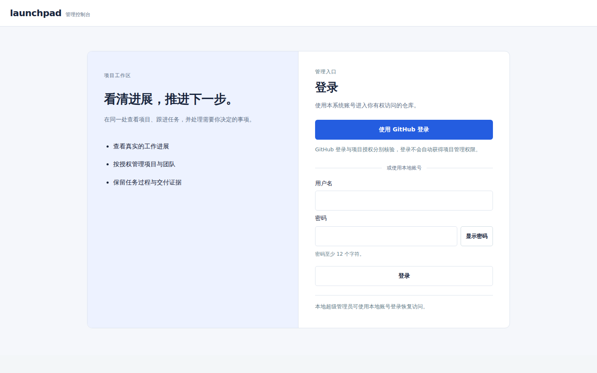
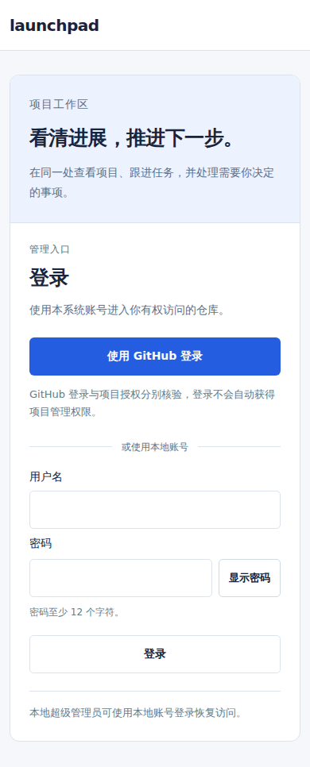
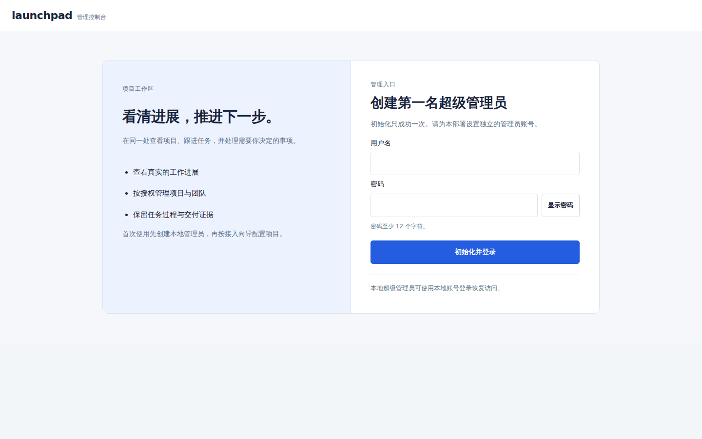
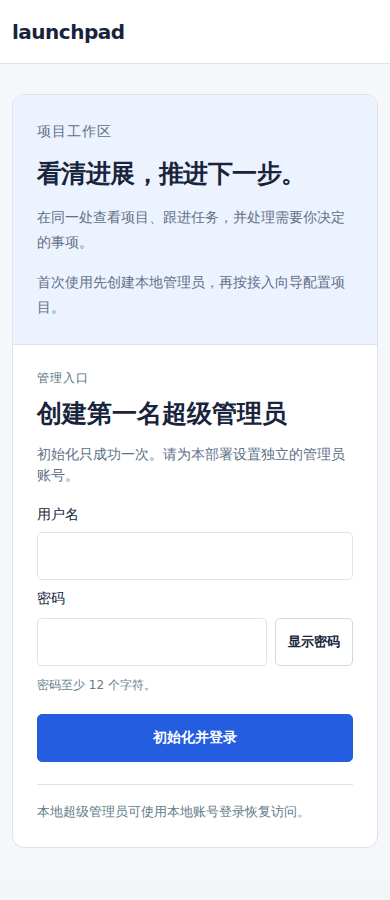
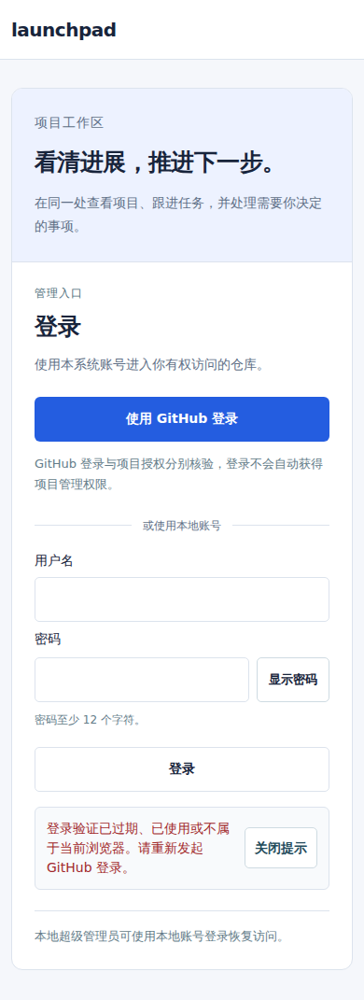

# 登录与首次初始化界面

登录和首位管理员初始化复用原 `/api/setup`、`/api/auth/login`、GitHub OAuth 路径及一次性初始化约束。桌面为聚焦的双栏入口，手机使用可自然滚动的单列表单；颜色、间距、圆角、焦点和状态组件沿用控制台公共 token，不引入另一个前端框架。

## 入口与状态

| 状态 | 页面行为 |
| --- | --- |
| 未初始化 | 创建第一名本地超级管理员，GitHub 登录隐藏；服务端仍只允许初始化成功一次 |
| GitHub 登录可用 | 主入口为 GitHub，保留可直接使用的本地恢复表单；登录与项目授权分别说明 |
| GitHub 登录未开启 | 本地登录仍可用；不把用户引到未配置的 OAuth 入口 |
| 入口状态暂不可读取 | 明确读取失败，提供重新读取；本地账号可以继续登录 |
| 正在提交 | 按实际请求显示初始化/登录中，禁用重复提交与并行 GitHub 跳转 |
| 登录失败 | 原因与恢复提示显示在表单旁；错误账号不暴露是否存在，限流与网络失败分别说明 |
| 登录成功但无项目权限 | 项目页明确显示已登录及授权说明，提供身份与权限入口和重新加载 |
| 登录成功后工作区读取失败 | 显示可重试的控制台载入失败，不把已经成功的身份验证说成密码错误 |

GitHub 取消、过期、重复或冲突回调继续使用原 `identityError` 映射，错误上下文在刷新时保留。成功登录才移除旧 `auth_error`，保留其他合法地址及 hash。GitHub 登录与 App 安装、组织选择和项目授权的边界不变，不从历史事件操作者推导管理权限。

## 表单与反馈

用户名/密码仍由原服务校验，密码输入至少16px，操作至少44px。表单提交前采集本次输入，提交期间禁用控件；失败后恢复可编辑性并保留当前页面中的输入，不放入 URL、浏览器存储或新的日志。密码可由用户主动显示/隐藏，成功登录和返回登录页后恢复遮挡并清空已提交内容。

错误继续复用 `notice` 与同一个 `#message`，未登录时移到登录卡，进入工作区后回到公共区域。无项目权限的说明使用基础 `consoleState`/`consoleLink`，与导航、待处理页保持同一组件；通用 DOM 辅助函数位于 app 基础层，普通列表不依赖后加载的导航层。

手机不固定提交区，页面与表单可自然滚动；缩小可见区域后仍可把操作滚入视口。浏览器视口与焦点验证不代表完成真实设备软键盘或屏幕阅读器验收。

## 验证范围

`e2e/console-access.spec.mjs` 通过真实控制面与隔离 OAuth HTTP 夹具验证初始化一次性、本地恢复、错误/限流映射入口、网络中断保留输入、提交中状态、GitHub回调错误、无项目权限说明、入口读取失败重试和工作区失败恢复。既有 GitHub 身份、组织切换、解绑、登录配置及管理员授权回归继续执行。预览在空表单或回调错误状态生成，不包含密码或真实用户数据。

本批为 #225 的登录/初始化切片。七步接入和身份页继续使用既有组件与真实服务，本批不据此宣称完整 #225/#223 验收完成。

## 真实页面预览

