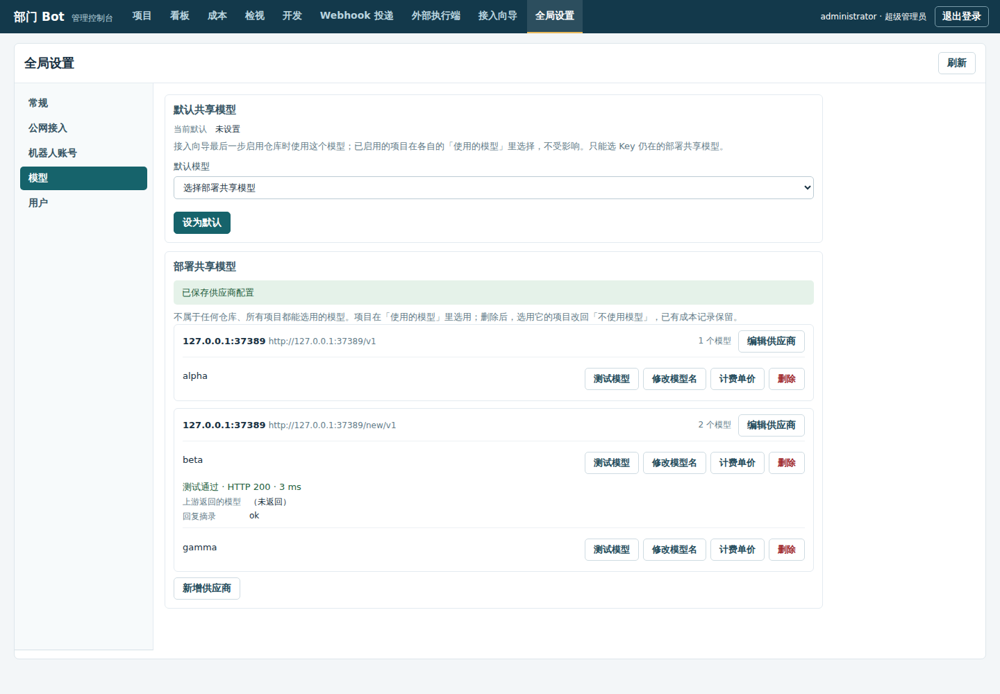
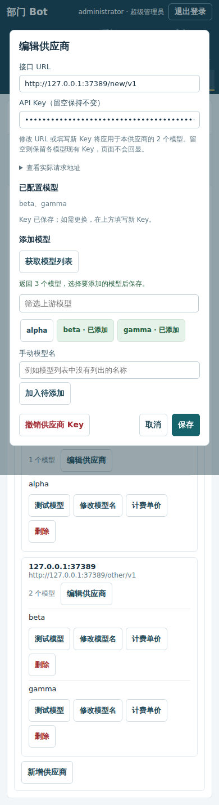

# 部署这套 bot 和管理员面板

本文写给部署和管理这套 bot 的人。只想把 bot 装到自己仓库的用户看 [README](../README.md) 即可。

一个控制面负责管理页面、接收 GitHub Webhook 和调度任务；每个启用的仓库各有一台长期运行的 Docker 容器（下文称“虚拟电脑”），bot 在里面读代码、跑命令。新开的 Issue 和 PR 会收到一条检视总结评论；打开自动开发后，明确要求改代码的 Issue 由 bot 实现、测试并开 PR。

项目页的「项目笔记」供超级管理员和本项目管理员读写 Markdown，记录检视和开发共同维护的长期经验；笔记不是规则，不进 Git。每个仓库的稳定笔记卷读写挂在 `/workspace/project-notes`（任务使用 `../notes/`），停机、重建、禁用和重置代次后保留；页面由 manager 直接访问同一份文件，无需启动项目电脑，删除项目时随环境删除笔记卷。

## 准备

- Docker Engine 和 Docker Compose v2（`docker compose version` 能输出版本）。
- 一个 GitHub 组织，以及能在其中创建和安装 GitHub App 的账号（组织所有者或 GitHub App 管理员）。
- 一个公网 HTTPS 入口，让 GitHub 能把 Webhook 送到这台机器：自己的域名加 HTTPS 反向代理，或者 Cloudflare Tunnel。
- 一个兼容 Chat Completions 的模型：接口 URL、API Key 和模型名。

## 启动

不需要克隆仓库，也不在本机构建：

```sh
mkdir department-bot && cd department-bot
curl -fsSLO https://raw.githubusercontent.com/agent-CI-Infra/bot/main/compose.yaml
docker compose up -d
```

然后在这台机器的浏览器打开 <http://127.0.0.1:8792/>。Bot 装在远程服务器上时，先 `ssh -L 8792:127.0.0.1:8792 <服务器>`，再在自己电脑上打开同一地址。

镜像发布在 GHCR，匿名拉取要求这些包已公开；如果拉取报 `denied` 或 `unauthorized`，克隆本仓库后[从源码构建](deployment.md#从源码构建)。

## 第一次配置

1. **创建超级管理员。** 首页显示「创建第一名超级管理员」：填用户名和 12–256 位密码，点「初始化并登录」。初始化只成功一次，之后这里只有登录。
2. **走完接入向导。** 首次登录会自动打开「全局设置 → 接入向导」（仅系统超级管理员可用），按页内的七步走：
   1. 公网 HTTPS：选「自建 HTTPS 中转」，把一个专用域名整个反向代理到 `http://<这台机器>:8791`，填 `https://<你的域名>`，点「检查并使用」。或者选「Cloudflare Tunnel」，粘贴 tunnel token 点「保存 token」，在 Cloudflare 的 Published application 把 Service URL 设为 `http://webhook:8791`，回到向导点该路由的「检查并使用此域名」。这两种 webhook 接入都不转发 8792；多人登录控制台时另配独立 HTTPS 管理入口。
   2. GitHub App：填「App 所属组织」和「App 名称」，点「准备 GitHub 确认页」→「前往 GitHub 确认创建」，在 GitHub 上确认后会回到向导。权限固定为 Contents、Issues、Pull requests、Commit statuses、Actions、Checks 写，Metadata、Members 读（Actions、Checks、Commit statuses 让检视和开发任务能用只读令牌查看 CI 状态，这三项的写权限留给控制面发布状态、检查结果和重跑 CI；之前创建的 App 要在 GitHub 上补加），订阅 `issues`、`pull_request`、`issue_comment`、`pull_request_review`、`pull_request_review_comment` 和 `organization`（已有 App 需由所有者在 Permissions & events 勾选 Issue comment、Pull request review、Pull request review comment 并保存，评论和检视回复才会触发再次检视；「检查权限和事件订阅」会列出缺少的事件）；Webhook 地址 `https://<你的域名>/hooks/github/<account_id>/<endpoint_id>` 由向导写进 App，不用手填。已在「全局设置 → 机器人账号」登记过的 App 点「使用此 App」。
   3. GitHub 登录：复用同一个 App，填写 Client ID、Client secret 和控制台访问地址，把页面给出的 `/auth/github/callback` 加到 App 用户授权 Callback URL 后勾选启用并保存。新建 App 可复用向导已加密保存的凭据。公网访问需独立 HTTPS 管理域名转发至 8792；本机可用 loopback HTTP。Secret 不回读，留空保留，停用后本地恢复账号仍可用。详见[接入说明](onboarding.md#github-用户登录)。
   4. 安装：点「在 GitHub 安装此 App」，选好仓库后回来点「重新检查安装」。
   5. 模型：在「添加模型」填接口 URL、API Key、模型名，点「保存并继续」。URL 下方会显示实际的对话地址和模型列表地址；bot 不会替你补上或去掉 `/v1`，地址不以 `/v1` 结尾时页面会提示。保存前可以点「获取模型列表」从上游选模型名，或点「测试模型」确认 URL、Key 和模型名可用。
   6. 规则：看一下内置规则，点「下一步」。
   7. 完成：点「同步已安装仓库」，在要用的仓库那一行点「启动并启用检视」，最后点「完成向导」。
3. **确认跑通。** 在已启用的仓库新开一个 Issue，bot 会在上面回复一条检视总结评论（之后再检视同一个 Issue 或 PR 时改写这条评论，不再新发）；第一次要先启动该仓库的虚拟电脑，会慢一些。没等到时，先在「Webhook 投递」页看投递是否到达、验签是否通过，再在「检视」页看任务状态。

## 日常使用

- **启用更多仓库**：在「项目」页点「同步安装列表」，在仓库行点「启动」，选好模型后确认。只有需要 bot 自动改代码时才勾选「同时开启自动开发」；开启后，bot 只开发由人加了开发标签（默认 `bot-develop`）且没有指派人的 Issue。仓库启动前收到的事件只存档，不会补跑。不再需要时点「禁用」，数据保留，之后可以再启用。仓库在 GitHub 上已删除，或当前账号已完全不能访问它（移出安装、安装被暂停）时，可以在项目行或项目设置里「删除」：先当场向 GitHub 核对，再停任务、去掉容器、网络和长期笔记卷并删掉项目记录，工作卷和操作审计保留。仍能看到、但授予的权限低于所需的仓库在列表上标为「权限不足」，不能删除。仓库行对照全部功能检查权限和事件订阅，未开启的功能也算：有缺项时显示带警告图标的「权限不足」「事件未订阅」或「需要 GitHub App」，点开逐项列出缺少什么、怎么操作、会影响哪些功能以及这些功能是否开启。缺项影响已开启的功能时为琥珀色，只影响未开启或手动使用的功能时为蓝色。暂停安装不算缺口。「同步安装列表」保留是否全部正常的结论与安装缺项，部分账号失败时说明还不能判断全部正常。全局「机器人账号」的检查只报告 App 定义缺口。仓库行的「接入门禁」打开门禁 PR 流程，看板仍由行上开关控制。
- **清理用户和账号**：「全局设置」的「用户」「机器人账号」两类里每行都能删除；不能删最后一名活跃的超级管理员，仍有项目使用的账号要先删掉这些项目。删除账号只从本系统移除，不会在 GitHub 上卸载 App。外部执行客户端在项目「外部执行」或全局「外部执行端」删除。
- **调整一个仓库**：在「项目」页点该仓库的「设置」。「工作流」页左侧列出八条内置工作流（检视 Issue、检视 PR、开发 Issue、跟进 bot PR、CI 观察、发行说明、Actions 失败处理和接入门禁）、管理员新增的工作流以及行为指南、检视标签等共用规则，右侧编辑选中的一项：概览（名称、说明、开关、触发源和流程图，触发源画在图的左侧）、提示词与流程、权限与模型分标签页。读取不用配置：所有工作流都在项目电脑里运行，都能读工作区、运行命令、写项目笔记、启动独立 agent、读取 GitHub；写入（回复、加标签、改代码、开 PR、提报 Issue、重跑 Actions、写发行说明）在「权限与模型」里按工作流勾选，例如让自定义工作流也能开 PR。「用聊天编写」打开悬浮的工作流助手，起草的触发源、提示词和写入保存后才生效，见[工作流](workflows.md)。默认分支规则可直接刷新。「模型」单独配置项目默认模型、各工作流的模型和项目专属供应商。部署共享模型在项目内只读展示和选用；即使是超级管理员，也需到「全局设置 → 模型」修改共享供应商、Key、模型名和计费单价。「机器配置」改虚拟电脑的资源、软件包和初始化脚本，以及这台电脑同时运行的任务数（项目管理员也能改，留空跟随全局默认）。仓库也可以在默认分支用 `.bot/` 下的文件覆盖规则，路径和格式见[用仓库文件调整规则](rules.md)。
- **看 bot 在做什么**：「看板」按工作流收拢检视、开发、自定义工作流和发版本；点卡片标题时，当前筛选只有一个任务就直接看过程，有多个任务则在同一个弹窗里选择。任务详情能看到每一步的思考、命令和输出；发版本卡片直接进入项目的发版本记录。「Webhook 投递」页列出 GitHub 送来的每次投递。
- **按工作看进展**：「看板」默认显示全部对象，每张卡只代表一条工作流在一个 Issue／PR 上的工作（检视、开发／跟进或自定义工作流），或一条发版本，卡片徽章写工作流名称（改过名的显示新名称）。同一对象的各条工作流分别保留各自状态。工具栏的「筛选」包含仓库、工作流、执行状态、对象类型、搜索和含已关闭；仓库、工作流、执行状态和对象类型使用平铺按钮直接点击选择，选中项会高亮；当前条件可以逐项移除。「按…分列」也使用平铺选项，切换 bot 执行阶段、仓库、执行状态、工作流或个人自定义字段，只改变排列，不改变卡片的任务目标。桌面在列内滚动，零数量状态用简短计数表示；窄屏用「当前分组」下拉选择一组，卡片纵向排列。更多菜单包含视图选择、保存／另存和自定义字段操作；视图保存筛选（含对象类型）、分列与折叠列。旧地址 `#/reviews`、`#/developments` 只在进入时选择全部检视或全部开发／跟进工作流，随后规范为 `#/board`。自定义字段仍属于 GitHub 对象，同一对象的各张卡共享个人字段值，修改不会改变执行阶段或触发任务。
- **全局设置**：超级管理员在「全局设置」里管理整个部署，左侧按类别分开，每个类别有自己的地址（`#/settings/<类别>`），刷新或分享链接都停在同一类：
  - 「常规」：每台虚拟电脑默认同时运行的任务数（1–32，默认 1），以及当前运行的镜像标签；源码运行时显示为源码运行。
  - 「接入向导」：完整七步接入，包括新建 App、配置 GitHub 用户登录、安装与启用项目。
  - 「公网接入」：修改并重新检查公网 HTTPS 地址；保存或撤销 Cloudflare Tunnel token（可以粘贴完整的 cloudflared 命令，只保存其中的 token，页面不回显）。
  - 「机器人账号」：改选接入向导使用的 GitHub App，并把它的 webhook 改到当前公网地址；新增、检查权限和事件订阅、删除已登记的 GitHub App 与机器人 Token。
  - 「模型」：更换向导启用仓库时使用的默认共享模型；添加、修改和删除部署共享模型。
  - 「用户」：新增用户、修改项目管理员的仓库权限、删除用户。

  新建 App、GitHub 登录配置和安装到账号均在「全局设置 → 接入向导」完成。项目与组织管理员看不到全局设置。
- **给别人权限**：在「全局设置 → 用户」新建项目管理员，从按组织分组的已安装仓库里多选：选「整个组织」时，这个组织已经启用和以后启用的项目都归他管理；只选仓库时不包括这个组织后来启用的仓库。用户列表列出每名项目管理员选的组织和仓库，「修改仓库权限」用同一份列表调整；不在安装列表里的整个组织会保持选中，直到管理员取消。也可以在仓库「设置」→「成员」单独添加或移除某个仓库。项目管理员只能看到和操作分给自己的仓库。
- **看用量和费用**：任务列表和详情显示累计运行时长、输入／输出／缓存命中 token 及加权命中率，运行时长不含排队和等待。项目专属模型在项目「模型」页点「计费单价」，部署共享模型在「全局设置 → 模型」点「计费单价」，填写每百万 token 的输入、输出和缓存命中单价；「统计」页按浏览器本地日期展示费用、token，以及每条工作流的任务数量和累计执行耗时（检视和开发四类总在表里，自定义工作流、Actions 失败分析、CI 观察等有任务时按名称列出），可按项目和日期范围筛选。费用保留每日堆叠柱状图、项目占比、已保存单价与币种筛选；当前范围没有可计价记录时，柱状图和项目占比改按已记录的输入加输出 token 展示，缓存命中已包含在输入中，不重复相加。存在有效费用记录（包括 0 费用）时仍显示费用；token 也缺失时明确显示无可靠记录，不当作 0。币种只影响费用和 token。模型请求归入实际发生日；任务的整段执行耗时归入创建日，不跨日拆分。创建日期缺失的历史任务单独列为日期不明，缺失耗时显示不完整。统计仅包含控制面模型请求和任务，不含外部执行端自行调用或项目内其他服务。单价变更只影响新请求，缺少用量或单价的请求单独提示，历史未记录的数据不作补算。

项目「模型」页和「全局设置 → 模型」按供应商（同一范围、同一请求地址）分组显示模型。列表只在供应商标题旁提供「编辑供应商」，「新增供应商」使用同一套表单：连接信息在上，选择或手动添加模型在下。获取模型列表只在该表单提供，不再逐条模型重复展示；可以选择多个模型，保存时一并添加，也能填写列表外的模型名。

编辑供应商时，修改 URL 会更新组内全部模型；填写新 Key 会统一更换，留空保留各模型现有 Key。「撤销供应商 Key」是编辑表单内的独立操作，确认后撤销这组模型的 Key，不保存尚未提交的 URL 或待添加模型。Key 加密保存且不回显。已有数据即使同一地址下使用了不同 Key，也不会因为留空保存而丢失；只有明确填写新 Key 时才统一替换。供应商操作在一个事务中完成，其他页面修改过模型或组内模型有变化时拒绝过期保存，提示重新打开编辑。模型 ID、项目选择和计费单价保持不变。

模型行只提供测试、修改模型名、计费单价和删除。共享供应商仍只有超级管理员能修改，项目管理员只能编辑自己负责项目的专属供应商。新增供应商至少添加一个模型，不保存空的供应商记录。





在项目「模型」中，本项目专属模型行的「删除」会先列出当前选用它的仓库，确认后只删除本系统的模型配置并销毁封存的 API Key，不会删除 GitHub 上的任何东西。项目管理员可删本项目专属模型；部署共享模型只能在「全局设置 → 模型」中由超级管理员删除，删除后所有项目都不能再选它。项目默认选择会改回「不使用模型」，任务专属选择保留为不可用，相关任务进入「配置待补」。已经运行的任务不会被取消，已有请求和成本记录保留，仍按当时记下的模型名和单价展示。删除失败会留在确认框中，可重试或取消；删掉的若是接入向导的默认模型，这个默认随之清空。

## 排查失败

- **任务失败或暂停**：任务详情的「原因」说明是谁的问题（外部波动、GitHub 权限、模型配置、项目电脑、仓库内容、Bot 自身）和怎么处理；时间线里的「暂停或失败」带错误码和细节。执行进程（agent）失败时有一条「执行进程失败」，写着它给出的原因；Bot 自身的意外异常记为「运行故障」，带消息和出错位置。
- **虚拟电脑故障**：项目「机器配置」的「故障」用中文说明错误码。manager 让电脑停止或恢复失败时，会在自己的日志里写一行原因（包括 Docker 拒绝操作时给出的说明）。
- **GitHub 限流**：「全局设置 → 机器人账号 → GitHub 请求额度」按账号列出每小时额度：GitHub App 每个组织（或个人账号）上的安装各一份，由那个组织下所有仓库和任务 agent 共用；Token 账号按 Token 所属的 GitHub 用户一份，由它处理的所有仓库和这个用户的其他 Token 共用；App 自身（JWT）只在 GitHub 报告时列出。每行显示额度、已用、剩余、窗口重置时间，以及流控中等待的任务数；「探测」立即读取一次：读窗口本身不计入额度，但 App 列出安装、签发临时令牌要用几次 App 自身（JWT）的请求，Token 账号第一次探测还要一次 `GET /user` 读登录名。额度用完时任务等到窗口重置再继续，不占重试次数。
- **后台对账和外部转发**：控制面周期对账、待发送的电脑操作和外部转发的内部失败写进控制面日志；同一个失败只在第一次出现、原因变化和恢复时各记一行，不会每 5 秒重复。

```sh
docker compose -p bot logs --since 1h manager   # 虚拟电脑：Docker 失败、恢复失败、意外异常
docker compose -p bot logs --since 1h bot       # 控制面：对账、任务运行故障、外部转发
```

任务记录里的消息先经过脱敏；日志只写错误码、Docker 的说明、异常消息和出错位置，不写请求内容和凭据。

## 升级与数据

在 `compose.yaml` 所在目录运行：

```sh
docker compose pull
docker compose up -d
```

数据在四个部署卷里：`bot-data`（控制面数据库）、`bot-keys`（加密凭据的主密钥）、`internal-keys`（bot 与 manager 的内部认证）和 `manager-data`（虚拟电脑账本及各项目笔记卷的文件）；`tunnel-keys` 只放 Cloudflare Tunnel token。丢了主密钥，已保存的 App 私钥和模型 Key 都解不开。`docker compose down` 会保留卷；日常升级不要加 `-v`（`--volumes`），它会删掉这些卷。备份见[备份与恢复](deployment.md#备份与恢复)。

以前在仓库根目录用 `docker compose up --build -d` 从源码部署的实例，更新代码后再运行 `docker compose up -d` 会改为拉取 GHCR 镜像（同一目录，数据卷不变）；要继续从源码构建，改用 `docker compose -f compose.yaml -f compose.build.yaml up -d --build`。

## 常用设置

在 `compose.yaml` 同目录的 `.env` 里写变量，然后重新 `docker compose up -d`：

- 改宿主端口：`BOT_WEBHOOK_PORT`（默认 `8791`）、`BOT_ADMIN_PORT`（默认 `8792`）。
- 远程管理：另做一个 HTTPS 反向代理到 `127.0.0.1:8792`（和 Webhook 用不同域名），设置 `BOT_COOKIE_SECURE=true` 和 `BOT_ADMIN_ORIGIN=https://<管理站域名>`。
- 虚拟电脑不访问外网：`BOT_PROJECT_EGRESS=false`。
- 固定版本：`BOT_IMAGE_TAG=v<版本>`（见 Releases；默认 `latest`，即 `main` 最新发布的镜像）。

全部变量见[端口与环境变量](deployment.md#端口与环境变量)。

## 文档

- [接入向导与规则文件](onboarding.md)：向导每一步的细节、`.bot/` 规则文件和 `computer.yaml`
- [用仓库文件调整规则](rules.md)：给仓库用户看的规则覆盖优先级、路径、格式和限制
- [部署细节](deployment.md)：镜像、从源码构建、版本发布与服务器部署、端口与环境变量、服务隔离、备份与恢复
- [外部执行端](external-executors.md)：在个人电脑或 GitHub Actions 里检视，再以 Bot 身份回复
- [仓库自动化规则](automation.md)：标签、门禁、合并队列和 CI 阶段
- [架构与行为](architecture.md)：权限模型、虚拟电脑生命周期、检视与开发数据流、当前限制
- [管理 API](api.md)
- [开发与验证](development.md)：代码结构、测试命令、Docker 验收、CI 与合入
