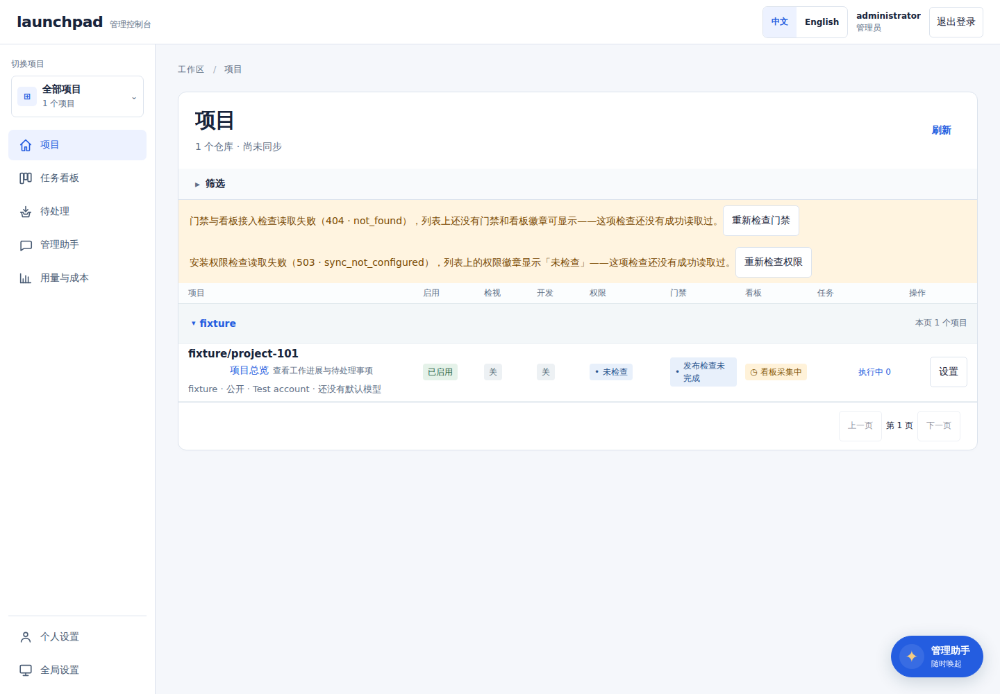
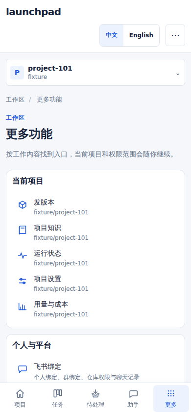

# 控制台公共界面

控制台沿用 `static/` 的真实页面、hash 路由和服务端授权。`shell.js` 与 `shell.css` 负责公共导航和响应式布局，业务模块复用 `app.js`、`views.js` 中的 DOM、状态、确认框、任务详情和表单函数，不引入第二个前端框架。

## 导航与地址

桌面使用 224px 工作区侧栏，768–1023px 缩为 192px。侧栏从视口顶部到底部是一整列，品牌、项目切换和导航都在其中，短窗口可独立滚动；右侧由固定顶栏和内容组成，顶栏从侧栏右缘开始，不横跨到侧栏上方。侧栏入口与地址都由当前范围生成，个人设置和全局设置保留上次范围。全部项目时，超级管理员依次看到项目、任务看板、待处理、管理助手、用量与成本，底部固定个人设置和全局设置；项目管理员依次看到项目、任务看板、待处理、管理助手、更多功能。

单项目时依次列出项目总览、任务看板、待处理、管理助手、发版本、项目知识、运行状态；超级管理员再列用量与成本。「设置」分组中的项目设置打开 `#/projects/<id>/basic`，任何一个项目设置类别都将此入口标为当前页。项目管理员保留更多功能，侧栏不列用量与成本，但仍可从更多的管理组打开。任务详情采用成功读取后的所属项目，不标侧栏当前项。短窗口上方导航独立滚动，底部设置保持固定。入口不显示数量。

项目与全局页面的位置、权限和事件缺口统一进入右侧固定顶栏，不再在内容区出现第二条位置栏。项目页的 h1 与操作也归入顶栏；总览另外展示项目全名、启停标记、GitHub 入口及角色/任务视图，并隐藏重复的位置栏。失权或项目切换时移除旧项目头和视图，只保留当前共享位置说明。设置类别和手机「当前页面」选择器仍留在内容区：基本设置、监听与触发、机器配置、角色、模型、定时任务与通知、外部执行、成员共八个设置类别，主区顶部一行导航只列这八项，当前项标 `aria-current=page`；768–1439px 放不下时换行。旧 `#/projects/<id>/menu` 原位替换为总览，后退不会再次访问旧地址。

手机（≤767px）底栏仍为项目、任务、待处理、助手、更多，目标至少 44px。项目打开当前范围首页，任务与待处理也采用范围地址；助手打开当前范围的普通整页对话，并从底栏离开。更多在单项目下为两种角色提供当前项目分组：发版本、项目知识、运行状态、项目设置，超级管理员另有用量与成本；不重复底栏入口。全部项目的更多保留个人设置与管理分组。当前页面选择器按项目工作和设置分组：工作页与侧栏同源，设置为八个类别，不再添加返回旧目录的选项。项目及设置只保留两层导航。

| 地址 | 内容与兼容行为 |
| --- | --- |
| `#/projects` | 全部有权项目，移动「项目」入口 |
| `#/projects/<id>/menu` | 兼容旧目录地址，以 replaceState 重定向到项目总览 |
| `#/projects/<id>/<section>` | 项目页：位置、权限和页面标题集中在固定顶栏，工作页直接由范围侧栏导航，8 个设置页的主区二级导航只列全部设置类别；`overview` 默认进入角色视图，`overview/tasks` 为任务流转列表，总览另把项目标题、启停标记、GitHub 入口及这两个视图入口集中在顶栏，不再使用内容区重复标题条；基本设置含公开看板与启停删除，机器配置含并发与电脑规格 |
| `#/tasks/<id>` | 独立任务详情页（替代原跨页 `#task-view` 弹窗，路由切换自动清理临时对话框）：顶部呈现标题、状态徽章、按 `can_manage` 门控的操作、任务目标与验收标准、关联 Issue / PR / GitHub Actions 检查状态（支持按需向 GitHub 同步检查）及可点击定位的角色流转框图；主体按角色运行历史与单步执行过程提供两层独立展开／折叠（运行中默认展开，已完成默认折叠，轮询刷新保留展开态与滚动位置），支持来源返回链接与 `Escape` 返回恢复焦点 |
| `#/board`、`#/projects/<id>/board` | 全部项目或单项目的真实任务看板，保留个人视图与其他筛选 |
| `#/costs`、`#/projects/<id>/costs` | 全部项目或单项目的用量与成本；全部项目的项目明细可链接到单项目用量 |
| `#/management`、`#/projects/<id>/management` | 当前范围的管理助手整页：左侧持久会话，右侧对话与输入框；窄屏可展开会话列表；只有壳层顶栏，没有悬浮或全屏模式 |
| `#/new-task`、`#/projects/<id>/new-task` | 全部项目先搜索选择项目；单项目显示项目名称与独立草稿，页内不能改项目 |
| `#/new-task/<id>` | 旧地址通过 replaceState 重定向到 `#/projects/<id>/new-task` |
| `#/inbox` | 当前用户有权项目中的待处理任务 |
| `#/projects/<id>/inbox` | 指定项目待处理任务；页面先核验项目访问，服务端继续校验查询权限 |
| `#/inbox/<id>` | 旧地址通过 replaceState 重定向到 `#/projects/<id>/inbox` |
| `#/inbox/all/<offset>` | 未限定项目的下一页，按 50 项分页 |
| `#/projects/<id>/inbox/<offset>` | 指定项目的下一页；旧 `#/inbox/<id>/<offset>` 原地重定向，后退不会重访旧地址 |
| `#/more` | 「更多」补充入口：两种角色在单项目下均有当前项目分组；其余为个人设置及管理分组（管理组只列本角色可打开的页面）。不重复底栏五个目的地。桌面侧栏对项目管理员也提供该入口。 |
| `#/settings/<key>` | 平台的全局设置分类（系统与算力、接入与网络、连接与渠道、仓库与用户）；项目管理员只能打开 `storage`，此时页面标题、浏览器标题与面包屑都写「存储」；系统初始化保留七步地址 |
| `#/settings/projects` | 超级管理员的仓库安装批量清单与已隐藏仓库恢复；普通项目与主页一样按「项目 / 启用 / 检视 / 开发 / 权限 / 门禁 / 看板 / 任务 / 操作」九列展示，看板开关留在看板列，项目设置从项目名称下的「项目设置」进入，已启动项目的启用/禁用与删除收进每行一个「操作」菜单，长说明单行省略并在 `title` 保留全文；未启动项目仍直接显示「启动」和「删除」。隐藏仓库使用「项目 / 操作」两列。`hidden.0` 管理已隐藏仓库，`list.<offset>` 按 50 项分页 |
| `#/settings/projects/<id>` | 兼容旧深链，自动重定向至 `#/projects/<id>/basic`（唯一的单项目配置入口）；`全局设置 → 项目管理` 只保留仓库批量清单与同步 |
| `#/settings/computers/<id>` | 兼容旧深链，自动重定向至 `#/projects/<id>/machine` |
| `#/settings/agent-tools` | 超级管理员的 Agent CLI 工具卷：卷状态、每个 CLI 的已安装/兼容版本与 manifest、安装与清理表单；卷未挂载或读不到架构时给部署指引并禁用提交，非超管没有入口 |
| `#/preferences`、`#/identity` | 个人设置入口，直接呈现身份与权限及横向个人设置二级导航 |
| `#/conversations`、`#/conversations/<chat-id>` | 飞书会话列表与消息、执行过程、派生任务管理页（位于个人设置二级导航） |
| `#/external` | 个人外部执行端接入与连接诊断（位于个人设置二级导航） |
| `#/identity/feishu`、`#/settings/feishu` | 统一的「飞书绑定」页（同页列表展示个人绑定与群绑定、仓库范围与权限档位、点击查看聊天记录）与管理员应用配置保持分离；旧 `#/identity/feishu/groups` 与 `#/identity/feishu/conversations` 自动重定向 |
| `#/design` | 设计系统样例页；仅平台超级管理员可见，不进入任何导航 |

项目模型、机器状态、任务并发、电脑规格与项目外部执行统一从对应项目设置进入；既有个人飞书绑定和群助手深链继续有效。身份总览呈现本人身份、私聊和可管理群的概览，飞书绑定（含个人绑定与群绑定）、飞书会话和外部执行端通过主区横向二级导航切换。

## 飞书会话

会话管理页以列表、对话时间线和派生任务三个区域呈现真实记录，窄屏按顺序排列。消息按时间显示发送者、内容、附件名称及回复或话题引用；撤回与敏感内容沿用本地消息账本的隐藏规则。发送消息仍在飞书中进行；群维护人可以在本页确认停止正在执行的群回答。阶段进展、最终回答和实际投递的机器人消息分别展示，不把完成执行当成已经送达。

`GET /api/channels/conversations` 在分页前过滤历史读取权限，私聊仅列出本人的会话；项目权限本身不等于群历史读取权限。`GET /api/channels/chats/:id/timeline` 从最近 50 条消息开始，使用绑定范围和消息游标签定的逆序分页；执行回合另行翻页。`turns/:turn` 分页提供模型、工具与完成状态等步骤元数据，不暴露工具正文或模型私有推理；启用记录前的历史明确标为没有步骤记录。群来源或范围变化时，旧派生回答、步骤与独立任务被隐藏。

`tasks` 返回当前授权且当前来源仍有效的项目任务，以及最近 20 个服务角色独立任务。项目任务继续进入原任务详情查看执行证据。刷新失败标明保留数据的读取时间，拒绝访问后清空旧内容；迟到响应不能覆盖新页面。自动刷新须由用户启用，翻看历史时停止自动刷新，展开步骤时暂缓刷新。

## 共用样式与组件

主题（#750）：控制台有浅色与深色两套配色，跟随系统，或在身份页手动选择「跟随系统／浅色／深色」。深色只换 `--color-*` 令牌，声明在 `static/shell.css` 的两块里（`@media (prefers-color-scheme: dark) :root:not([data-theme="light"])` 与 `:root[data-theme="dark"]`）；两块与浅色 `:root` 的令牌集合必须完全一致，缺一个 `test/ut/static/console-tokens.test.mjs` 会红。模块样式不写第二套深色色值。原本硬编码浅色底色的几处——任务详情的 `.step`、`.task-side`、`pre.output`、`.task-archive-body`，项目列表的表头与 owner bar，项目页的 `.project-page` 与 `.project-nav`——在 `static/views.css` 末尾用两块只作用于深色的覆盖改读令牌，浅色值一个不动。品牌色有两种用法：`--color-brand` 是填充色（配 `--color-text-inverse`，5.65:1），`--color-brand-text` 只画文字、链接和图标，深色下取更亮的 `#96b4ff`；`.btn-primary` 的填充与描边用前者，文字用后者。正文与 12px 辅助文字在深色背景上同样 ≥ 4.5:1，`test/e2e/console/theme.spec.mjs` 逐面实测。

`--color-*`、`--space-1..10`、`--radius-*`、`--font-size-*`、`--line-height-*`、`--control-min`、`--motion-*`、`--shadow-*` 和 `--focus-ring*` 为公共变量，只在 `static/shell.css` 的 `:root` 中声明。颜色值遵循近白背景、深色文字、蓝色操作，琥珀表示关注、红色表示实际失败、绿色表示成功。模块样式（含 `style.css`、`access.css`、`management.css`、`views.css`、`board.css`）引用这些变量，不写第二套正文色、辅助色或字号；看板的边框、阴影、状态圆点、圆角和文字也使用公共令牌，不保留独立的 teal 色值或硬编码字号。`--font-size-touch`（16px）是防止 iOS 聚焦输入时缩放的下限，不是字号阶梯中的一级。`--font-size-caption`（10px，输入框旁的小字说明）、`--font-size-title`（20px，回执页标题）和 `--font-size-hero`（28px，对话欢迎标题）补齐对话页原先没有对应档位的字号；图标字形的尺寸不属于字号阶梯。

按钮的四种用法是 `.btn-primary`（每页默认最多一个启用的主操作）、`.btn-secondary`（与 `.quiet` 同外观）、`.btn-danger`（与 `.quiet.destructive` 同外观）和 `.btn-text`（工具栏文字操作；行内链接仍用 `.linkish`）。`.card` 与 `.side-card` 共用内边距、圆角、边框和阴影；列表容器 `.card.list-panel` 去掉内边距以便行贴边。

`test/ut/static/console-tokens.test.mjs` 检查只有 `shell.css` 在 `:root` 声明自定义属性，每个 `var()` 都有声明、运行时写入或自身 fallback，`board.css` 不再写死十六进制颜色和 `font-size: Npx`，旧青绿硬编码色不再出现，以及中性徽章和看板空状态的对比度至少 4.5:1。对比度按 `shell.css` 里的声明现算，测试不再另抄一份色值。模块样式新增公共变量时，把声明写进 `shell.css`。

| 入口 | 用法 |
| --- | --- |
| `element()`、`button()`、`field()` | 创建文本节点、安全事件绑定及带标签控件 |
| `state()`、`badge()` | 复用状态字典和文字，不根据模型文本推断成功 |
| `askConfirm()`、`confirmDialog()` | 共用危险操作说明、提交反馈、Escape 和焦点恢复 |
| `consoleLink()` | 带可选说明的导航条目，用于更多页与公共导航 |
| `consoleIcon(name)`、`consoleIconName(href)` | 同一套线性 SVG 图标；图标装饰性隐藏于辅助技术，入口名称仍是可见文字 |
| `consoleState(title, text, { tone, retry, retryLabel, retryId })` | 空、加载、失败共用同一组件（`.console-state`）。不传 `tone` 为空状态（`role=status`）；`tone: "loading"` 带 `aria-busy` 和旋转指示（遵循减少动画偏好）；`tone: "error"` 使用 `role=alert`，外观与空状态明显不同，不可被读成「没有数据」。可重试按钮默认为「重新加载」，可用 `retryLabel` / `retryId`（例如电脑状态的 `#computer-refresh`）。`data-testid` 为 `console-state-empty`、`console-state-loading` 或 `console-state-error`。|
| `consoleGroups()` | 由当前项目和权限生成「更多」页入口（不重复底栏目的地）：超级管理员「当前项目 / 个人与平台 / 管理」，项目管理员「设置 / 管理」，供后续模块扩充 |
| `syncConsoleShell()` | 登录、退出、路由完成与断点变化后同步外壳 |
| `readErrorText(err)` | 控制台上显示失败文案的唯一入口（#800）：按错误种类选词而不是匹配某一种浏览器原文——`AbortError` 是页面切换主动取消（`请求已取消`）、`TypeError` 或跨 realm 的 `name === 'TypeError'` 是网络不可达（`网络连接失败，请稍后重试`），服务端已答的错误原样保留自己的文案（技术码仍走 #715 的技术信息）。网络与取消两类**不带句号**，由调用方收尾，兜底是 `请求失败`；服务端原文里 `authorization_changed`、`note_revision_changed` 自带句号，调用方对这两种码不要再补一个。读取失败卡（`consoleState(..., { tone: 'error' })`）、行内读取状态（会话刷新、总览、计划记录、事件订阅、发布记录、回执、知识文件、受信任的组织、项目群助手角色）与动作回执（提交、保存、表单校验、SSE 断线重连）一律经它，禁止直接拼 `err.message` 露出 `Failed to fetch` / `NetworkError when attempting to fetch resource.` / `Load failed`；回执同样安全——服务端已答的原因原样返回，只有网络与取消两类被翻译成中文句子。解析错误码的地方（`.replace(/^\d+\s*·\s*/, '')`、`.includes(...)`、`String(err.message)`）仍直接读 `err.message`，那不是文案。文案只有中文、不跟随界面语言：英文界面下卡片标题走 `t()` 出英文，正文仍是中文句子；#800 只覆盖中文控制台，要英文正文另开单。 |

区块间距（#559）：标题、筛选、内容、分页和卡片之间的垂直节奏使用 `--space-*` 阶梯（4/6/8/12/16/20/24/32/40/48px；本单主要用 `--space-4` 12px 与 `--space-6` 20px）。桌面主栏底部留白使用 `--space-10`；「更多功能」分组标题与入口的间距为 `--space-5`。不改按钮和卡片外观。

表格密度（#560）：统计表「任务数」「耗时」和费用数字列右对齐、用等宽数字；类别列左对齐。单价表的「币种」仍左对齐。角色概览表（角色、启用、职责、状态）统一行高，职责最多显示两行，完整内容在 `title` 里。项目列表的改动留给 #544，本单不改。窄屏角色表继续按列堆叠。

对比度（#563）：`--color-text-muted`（#607087）取值不变。11px 的导航标签、顶栏角色（`#who`）、页眉说明和窄屏底栏文案改用 `--font-size-1`（12px）。默认状态芯片沿用 #551 的 `--color-status-neutral` / `--color-status-neutral-bg`（4.89:1）。统计、看板、项目设置里残留的 `#637c89` / `#52707d` 改读 muted token；管理助手里浅灰 11px 说明一并改为同一套颜色和字号。正文与 12px 辅助文字在浅色背景上对照度 ≥ 4.5:1。

标题与正文层级（#558）：页面 `h1` 使用 `--font-size-5`（窄屏 `--font-size-display`），字重 650、行高 `--line-height-tight`；`h2` 使用 `--font-size-4`。正文与长说明使用 `--font-size-2` 和 `--line-height-relaxed`，最大行长 40em，不与标题挤在同一基线上。身份页面包屑不再重复「身份与权限」，该页只保留一个可见 `h1`。

页面栅格（#557）：已登录主栏铺满可用宽度，不再把项目设置卡在 980px。多栏卡片（身份页、基本设置、状态网格）两列等宽、同行等高，栏间距用 `--space-6`。身份页在「高级／诊断」里的组织、绑定和授权卡片在 ≥1280px 时也用同一套两列拉伸（更窄时单列），不因折进折叠区而错落。登录卡最大宽度为 `--content-max`（1120px），在顶栏下垂直居中，左右栏拉伸到同一高度。「更多功能」同一行的卡片底部对齐（≥1440 的三栏和 768–1439 的两栏都拉伸到同一行等高）：超级管理员在项目里时，第一行是「当前项目」和「个人与平台」，「管理」组（#550，`consoleGroups()` 的 `wide` 标记）跨满整行、入口排成三栏；项目管理员的「设置」和「管理」两组各自跨满整行。不改导航信息架构。

触控操作至少 44px；手机表单输入至少 16px。固定导航预留安全区及正文空间（`html` 的 `scroll-padding-bottom` 与正文下内边距同时计入底栏高度），底栏在输入聚焦时保持可见并把焦点控件滚动到它上方，窄屏全屏对话框也预留底栏高度；浏览器原生对话框继续管理焦点，窄屏对话框适应可见视口。减少动画偏好覆盖过渡和动画。外壳只在当前登录会话的内存中保存滚动与焦点元信息，不保存输入值、密钥或跨用户数据。

## 定时任务与通知页用模板创建，高级字段默认折叠（#572、#1027）

「定时任务与通知」首屏提供「项目定时任务」和「失败时通知」两个常用模板。选用后即可改时间并保存，不必先填完整高级表单。项目定时任务模板套用每天 09:00 生成一个项目任务、只需写明要做什么，结果留在项目里，不发飞书；失败时通知套用任务失败和 CI 失败的事件订阅，选择发到哪个飞书会话。原来的「每日摘要」（项目日报发到飞书）已移除，需要在飞书里定时看到汇报，在对应私聊或群的会话定时任务里添加。Cron、时区、有效期、遗漏策略、身份与维护人，以及订阅的聚合窗口、时区和静默时段，都放在默认关闭的高级折叠里；展开后仍可配置原有能力。基于当前 main（已含 #555 与 #481）。不改外部执行端引导（#524 / #529），也不改 #481 / #496 的导航。

## 模型页默认只选项目默认模型（#571、#1122）

模型页首屏保留「项目默认模型」、统一保存栏（#567）以及前往「角色」页按角色配置模型的引导入口；原来的「按任务类型覆写」折叠区已随 #1122 退役。本项目专属与部署共享模型放在「模型目录」里，默认折叠。

## 管理与诊断页面收进按角色可见的「管理」区（#550）

用量与成本、存储、外部执行端，以及超级管理员的系统初始化、安装档案、机器人账号和全局设置，从「更多」的平铺目录收进「管理」一组。项目管理员只看到自己本来就能打开的页面（用量、外部执行端、存储）；超级管理员还能看到系统初始化、安装档案、机器人账号和全局设置。侧栏一级入口和 #481 五目的地底栏不变。这些页面的原地址仍可打开，权限未改。本分支叠在 #549 上。不改全局设置页内部信息架构，也不改 #481 / #496 的导航。

## 普通用户主导航只保留四个主要入口（#549）

未以超级管理员登录时，桌面侧栏的工作入口是「项目」「管理助手」「任务看板」「待处理」，并加上可见的「更多功能」，以便在桌面宽度进入个人设置（账号菜单只在 767px 及以下显示）。用量与成本、个人设置和存储不再作为侧栏一级入口列出。手机底栏仍是「项目 / 任务 / 待处理 / 助手 / 更多」，没有改 #481 / #496 的导航结构。

「更多」对项目管理员只保留飞书绑定、身份与权限和飞书会话，不再重复侧栏已有入口，也不再列出用量、存储、外部执行端和全部全局设置。这些仍保留的管理页的地址仍然可打开，入口整理见 #550：之后它们收进「更多」的「管理」组，超级管理员的「分析与渠道」组也并入「管理」，飞书会话改列在「个人与平台」。基于当前 main（已含 #481 与 #555）。不改项目设置内部导航（见 #565）。

## 基本设置的信息分层（#570）

基本设置首屏只保留仓库名称、基准分支、监听与触发入口，以及公开可见性。仓库 ID、处理账号、安装来源和虚拟电脑技术信息放在默认关闭的「高级」里（#935 起首屏另有检视和开发标签，原来的规则路径一项已删除）。危险区（禁用 / 删除）同样默认折叠，展开后仍需确认才能执行。分组保存交互见统一保存栏（#567）；本单只做信息分层。不改 #481 / #496 的移动端导航。此改动基于当前 main（已含 #555 与 #481）。

## 每页一个主操作（#555）

项目列表、身份页和管理助手页的首屏各只保留一个主按钮。项目列表的账号 / 组织筛选默认折在「筛选」里，已设条件时自动展开并在摘要写明「筛选（已设条件）」。身份页沿用 #514 的「我的 GitHub 连接」主操作和「高级／诊断」折叠；飞书卡片仍留在首屏，创建绑定和查看会话收进「更多飞书操作」。管理助手的「新建会话」和窄屏「会话记录」是次按钮，输入框的「发送」是该页唯一主按钮；旧的全屏、悬浮窗口和快捷操作控件已删除。不改 #481 / #496 的移动端导航。


## 角色页布局与「启用角色」状态（#569）

角色配置页不再用 `overflow: clip` 裁切外壳，内容区铺满项目页栅格，去掉首屏右侧大块空白。列表单元格可收缩并换行，导航文字换行或横向滚动，不截断文字。可编辑的「启用角色」是明确可点的复选框；项目管理者（Manager）和独立验收（QA）这两个必需角色的复选框禁用，并写明「…是必需角色，不能关闭。」。390 下首屏能看到角色标题和启用控件。

## 角色名称与职责的中英文（#568）

项目总览列出全部已启用角色，包括空闲角色。角色名称按配置保存的原文显示，内置角色与自定义角色都遵循这一规则。例如，保存的 `Dev`、`开发` 或 `Task Coordinator` 在中英文界面均原样显示。名字为空时显示角色标识，表单「高级」中也可查看标识。角色配置页的内置职责在中文界面使用中文，在英文界面使用英文，自定义职责保留原文。推荐配置的提示词仍是发给模型的英文模板，页上有中文说明，可改成中文。本单不是全站 i18n（#527），只覆盖角色列表和详情。此改动叠在 #606（#567 统一保存栏）之上。

## 统一保存栏（#567）

角色、基本设置、模型和机器配置四页共用一条固定在顶部的保存栏：未改动时只显示「已保存」；有改动时出现主按钮「保存」和次要按钮「放弃更改」，状态为「有未保存的更改」。比较服务器版本和「重新读取电脑配置」在各自只有一个操作时直接显示；按组放弃等两项及以上操作仍放在栏内默认关闭的「高级」里（一页有多组草稿时，可以只放弃其中一组）。机器配置里，项目管理员不能改电脑规格，但「同时运行的任务」仍由同一条保存栏保存；读不到电脑记录时也一样。Manager 规则页不属于这四页，「Manager 分派」的模型选择仍用自己的「保存模型」和「恢复继承」立即保存。角色页的保存栏一直显示：项目跟随内置默认时，未改动的状态是「正在使用默认配置，内置默认更新时自动跟随。」，有改动时提示保存后成为自定义配置（#1068，见下文「角色页的默认配置」）。角色定义以及基本、模型、机器配置的表单卡片不再单独放「保存」主按钮；项目「监听与触发」页的事件和检视/开发策略分别保存；Manager 页单独保存提示词和分派模型，各自保留其他组的已保存值。#604（#566 角色列表与单页表单）已合入 main，本改动直接基于 main。

## 角色列表与单页表单（#566）

角色页概览改成列表：只展示名称、是否启用、一句职责和状态。点角色名称打开该角色的单页表单，一次滚动即可编辑并保存。首屏可见基本信息、Agent 与模型和提示词；技能包、权限、环境与输出、预算、模型细节和删除折在「高级设置」里，默认关闭。角色页不再用整排角色标签，也不再有表单内的分段跳转按钮；详情只有「← 角色列表」回链和当前角色名。技能包目录从概览进入。

## 角色页的默认配置（#1068）

没有自己配置的项目直接展示正在生效的默认配置：角色列表、每个角色的设置和保存栏都和保存过的项目一样，状态文案是「正在使用默认配置，内置默认更新时自动跟随。」，列表每行的状态是「默认配置」。不再有「使用推荐配置」按钮和折住角色列表的「高级」区（#564 的首屏已撤下）。改动任一设置后，保存栏提示「保存后成为自定义配置，不再跟随内置默认」；保存后状态回到「已保存」，概览注明这是项目自己的配置，并提供「恢复默认」：确认后回到跟随内置默认，当前配置留在修订历史里。折叠区（角色表单的「高级设置」、保存栏仍有多个操作时的「高级」）的标题前画出 ▸／▾ 标记，`display:flex` 的 summary 不再丢失展开标记。

## Markdown 与流程图（#1123）

管理助手回答、项目知识中的 `.md` 文件和提示词阅读视图共用 `renderManagementMarkdown()`（`static/management/presentation.js`）：Marked 解析后经 DOMPurify 只保留文档标签。` ```mermaid ` 代码块由 `static/management/diagrams.js` 画成流程图，源码折叠在图下的「流程图源码」里；语法错误、超出大小限制或组件加载失败时不画图，直接展开源码并说明原因。飞书仍只发送 Mermaid 源码（见[消息渠道](message-channels.md#markdown图片与文件)）。

图的来源是模型或人写的文本，按不可信内容处理：

- 控制台 CSP 不为流程图放宽。Mermaid（固定版本的 `@mermaid-js/tiny`，经 `/vendor/mermaid.js` 提供）在第一个图出现时才加载，在页面内的离屏容器里绘制；它注入的 `<style>` 和 style 属性被 CSP 拒绝，不会生效。
- Mermaid 使用 `securityLevel: 'strict'` 和纯 SVG 文字标签（不生成 `foreignObject`）。源码里的 `%%{init}%%` 指令不能改动安全级别、标签方式、主题、样式或大小上限（`secure` 列表）。
- 输出的 SVG 再经 DOMPurify 的 SVG 配置清洗：去掉 `<style>`、`foreignObject`、`image`、`use`、脚本和所有 style、href 属性；`click` 生成的链接改成普通分组，图里没有可导航的元素。颜色、线条和字号只来自 `static/diagrams.css` 的公共令牌，源码中的 `classDef`、`style`、`linkStyle` 配色不生效。
- 图按栏宽缩放，最小缩到原尺寸的 70%；更宽的图在自己的框内横向滚动（可聚焦），页面本身在 390 / 768 / 1440 宽度下都不横向滚动。流式回答每帧重绘时，旧的图不再绘制，写完的图只绘制一次并缓存。

Manager 提示词和角色提示词卡片由 `promptReader()`（`static/views/prompt-reader.js`）默认显示阅读视图，即保存后模型读到的同一份文本的排版结果。「编辑源码」显示卡片原有的文本框和实时预览，保存、草稿和版本校验不变；同一项目内切换角色或放弃草稿后仍保持所选视图。「在管理助手中用对话改流程」打开本项目的管理助手并预填请求，有未保存修改时先确认。按钮的可访问名称带卡片名称（如「Manager 提示词：编辑源码」），同一页的两张提示词卡片可以区分。`test/e2e/console/prompt-diagrams.spec.mjs` 覆盖三种宽度、恶意源码、语法错误、编辑预览、预填请求和流式回答中的图；其他测试改提示词前通过 `test/e2e/helpers/prompt-editor.mjs` 切到编辑源码。没有保存过自己提示词的项目，Manager 卡片的阅读视图就是内置提示词的六大场景章节和每章一张流程图（见[统一任务调度与对象 Manager](workflows.md#内置-manager-提示词六大场景1123)），同一文件的另一个用例检查它们在三种宽度下都画成功且页面不横向滚动。

## 待处理投影

`GET /api/tasks?attention=1` 在现有任务查询上增加关注状态筛选，先应用授权和状态条件，再分页，按状态更新时间从早到晚排列。状态包括失败、暂停、配置待补、环境等待、权限待处理、发布待核实和需要重新规划。正常排队、执行、自动重试等待和等待 PR 更新不因此变成人工待办。

该列表只说明需要关注，不声明当前用户必须或有权处理每一项。下一步进入现有任务详情，操作由原服务端能力、版本与幂等规则约束；发布未知先核实远程结果。取数失败显示无法判断，空列表也不宣称服务或 CI 全部正常。

## 验证

`test/e2e/console/console-shell.spec.mjs` 使用独立控制面和真实 API，验证六个宽度、短窗口滚动与底部设置、深链、项目/平台入口、移动选择器、任务详情、网络失败重试、越权拒绝、迟到回包、返回和退出；`test/e2e/console/shell-split.spec.mjs` 验证全高独立侧栏、右侧唯一固定顶栏、位置与权限归并、短内容不撑高顶栏、手机回桌面后高度回缩及偏移同步，以及任务看板、项目设置、总览和各路由族的宽窄屏布局。`test/e2e/console/mobile-console-nav.spec.mjs` 单独锚定手机壳层：五个目的地与 44px 触控、767/768 断点、助手整页入口/未读镜像、更多页去重与角色可见性、当前页面选择器的分组、账号菜单键盘操作，以及 320/390/767 与矮窗下的横向溢出和遮挡。`test/e2e/management/management.spec.mjs` 验证桌面与手机的会话侧栏、新建和切换、顶栏合并、运行与草稿保留。截图保存在 `.tmp/` 下各主题的目录。`test/st/src/app/control-plane.test.mjs` 验证关注筛选先于分页、排队任务不计入，以及跨项目授权。

同时执行现有地址、看板和管理助手回归；涉及公共样式的交付需要全量浏览器回归。软键盘的真实设备行为与屏幕阅读器仍需设备验收，浏览器视口缩小和键盘操作不能代替这些检查。

## 真实页面预览

以下截图来自独立控制面及夹具项目，分别为 1440px 桌面和 390px 手机，不使用原型或线上数据。桌面展示「全部项目」导航，手机展示所选项目的「更多功能」。





控制台在 390、768、1440 三个宽度各有一套布局（#562）：390 用 #481 的五入口底栏加单列，管理助手由底栏进入并使用可展开的会话列表；768 用 192px 窄侧栏，二级导航单行横向滚动，只有项目设置类别导航放不下时换行，让 8 个类别都在屏内一次可点（#707）；项目页头的操作按钮在标题旁放不下时整体换到标题下方，不把项目名挤成几个字，390 下按钮在自己那一行内换行；1440 用完整侧栏，项目内容铺满主栏，助手在内容区左侧显示固定会话栏。小于 1440 时角色详情页的回链一行横向滚动、不换行。没有自己角色配置的项目，角色页首屏就是生效中的角色列表和保存栏（#1068）；390 下登录后的唯一顶栏按项目标题、位置与工具内容换行，不再沿用第二条位置栏的固定高度；列表的第一个角色可能紧贴底栏，滚到它时底栏不遮挡。身份页「切换组织」的按钮在窄屏按内容宽度显示，不再拉满整行。没有改写 #481 / #496 的移动端主导航。

面向日常使用的文案用用户语言：登录页只保留一句说明，不再出现「超级管理员」；项目列表不在首屏展示仓库编号；身份页把权限记录版本收到「高级说明」里，授权来源写成「来自 GitHub」或「手动分配」；用量与成本页把用量和统计范围的说明收到「统计说明」里，关键数字、任务统计和每日图表位于说明之前。技术术语只在用户展开高级说明后出现。

长名称与说明在一行放不下时以省略号截断（标题、仓库名单行；列表行 `.row-content > p` 副标题最多两行），完整文字写在 `title` 上，悬停即可阅读。折叠区里的内容（如身份页「查看具体能力」的能力列表）不截断。项目列表的状态格跟随 #544 的单元格布局，不再另外限制芯片行数。宽屏页头的用户名单行截断，完整「用户名 · 角色」写在 `title` 上；窄屏（767px 及以下）按 #481 由账号菜单（`#console-account`）承载登录名、角色与「退出登录」。390 下项目列表把「设置」（「操作」列）放在标题正下方、状态格之前。身份页说明在窄屏最多四行，不再压到「切换组织」等按钮上。1440 下中等长度的仓库名只要一行放得下就不会被截断。

看板工具栏（#482）：视图选择器、未保存状态和「保存视图」常驻工具栏，不展开「⋯」也读得到；`⋯` 只保留切换布局、另存视图、新建自定义字段和删除视图。工作类型是视图旁的紧凑下拉，桌面按「视图 → 工作类型 → 按…分列」排列，选它写入的仍是 `category` 条件，已保存视图会回填到下拉，筛片照旧显示并可移除。仓库条件只在筛片里：工作页的地址就是唯一的范围入口，看板不出现第二个仓库选择器（`test/e2e/console/console-project-scope.spec.mjs` 的「地址是唯一范围」契约），已保存视图带的 `repository_id` 以筛片呈现。390 下视图独占一行，工作类型与「按…分列」各占一半并排，第三行是 `⋯`、新建任务、刷新，行尾接一行省略号的实时状态；工具栏最多三行，第四行会把首张卡压到固定底栏之下、滚不出来。页面不出现横向滚动。
