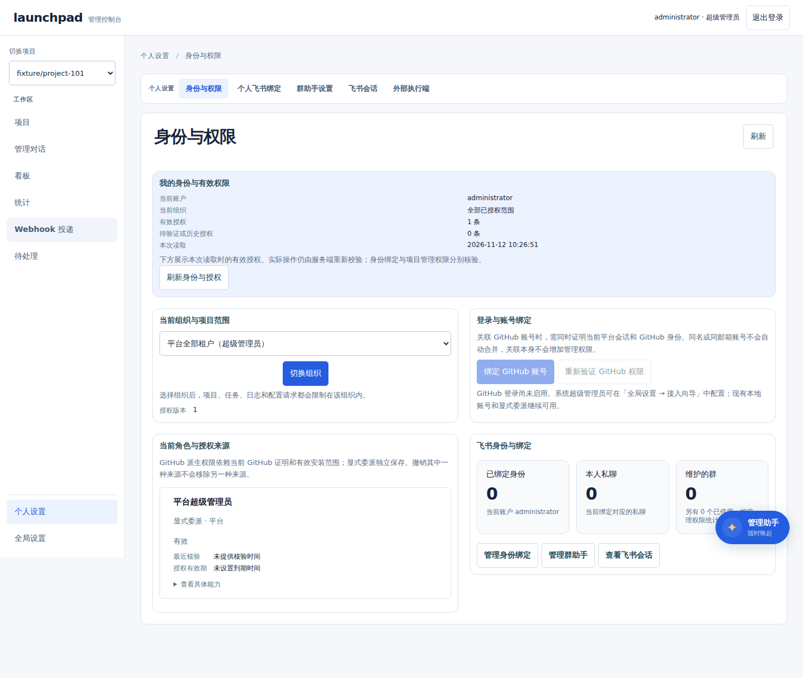
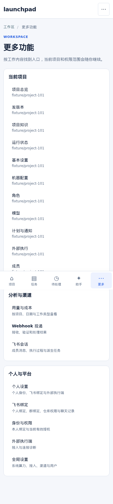

# 控制台公共界面

控制台沿用 `static/` 的真实页面、hash 路由和服务端授权。`shell.js` 与 `shell.css` 负责公共导航和响应式布局，业务模块复用 `app.js`、`views.js` 中的 DOM、状态、确认框、任务详情和表单函数，不引入第二个前端框架。

## 导航与地址

桌面使用 224px 工作区侧栏，768–1023px 缩为 192px。超级管理员的左侧栏上方收敛为项目切换器与核心工作入口（项目、管理对话、看板、统计、Webhook 投递、待处理），「个人设置」和「全局设置」固定在侧栏底部；项目管理员的侧栏是项目、管理对话、看板、待处理，并保留可见的「更多功能」以进入个人设置。项目切换器同时是看板、统计与管理助手的共享默认项目范围（`全部项目` 显式清掉它），短窗口时上方工作入口独立滚动。个人设置和全局设置的二级分类呈现在主内容区顶部的横向二级导航栏（`#console-secondary-nav`），桌面与手机「当前页面」选择器共用同一份导航。项目页不再在二级导航里同时列出全部分类：`#/projects/<id>/menu` 的「项目入口」总览按「项目工作 / 设置」分组列出全部原有入口；打开具体页面后，主区顶部只保留两项面包屑（「← 项目入口」和当前分类，当前项带 `aria-current=page`）。手机「当前页面」选择器仍保留 #481 的分组：第一项是「← 项目入口」，其后按「项目工作 / 设置」列出全部原有入口并选中当前页。窄屏下次导航隐藏时，页头的「项目入口」链接仍可返回总览。手机（767px 及以下）使用五个稳定目的地「项目 / 任务 / 待处理 / 助手 / 更多」，每个目的地至少 44px 并只对当前页面标 `aria-current`；「助手」直接在底栏唤起同一个管理助手（不带项目参数，按共享默认项目打开），不再有悬浮按钮，收起时焦点回到这个目的地，处理中的回合和关闭期间到达的新回复以圆点和可访问名（「正在处理」「未读」）提示，打开即清除。其余页面通过「更多」补充，不重复底栏已有的目的地：超级管理员分「当前项目 / 个人与平台 / 管理」三组；项目管理员分「设置 / 管理」两组，「设置」是个人设置、飞书绑定、身份与权限、飞书会话，「管理」只列本角色能打开的管理页，见 #549、#550。手机头部把登录名、角色与退出登录收进一个账号菜单（`#console-account`），Escape 关闭并把焦点还给触发按钮。

「个人设置」直接展示身份与权限主页，并在主区横向二级导航收拢「身份与权限 / 飞书绑定 / 组织飞书应用（有权限时） / 飞书会话 / 外部执行端」。其中「飞书绑定」在同一页以清晰列表同时展示个人绑定与群绑定（含仓库或组织范围、可达仓库、服务角色具体权限项与负责人），顶栏常驻「创建个人绑定 / 创建群绑定」并在每个可管理群条目提供「配置仓库与权限」，点击已建立会话的绑定条目或「查看聊天记录」即进入对应飞书会话记录。单项目的配置全部内聚在项目设置（`#/projects/<id>/...`）内部，其中「基本设置」包含项目策略、公开可见性与危险区（启停、删除），「机器配置」同时包含实时状态、任务并发与虚拟电脑规格，按当前角色控制读写。「全局设置」仅对超级管理员显示，按「系统与算力 / 接入与网络 / 连接与渠道 / 仓库与用户」分组管理平台级配置与仓库批量清单。页面分类不改变服务端授权。

| 地址 | 内容与兼容行为 |
| --- | --- |
| `#/projects` | 全部有权项目，移动「总览」入口 |
| `#/projects/<id>/menu` | 项目入口总览，按「项目工作 / 设置」分组列出全部原有入口 |
| `#/projects/<id>/<section>` | 项目叶子页：主区二级导航只显示两项面包屑（「← 项目入口」与当前分类）；基本设置含公开看板与启停删除，机器配置含并发与电脑规格 |
| `#/board` | 真实任务看板，已有个人视图与筛选保持 |
| `#/inbox` | 当前用户有权项目中的待处理任务 |
| `#/inbox/<id>` | 指定项目待处理任务；服务端验证项目权限 |
| `#/inbox/all/<offset>` | 未限定项目的下一页，按 50 项分页 |
| `#/inbox/<id>/<offset>` | 指定项目的下一页 |
| `#/more` | 「更多」补充入口：超级管理员按当前项目、个人与平台、管理分组；项目管理员按设置、管理分组（管理组只列本角色可打开的页面）。不重复底栏五个目的地。桌面侧栏对项目管理员也提供该入口。 |
| `#/settings/<key>` | 平台全局设置分类（系统与算力、接入与网络、连接与渠道、仓库与用户）；接入向导保留七步地址 |
| `#/settings/projects` | 超级管理员的仓库安装批量清单与已隐藏仓库恢复；`hidden.0` 管理已隐藏仓库，`list.<offset>` 按 50 项分页 |
| `#/settings/projects/<id>` | 兼容旧深链，自动重定向至 `#/projects/<id>/basic`（唯一的单项目配置入口）；`全局设置 → 项目管理` 只保留仓库批量清单与同步 |
| `#/settings/computers/<id>` | 兼容旧深链，自动重定向至 `#/projects/<id>/machine` |
| `#/preferences`、`#/identity` | 个人设置入口，直接呈现身份与权限及横向个人设置二级导航 |
| `#/conversations`、`#/conversations/<chat-id>` | 飞书会话列表与消息、执行过程、派生任务管理页（位于个人设置二级导航） |
| `#/external` | 个人外部执行端接入与连接诊断（位于个人设置二级导航） |
| `#/identity/feishu`、`#/settings/feishu` | 统一的「飞书绑定」页（同页列表展示个人绑定与群绑定、仓库范围与角色权限、点击查看聊天记录）与管理员应用配置保持分离；旧 `#/identity/feishu/groups` 与 `#/identity/feishu/conversations` 自动重定向 |
| `#/design` | 设计系统样例页；仅平台超级管理员可见，不进入任何导航 |

项目模型、机器状态、任务并发、电脑规格与项目外部执行统一从对应项目设置进入；既有个人飞书绑定和群助手深链继续有效。身份总览呈现本人身份、私聊和可管理群的概览，飞书绑定（含个人绑定与群绑定）、飞书会话和外部执行端通过主区横向二级导航切换。

## 飞书会话

会话管理页以列表、对话时间线和派生任务三个区域呈现真实记录，窄屏按顺序排列。消息按时间显示发送者、内容、附件名称及回复或话题引用；撤回与敏感内容沿用本地消息账本的隐藏规则。发送消息仍在飞书中进行；群维护人可以在本页确认停止正在执行的群回答。阶段进展、最终回答和实际投递的机器人消息分别展示，不把完成执行当成已经送达。

`GET /api/channels/conversations` 在分页前过滤历史读取权限，私聊仅列出本人的会话；项目权限本身不等于群历史读取权限。`GET /api/channels/chats/:id/timeline` 从最近 50 条消息开始，使用绑定范围和消息游标签定的逆序分页；执行回合另行翻页。`turns/:turn` 分页提供模型、工具与完成状态等步骤元数据，不暴露工具正文或模型私有推理；启用记录前的历史明确标为没有步骤记录。群来源或范围变化时，旧派生回答、步骤与独立任务被隐藏。

`tasks` 返回当前授权且当前来源仍有效的项目任务，以及最近 20 个服务角色独立任务。项目任务继续进入原任务详情查看执行证据。刷新失败标明保留数据的读取时间，拒绝访问后清空旧内容；迟到响应不能覆盖新页面。自动刷新须由用户启用，翻看历史时停止自动刷新，展开步骤时暂缓刷新。

## 共用样式与组件

`--color-*`、`--space-1..10`、`--radius-*`、`--font-size-*`、`--line-height-*`、`--control-min`、`--motion-*` 和 `--focus-ring*` 为公共变量，只在 `static/shell.css` 的 `:root` 中声明。颜色值遵循近白背景、深色文字、蓝色操作，琥珀表示关注、红色表示实际失败、绿色表示成功。模块样式（含 `style.css`、`access.css`、`management.css`、`views.css`）引用这些变量，不写第二套正文色、辅助色或字号。`--font-size-touch`（16px）是防止 iOS 聚焦输入时缩放的下限，不是字号阶梯中的一级。`--font-size-caption`（10px，输入框旁的小字说明）、`--font-size-title`（20px，回执页标题）和 `--font-size-hero`（28px，对话欢迎标题）补齐对话页原先没有对应档位的字号；图标字形的尺寸不属于字号阶梯。

按钮的四种用法是 `.btn-primary`（每页默认最多一个启用的主操作）、`.btn-secondary`（与 `.quiet` 同外观）、`.btn-danger`（与 `.quiet.destructive` 同外观）和 `.btn-text`（工具栏文字操作；行内链接仍用 `.linkish`）。`.card` 与 `.side-card` 共用内边距、圆角、边框和阴影；列表容器 `.card.list-panel` 去掉内边距以便行贴边。

`test/console-tokens.test.mjs` 同时检查变量声明与跨模块固定值。契约覆盖的模块样式新增公共变量引用时，在 `SHARED` 中登记 `static/shell.css` 的实际值，并运行主题契约测试；变量已声明并不代表其固定值已登记。

| 入口 | 用法 |
| --- | --- |
| `element()`、`button()`、`field()` | 创建文本节点、安全事件绑定及带标签控件 |
| `state()`、`badge()` | 复用状态字典和文字，不根据模型文本推断成功 |
| `askConfirm()`、`confirmDialog()` | 共用危险操作说明、提交反馈、Escape 和焦点恢复 |
| `consoleLink()` | 带可选说明的导航条目，用于更多页与公共导航 |
| `consoleState(title, text, { tone, retry, retryLabel, retryId })` | 空、加载、失败共用同一组件（`.console-state`）。不传 `tone` 为空状态（`role=status`）；`tone: "loading"` 带 `aria-busy` 和旋转指示（遵循减少动画偏好）；`tone: "error"` 使用 `role=alert`，外观与空状态明显不同，不可被读成「没有数据」。可重试按钮默认为「重新加载」，可用 `retryLabel` / `retryId`（例如电脑状态的 `#computer-refresh`）。`data-testid` 为 `console-state-empty`、`console-state-loading` 或 `console-state-error`。|
| `consoleGroups()` | 由当前项目和权限生成「更多」页入口（不重复底栏目的地）：超级管理员「当前项目 / 个人与平台 / 管理」，项目管理员「设置 / 管理」，供后续模块扩充 |
| `syncConsoleShell()` | 登录、退出、路由完成与断点变化后同步外壳 |

区块间距（#559）：标题、筛选、内容、分页和卡片之间的垂直节奏使用 `--space-*` 阶梯（4/6/8/12/16/20/24/32/40/48px；本单主要用 `--space-4` 12px 与 `--space-6` 20px）。桌面主栏底部留白从 112px 收为 `--space-10`（有悬浮管理助手入口时，`management.css` 为它保留的 96px 底部留白优先）；「更多功能」分组标题与入口的间距为 `--space-5`。不改按钮和卡片外观。

表格密度（#560）：统计表「任务数」「耗时」和费用数字列右对齐、用等宽数字；类别列左对齐。单价表的「币种」仍左对齐。角色概览表（角色、启用、职责、状态）统一行高，职责最多显示两行，完整内容在 `title` 里。项目列表的改动留给 #544，本单不改。窄屏角色表继续按列堆叠。

对比度（#563）：`--color-text-muted`（#607087）取值不变。11px 的导航标签、顶栏角色（`#who`）、页眉说明和窄屏底栏文案改用 `--font-size-1`（12px）。默认状态芯片沿用 #551 的 `--color-status-neutral` / `--color-status-neutral-bg`（4.89:1）。统计、看板、项目设置里残留的 `#637c89` / `#52707d` 改读 muted token；管理对话里浅灰 11px 说明一并改为同一套颜色和字号。正文与 12px 辅助文字在浅色背景上对照度 ≥ 4.5:1。

页面栅格（#557）：已登录主栏铺满可用宽度，不再把项目设置卡在 980px。多栏卡片（身份页、基本设置、状态网格）两列等宽、同行等高，栏间距用 `--space-6`。身份页在「高级／诊断」里的组织、绑定和授权卡片在 ≥1280px 时也用同一套两列拉伸（更窄时单列），不因折进折叠区而错落。登录卡最大宽度为 `--content-max`（1120px），在顶栏下垂直居中，左右栏拉伸到同一高度。「更多功能」同一行的卡片底部对齐（≥1440 的三栏和 768–1439 的两栏都拉伸到同一行等高）：超级管理员在项目里时，第一行是「当前项目」和「个人与平台」，「管理」组（#550，`consoleGroups()` 的 `wide` 标记）跨满整行、入口排成三栏；项目管理员的「设置」和「管理」两组各自跨满整行。不改导航信息架构。

触控操作至少 44px；手机表单输入至少 16px。固定导航预留安全区及正文空间（`html` 的 `scroll-padding-bottom` 与正文下内边距同时计入底栏高度），底栏在输入聚焦时保持可见并把焦点控件滚动到它上方，窄屏全屏对话框也预留底栏高度；浏览器原生对话框继续管理焦点，窄屏对话框适应可见视口。减少动画偏好覆盖过渡和动画。外壳只在当前登录会话的内存中保存滚动与焦点元信息，不保存输入值、密钥或跨用户数据。

## 计划与通知页用模板创建，高级字段默认折叠（#572）

「计划与通知」首屏提供「每日摘要」和「失败时通知」两个常用模板。选用后即可改时间和目的地并保存，不必先填完整高级表单。每日摘要套用每天 09:00 的项目日报计划；失败时通知套用任务失败和 CI 失败的事件订阅。Cron、时区、有效期、遗漏策略、身份与维护人，以及订阅的聚合窗口、时区和静默时段，都放在默认关闭的高级折叠里；展开后仍可配置原有能力。基于当前 main（已含 #555 与 #481）。不改外部执行端引导（#524 / #529），也不改 #481 / #496 的导航。

## 模型页默认只选项目默认模型（#571）

模型页首屏只保留「项目默认模型」和统一保存栏（#567）的一次「保存」。按工作类型覆写放在默认关闭的「按任务类型覆写」里，列表只用中文名称（检视 Issue、开发 Issue、「Manager 分派」「检视 Issue」等现有中文标题），内部标识（`review.issue` 等）不再当作标题。本项目专属与部署共享模型放在「模型目录」里，默认折叠。保存后若折叠区本来是打开的，重绘后保持打开，避免把正在编辑的覆写表合上。基于当前 main（已含 #555 与 #481）。分组保存见 #567，本单不改统一保存栏。不改 #481 / #496 的导航。

## 管理与诊断页面收进按角色可见的「管理」区（#550）

Webhook 投递、用量与成本、存储、外部执行端，以及超级管理员的接入向导、安装档案、机器人账号和全局设置，从「更多」的平铺目录收进「管理」一组。项目管理员只看到自己本来就能打开的页面（用量、Webhook、外部执行端、存储）；超级管理员还能看到接入向导、安装档案、机器人账号和全局设置。侧栏一级入口和 #481 五目的地底栏不变。原地址仍可打开，权限未改。本分支叠在 #549 上。不改全局设置页内部信息架构，也不改 #481 / #496 的导航。

## 普通用户主导航只保留四个主要入口（#549）

未以超级管理员登录时，桌面侧栏的工作入口是「项目」「管理对话」「看板」「待处理」，并加上可见的「更多功能」，以便在桌面宽度进入个人设置（账号菜单只在 767px 及以下显示）。统计、Webhook 投递、个人设置和存储不再作为侧栏一级入口列出。手机底栏仍是「项目 / 任务 / 待处理 / 助手 / 更多」，没有改 #481 / #496 的导航结构。

「更多」对项目管理员只保留个人设置、飞书绑定、身份与权限和飞书会话，不再重复侧栏已有入口，也不再列出 Webhook、用量、存储、外部执行端和全部全局设置。这些管理页的地址仍然可打开，入口整理见 #550：之后它们收进「更多」的「管理」组，超级管理员的「分析与渠道」组也并入「管理」，飞书会话改列在「个人与平台」。基于当前 main（已含 #481 与 #555）。不改项目设置内部导航（见 #565）。

## 基本设置的信息分层（#570）

基本设置首屏只保留仓库名称、基准分支、检视与开发开关，以及公开可见性。仓库 ID、处理账号、安装来源、规则路径（`.bot/guide.md`、`.bot/computer.yaml`）和虚拟电脑技术信息放在默认关闭的「高级」里。危险区（禁用 / 删除）同样默认折叠，展开后仍需确认才能执行。分组保存交互见统一保存栏（#567）；本单只做信息分层。不改 #481 / #496 的移动端导航。此改动基于当前 main（已含 #555 与 #481）。

## 每页一个主操作（#555）

项目列表、身份页和管理对话页的首屏各只保留一个主按钮。项目和投递列表的仓库 / 账号 / 组织筛选默认折在「筛选」里，已设条件时自动展开并在摘要写明「筛选（已设条件）」。身份页沿用 #514 的「我的 GitHub 连接」主操作和「高级／诊断」折叠；飞书卡片仍留在首屏，创建绑定和查看会话收进「更多飞书操作」。管理助手标题栏的「全屏」「悬浮窗口 / 收起」以及「新建会话」「快捷操作」保持可见，但都是次按钮，不和输入框的「发送」抢主操作；发送是该页唯一主按钮。不改 #481 / #496 的移动端导航。

## 角色页布局与「启用角色」状态（#569）

角色配置页不再用 `overflow: clip` 裁切外壳，内容区铺满项目页栅格，去掉首屏右侧大块空白。列表单元格可收缩并换行，导航文字换行或横向滚动，不截断文字。可编辑的「启用角色」是明确可点的复选框；项目管理者、跨任务协调和独立验收等必需角色的复选框禁用，并写明「…是必需角色，不能关闭。」。390 下首屏能看到角色标题和启用控件。本单只修布局和控件状态，叠在 #608（#568）之上，不改推荐预设和 #481 / #496 的导航。

## 角色名称与职责的中英文（#568）

角色配置页在中文界面用完整中文显示名和职责（开发、项目管理者、检视、独立验收等），在英文界面用完整英文（Developer、Project controller），不再同一屏混用 Dev / 开发 / Developer。内部标识（dev、manager）只出现在表单「高级」里。推荐配置的提示词仍是发给模型的英文模板，页上有中文说明，可改成中文。本单不是全站 i18n（#527），只覆盖角色列表和详情。此改动叠在 #606（#567 统一保存栏）之上。

## 统一保存栏（#567）

角色、基本设置、模型和机器配置四页共用一条固定在顶部的保存栏：未改动时只显示「已保存」；有改动时出现主按钮「保存」和次要按钮「放弃更改」，状态为「有未保存的更改」。比较服务器版本、按组放弃（一页有多组草稿时，如基本设置的「分支」和「检视与开发策略」，可以只放弃其中一组）和「重新读取电脑配置」放在栏内默认关闭的「高级」里。机器配置里，项目管理员不能改电脑规格，但「同时运行的任务」仍由同一条保存栏保存；读不到电脑记录时也一样。Manager 规则页不属于这四页，「Manager 分派」的模型选择仍用自己的「保存模型」和「恢复继承」立即保存。尚未保存过角色配置的首屏仍把「使用推荐配置」留在说明卡片上（#564）；开始编辑后才出现这条保存栏。各表单卡片不再单独放「保存」主按钮。#604（#566 角色列表与单页表单）已合入 main，本改动直接基于 main。

## 角色列表与单页表单（#566）

角色页概览改成列表：只展示名称、是否启用、一句职责和状态。点角色名称打开该角色的单页表单，一次滚动即可编辑并保存。首屏可见基本信息、Agent 与模型和提示词；技能包、权限、环境与输出、预算、模型细节和删除折在「高级设置」里，默认关闭。角色页不再用整排角色标签，也不再有表单内的分段跳转按钮；详情只有「← 角色列表」回链和当前角色名。技能包目录和阶段策略从概览进入，仍用原来的地址。不改 #481 / #496 的移动端导航。#601（#564 推荐配置）已合入 main，本改动直接基于 main。

## 角色页的推荐配置（#564）

尚未保存过角色配置的项目，角色页首屏是简短说明和一个「使用推荐配置」主按钮，不强制先编辑技能、提示词、权限或预算。一键采用后即可按默认角色分工；这些细节折在「高级」里，默认关闭。状态文案是「尚未保存。可先使用推荐配置。」，不再写「推荐配置 · 尚未保存」。不改 #481 / #496 的移动端导航。

## 待处理投影

`GET /api/tasks?attention=1` 在现有任务查询上增加关注状态筛选，先应用授权和状态条件，再分页，按状态更新时间从早到晚排列。状态包括失败、暂停、配置待补、环境等待、权限待处理、发布待核实和需要重新规划。正常排队、执行、自动重试等待和等待 PR 更新不因此变成人工待办。

该列表只说明需要关注，不声明当前用户必须或有权处理每一项。下一步进入现有任务详情，操作由原服务端能力、版本与幂等规则约束；发布未知先核实远程结果。取数失败显示无法判断，空列表也不宣称服务或 CI 全部正常。

## 验证

`e2e/console-shell.spec.mjs` 使用独立控制面和真实 API，验证六个宽度、短窗口滚动与底部设置、深链、项目/平台入口、移动选择器、任务详情、网络失败重试、越权拒绝、迟到回包、返回和退出；`e2e/mobile-console-nav.spec.mjs` 单独锚定手机壳层：五个目的地与 44px 触控、767/768 断点、助手的入口/焦点/未读镜像、更多页去重与角色可见性、当前页面选择器的分组、账号菜单键盘操作，以及 320/390/767 与矮窗下的横向溢出和遮挡。截图保存在 `.tmp/console-shell/`。`test/control-plane.test.mjs` 验证关注筛选先于分页、排队任务不计入，以及跨项目授权。

同时执行现有地址、看板和管理对话回归；涉及公共样式的交付需要全量浏览器回归。软键盘的真实设备行为与屏幕阅读器仍需设备验收，浏览器视口缩小和键盘操作不能代替这些检查。

## 真实页面预览

以下截图来自独立控制面及夹具项目，分别为 1440px 桌面和 390px 手机，不使用原型或线上数据。

控制台在 390、768、1440 三个宽度各有一套布局（#562）：390 用 #481 的五入口底栏加单列，手机上不显示悬浮管理助手（由底栏「助手」进入）；768 用 192px 窄侧栏，项目分段导航单行横向滚动；1440 用完整侧栏，项目内容铺满主栏。小于 1440 时角色详情页的回链一行横向滚动、不换行。未配置角色的项目，角色页首屏是「使用推荐配置」；390 下登录后的页头因语言切换换行（#527，108px），按钮可能紧贴底栏，滚到它时底栏和悬浮按钮都不遮挡。身份页「切换组织」的按钮在窄屏按内容宽度显示，不再拉满整行。没有改写 #481 / #496 的移动端主导航。

面向日常使用的文案用用户语言：登录页只保留一句说明，不再出现「超级管理员」；项目列表不在首屏展示仓库编号；身份页把权限记录版本收到「高级说明」里，授权来源写成「来自 GitHub」或「手动分配」；统计页把用量和统计范围的说明收到「统计说明」里。技术术语只在用户展开高级说明后出现。
