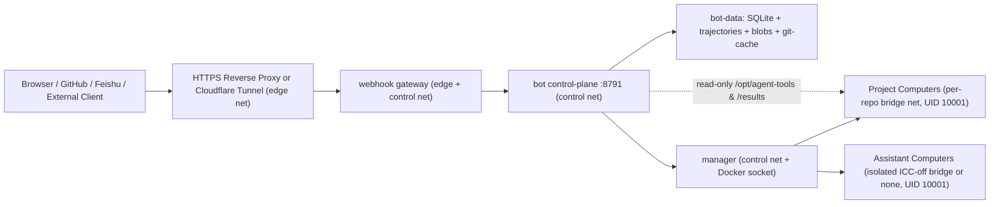

# 系统总体架构与安全边界

本文从系统视角说明 launchpad 的整体服务拓扑、模块职责、隔离边界与凭据安全模型。面向用户的部署与运维操作见 [部署、升级与运维](../features/deployment-and-operations.md)。

## 1. 服务拓扑

系统以 Docker Compose 编排静态核心服务，并由 `manager` 按需动态管理项目电脑与助手电脑容器：



| 服务 | 源码目录 | 核心职责 |
| --- | --- | --- |
| `bot`（控制面） | `src/`、`static/`、`public-board/` | 单一业务端口 `8791` 统一承接管理 API、控制台静态页、OAuth/App 回调、GitHub/飞书 Webhook、外部执行端与公开看板；承担全部认证授权、事件分派、任务调度、模型网关、GitHub 发布与存储持久化。 |
| `manager` | `manager/` | **唯一挂载 Docker socket 的服务**；按部署 ID 和受控操作接口管理项目电脑、助手电脑与笔记卷，不对外暴露宿主端口，也不接触上游凭据或控制面数据库。 |
| `runner` | `runner/` | 预装在项目/助手电脑镜像内的一次性固定执行入口，经 `docker exec` 接收校验后的命令/文件/Git/Harness 请求并维护本地 journal。 |
| `webhook`、`tunnel` | `webhook/`、`tunnel/` | 边界转发网关与可选 Cloudflare Tunnel；`tunnel` 仅位于 `edge` 网络，只能经 `webhook` 到达 `bot:8791`，无法触及 `manager`。 |

## 2. 核心设计原则

1. **控制面是唯一权威与凭据边界**：
   - GitHub App 私钥、机器人 Token、模型长期 API Key、OAuth Secret 与飞书凭据全部使用 **AES-256-GCM（`SecretBox`）绑定记录 AAD** 密封在控制面，绝不进入项目电脑、助手电脑、浏览器响应或日志。
   - 项目容器内仅能通过短期受限机制访问外部能力：控制面代理或受控网关负责模型转发与 GitHub 写入，容器内按需签发单仓只读短期安装令牌（结束即撤销）。
2. **授权收敛与失败关闭**：
   - 任何外部输入（Issue/PR 文本、仓库文件、`.agents/skills/`、模型输出、飞书卡片参数）均视为不可信数据，不能扩大工具集、权限或改变平台规则。
   - 权限计算在控制面每次落库或外部写入前按实时授权、项目能力上限（`capability_ceiling`）、任务写授权（`task_write_grants`）与 GitHub App 安装范围取交集。
3. **确定性事务与幂等外发**：
   - Webhook 验签、归档、去重与事件/任务入队在 SQLite `BEGIN IMMEDIATE` 事务内原子提交。
   - 对 GitHub 与飞书的外部副作用均采用持久 Outbox + 稳定幂等键 + 未知结果对账（`unknown` 不盲目重发）。
4. **单线程事件循环可观测性**：
   - 控制面在单 Node 进程内运行 HTTP、调度与后台巡检，内置事件循环阻塞检测（`[stall]`）、慢请求（`[slow]`）、慢 SQL（`[slow-sql]` ≥ 100ms）与慢迁移日志（`[slow-migration]` ≥ 200ms），避免隐蔽性能退化。

## 3. 容器与网络隔离模型

- **项目电脑（每仓库一台长期容器）**：
  - 非特权用户 UID `10001`、只读根文件系统、`cap_drop: [ALL]`、`no-new-privileges`、`init` 回收僵尸进程、禁宿主 swap。
  - 每个仓库独立 bridge 网络，项目间互不可达，与控制面 `control` 网络隔离；默认开启外网（可按部署或项目关闭）。
  - 通过共享工作卷（`/workspace`）、独立持久笔记卷（`/workspace/project-notes`）、只读工具卷（`/opt/agent-tools`）与只读工具结果卷（`/results`）划分数据边界。
- **助手电脑（按对话归属短时容器）**：
  - 按飞书群或个人归属隔离，仅经 Docker volume subpath 挂载自身当前代次的持久 HOME 目录（`assistant-homes`）；`/workspace` 与 `/tmp` 为随容器生命周期自动创建与回收的临时磁盘卷（默认各 20 GB，不计入 16 GB 内存上限）。
  - 默认连接关闭容器间通信（`enable_icc=false`）的独立外网 bridge 网络，与 `control` 及其他助手容器隔离；全局关闭外网时切换为 `NetworkMode: none`。
- **可信与不可信代码检出区分**：
  - PR 检视、续修未合入 bot PR 属于非受信任检出：控制面禁止从该检出自动加载 `.agents/skills/`、`.pi/skills/`、根目录 `AGENTS.md`/`CLAUDE.md` 或任何本地 hooks/MCP，仅从受控基准分支注入可信配置。

## 4. 模块分层总览

```text
src/
├── main.ts / server.ts          # 启动编排、路由分派、静态白名单、健康/就绪探针
├── core/                        # 加密密封、脱敏、参数校验、基础错误类型
├── identity/ & installations/   # Principal/Tenant、OAuth 登录、安装档案同步、成员缓存、ActorContext
├── dispatch/ & tasks/           # 对象持久 Manager 线程、常设规则、通用任务引擎、优先级/父子/协调
├── agent/ & roles/ & harness/   # runAgent、模型网关、RoleRun 协议、TaskToolGateway、多 Harness 后端
├── review/ & github/ & actions/ & releases/  # 检视与交付验证、github_write 与 Publisher、Actions 扫描、发版本
├── management/ & service-roles/ & channels/  # ManagementService、管理/群聊助手、飞书适配与本地消息账本
├── schedules/                   # 持久化 Schedule/Occurrence 租约与事件通知 Outbox
├── storage/ & memory/ & projects/            # SQLite/轨迹/Blob、项目知识、项目电脑网关与 Worktree
└── external/ & public-board/    # 外部执行端凭据 Broker、公开看板增量采集与托管
```
