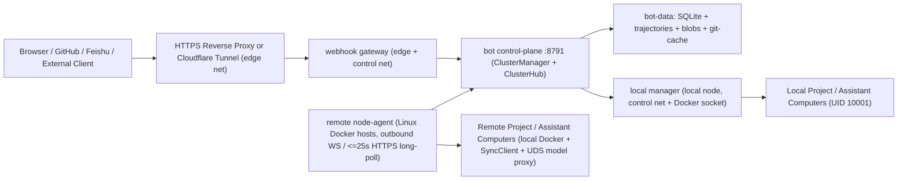

# 系统总体架构与安全边界

本文从系统视角说明 launchpad 的整体服务拓扑、模块职责、隔离边界与凭据安全模型。面向用户的部署与运维操作见 [部署、升级与运维](../features/deployment-and-operations.md)。

## 1. 服务拓扑

系统以 Docker Compose 编排静态核心服务，并由 `manager` 按需动态管理项目电脑与助手电脑容器：



| 服务 | 源码目录 | 核心职责 |
| --- | --- | --- |
| `bot`（控制面） | `src/`、`static/`、`public-board/` | 单一业务端口 `8791` 统一承接管理 API、控制台静态页、OAuth/App 回调、GitHub/飞书 Webhook、外部执行端、公开看板、文件同步网关（`/sync/*`）与节点接入总线（`/cluster/nodes/*`）；承担全部认证授权、事件分派、任务调度、集群路由与助手租约、模型网关、GitHub 发布与存储持久化。 |
| `manager` / `node-agent` | `manager/` | **唯一挂载本地 Docker socket 的计算面服务**（永不暴露 Docker TCP）。单机部署运行 `manager/main.mjs` 作为内置 `local` 节点；分布式扩展节点复用同一镜像运行 `manager/node-agent.mjs`（`ComputeDriver` Linux Docker 实现，预留 `host` 返回 501），通过主动反向 WS / 长轮询接入控制面，保留本机 `manager.sqlite`、容器与预编译镜像缓存。 |
| `runner` | `runner/` | 预装在项目/助手电脑镜像内的常驻守护进程（`runner/daemon.mjs`），经每容器隔离挂载的 UDS（`/run/bot-runner/runner.sock`，带一次性 Bearer 令牌鉴权，容器间及非 `manager` 服务均不可见）提供统一 HTTP/1.1 + WebSocket 线协议，进程内直接执行命令（异步流式 + 心跳 + HTTP 长轮询降级）、文件/二进制流、Git、Harness 与 inotify 邮箱唤醒，并维护本地 journal；`runner/runner.mjs --stdin` 保留供本地开发与 `docker exec` 大载荷兼容回退使用。 |
| `webhook`、`tunnel` | `webhook/`、`tunnel/` | 边界转发网关与可选 Cloudflare Tunnel；`tunnel` 仅位于 `edge` 网络，只能经 `webhook` 到达 `bot:8791`，无法触及 `manager`。 |

> 四个核心常驻服务（`bot`、`manager`、`webhook`、`tunnel`）在 `docker/compose.yaml` 中统一启用 `init: true`，且各进程在收到 `SIGTERM`/`SIGINT` 后立即关闭空闲 HTTP keep-alive 连接、经有限排空后主动收口并在 `stop_grace_period` 之前自主退出，避免升级重建时因连接滞留触发 Docker `SIGKILL`。

## 2. 核心设计原则

1. **控制面是唯一权威与凭据边界**：
   - GitHub App 私钥、机器人 Token、模型长期 API Key、OAuth Secret 与飞书凭据全部使用 **AES-256-GCM（`SecretBox`）绑定记录 AAD** 密封在控制面，绝不进入项目电脑、助手电脑、浏览器响应或日志。
   - 项目容器与助手容器内仅能通过短期受限机制访问外部能力：所有平台模型调用统一经控制面只读挂载的 Unix Domain Socket 透传网关（`/run/model-gateway/gateway.sock`）持短期运行令牌（`rrt_…`）访问，容器内仅运行内存态回环 TCP→UDS 字节转发桥，长期模型 API Key 永不进入容器，在 `egress=false` / `NetworkMode: none` 下同样可用；GitHub 写入经控制面 `github_write` 执行，容器内按需签发单仓只读短期安装令牌（结束即撤销）。
2. **授权收敛与失败关闭**：
   - 任何外部输入（Issue/PR 文本、仓库文件、`.agents/skills/`、模型输出、飞书卡片参数）均视为不可信数据，不能扩大工具集、权限或改变平台规则。
   - 权限计算在控制面每次落库或外部写入前按实时授权、项目能力上限（`capability_ceiling`）、任务写授权（`task_write_grants`）与 GitHub App 安装范围取交集。
3. **确定性事务与幂等外发**：
   - Webhook 验签、归档、去重与事件/任务入队在 SQLite `BEGIN IMMEDIATE` 事务内原子提交。
   - 对 GitHub 与飞书的外部副作用均采用持久 Outbox + 稳定幂等键 + 未知结果对账（`unknown` 不盲目重发）。
4. **单线程事件循环可观测性**：
   - 控制面在单 Node 进程内运行 HTTP、调度与后台巡检，内置事件循环阻塞检测（`[stall]`）、慢请求（`[slow]`）、慢 SQL（`[slow-sql]` ≥ 100ms）与慢迁移日志（`[slow-migration]` ≥ 200ms），避免隐蔽性能退化。

## 3. 容器与网络隔离模型

- **项目电脑（每仓库一台长期容器）**：
  - 非特权用户 UID `10001`、只读根文件系统、`cap_drop: [ALL]`、`no-new-privileges`、`init` 回收僵尸进程、禁宿主 swap。
  - 每个仓库独立 bridge 网络，项目间互不可达，与控制面 `control` 网络隔离；默认开启外网（可按部署或项目关闭）。
  - 通过共享工作卷（`/workspace`）、独立持久笔记卷（`/workspace/project-notes`）、每容器私有 Runner 套接字子路径（`/run/bot-runner`，`runner-sockets` 卷隔离挂载，与 `egress=false` / `NetworkMode: none` 兼容）、只读工具卷（`/opt/agent-tools`）、只读项目工具卷（`/opt/project-tools`）、只读 Skill 卷（`/opt/bot-skills`，`skill-store` 子路径 `projects/<repository_id>`）、只读工具结果卷（`/results`）与只读模型网关套接字卷（`/run/model-gateway`）划分数据边界。
- **助手电脑（按对话归属短时容器）**：
  - 按飞书群或个人归属隔离，仅经 Docker volume subpath 挂载自身当前代次的持久 HOME 目录（`assistant-homes`）、自身私有 Runner 套接字子路径（`/run/bot-runner`）以及公共服务 Skill 只读子路径（`/opt/bot-skills`，`skill-store` 子路径 `service`），并只读挂载模型网关套接字卷（`/run/model-gateway`）；`/workspace` 与 `/tmp` 为随容器生命周期自动创建与回收的临时磁盘卷（默认各 20 GB，不计入 16 GB 内存上限）。
  - 默认连接关闭容器间通信（`enable_icc=false`）的独立外网 bridge 网络，与 `control` 及其他助手容器隔离；全局关闭外网时切换为 `NetworkMode: none`。
- **可信与不可信代码检出区分**：
  - PR 检视、续修未合入 bot PR 属于非受信任检出：控制面禁止任何后端从该检出自动加载 `.agents/skills/`、`.pi/skills/`、`.codex/skills/`、根目录 `AGENTS.md`/`CLAUDE.md` 或任何本地 hooks/MCP，仅从受控基准分支注入可信配置并将可信 Skill 物化至只读 `/opt/bot-skills` 卷。

## 4. 分布式计算节点架构（ClusterManager 与 node-agent）

- **状态归属与路由边界（`src/cluster/manager.ts`）**：
  - 控制面 `control.sqlite` 仅保存集群期望态与协调账本：`compute_nodes`（默认自动注册内置 `local` 节点）、`compute_node_sessions`、`repository_node_bindings`、`repository_node_volumes`、`assistant_placements` 与 `environment_operation_nodes`；每个节点保留本机实态（`manager.sqlite`、本机容器、本机预编译镜像缓存与宿主机资源水位）。
  - `ClusterManager` 实现 `Manager` 接口并按纯路由表分流：项目笔记与文件树（`/file-tree`、`/files`、`/notes`）始终由控制面权威处理，绝不将写入路由至远端节点；项目生命周期与执行按 `repository_node_bindings` 路由并执行 `binding_epoch` 栅栏校验；全局读接口（`/v1/projects`、`/v1/defaults`、`/v1/storage`、`/v1/precompiled-images`、`/v1/project-tools/mounts`、`/v1/notes-volumes`）聚合本机与在线远端节点，全局写接口扇出同步。
- **节点身份、双向传输与统一同步（`src/cluster/hub.ts`、`manager/node-agent.mjs`、`manager/node-sync.mjs`、`manager/node-model-proxy.mjs`）**：
  - 节点通过一次性配对令牌（`bnode_...`，数据库仅存哈希）绑定 Ed25519 公钥并换发绑定至 `node_id` 的短期会话（`bnsess_...`，均纳入全局红线脱敏）；所有远端调用采用异步 `operation_id` 立即 ack、断线重连后按 `op.resume` 幂等续传、超阈结果自动 `op.chunk` 分片传输（支持最长 35 分钟启停/构建与 `<=25s` HTTPS 长轮询回退）。
  - 节点目录同步严格复用统一 `FileSyncEngine` 与 `runner/sync-client.mjs`（共享本地 CAS 对象缓存池，向 `/cluster/nodes/sync-token` 申请严格按节点绑定与助手归属校验的短期 `bsync_...` 令牌），不引入第二套同步或冲突合并实现。
  - 节点本地监听 `/run/model-gateway/gateway.sock`（只读挂入容器），将容器 `rrt_...` 请求经节点长连或流式 `/cluster/nodes/model-proxy` 转发至控制面 `ModelGatewayHub`，长期 API Key 永不离开控制面；认证 WS 上同步预留默认拒绝（`allowTunnel=false`）的通用 TCP 隧道原语供后续远端 SSH 目标接入复用。
- **助手电脑单写者与排水/改绑安全**：
  - 控制面通过 `assistant_placements`（`owner, node_id, epoch, generation, turn, state, lease_expires_at, affinity_until`）执行 SQLite CAS 租约：同一归属任何时刻至多运行一台容器，保留亲和窗口与 `owner_busy` 排队语义；跨节点迁移严格遵循「先停旧节点容器并经 `SyncClient` 刷回 `assistant-homes` → 原子提交新 placement → 再在新节点拉起容器」，消除跨节点双写。
  - 绑定状态机维护 `bound | active | draining | offline | rebinding`；节点排水后 `claimQueuedTask` 与 `ProjectService.reconcileProject` 立即拒绝新任务认领与失败自动重启，待在跑任务结束或超时后再停止容器；项目改绑先写回 `project-notes` 并就地回收旧节点容器/工作卷（不跨节点拷贝工作卷），孤儿笔记卷回收（`reclaimNotes` / `NotesReclaimer`）严格按 `node_id` 命中真实持卷节点。

## 5. 模块分层总览

```text
src/
├── main.ts / server.ts          # 启动编排、路由分派、静态白名单、健康/就绪探针
├── core/                        # 加密密封、脱敏、参数校验、基础错误类型
├── identity/ & installations/   # Principal/Tenant、OAuth 登录、安装档案同步、成员缓存、ActorContext
├── dispatch/ & tasks/           # 对象持久 Manager 线程、常设规则、通用任务引擎、优先级/父子/协调
├── agent/ & roles/ & harness/   # runAgent、模型网关、RoleRun 协议、TaskToolGateway、多 Harness 后端
├── review/ & github/ & actions/ & releases/  # 检视与交付验证、github_write 与 Publisher、Actions 扫描、发版本
├── management/ & service-roles/ & channels/  # ManagementService、管理/群聊助手、飞书适配与本地消息账本
├── schedules/                   # 持久化 Schedule/Occurrence 租约与事件通知 Outbox
├── storage/ & memory/ & projects/ & sync/ & cluster/  # SQLite/轨迹/Blob、项目知识、项目电脑、统一 FileSyncEngine、分布式节点集群
└── external/ & public-board/    # 外部执行端凭据 Broker、公开看板增量采集与托管
```
