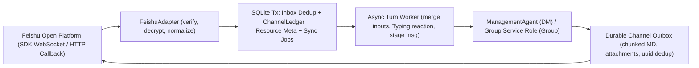

# 统一管理服务、服务角色与飞书渠道架构

本文说明控制台管理助手、平台级服务角色以及飞书应用机器人的核心架构。面向用户的配置与使用方式见 [管理助手、飞书应用机器人与群聊助手](../features/assistants-and-channels.md)。

## 1. 统一管理服务与管理助手（`src/management/`）

控制台设置表单、Web 管理助手与飞书私聊共享同一套 `ManagementService` 闭集契约，避免不同入口出现两套权限或状态机：

- **查询与命令契约**：
  - `POST /api/management/query`：只读查询目录（`list_projects`、`list_tasks`、`get_task`、`get_effective_config`、`get_usage`、`list_audit`、`search_knowledge` 等），统一通过 `resolveActor` 过滤项目范围。
  - `POST /api/management/commands`：写操作必须携带闭合 Schema 参数、`expected_revision`（冲突返回 `409 management_revision_conflict`）、操作者范围唯一 `idempotency_key` 与来源会话/消息引用；保存持久化回执（`succeeded` / `failed` / `unknown`）和变更 diff，支持按命令 ID 对账恢复。
- **无审批直执行**：授权范围内的管理命令（含 `task.create`）直接执行并记审计，不设额外的控制台二次确认卡片拦截；历史请求中的 `workflow_changes` 布尔字段平滑兼容忽略。
- **仓库接入归一**：管理助手原生覆盖已安装未启动仓库（`pending_repositories`）的只读探索与 `start_repository` 工具（超管或受信任组织管理员直接启动并同轮配置，未受信任组织落库 `onboarding_requests` 待超管审批）。
- **流式持久会话**：对话事件经 `GET /api/management/conversations/:id/events?stream=1` 以 NDJSON 推送，支持断线续读不重发、随时停止及首轮自动生成标题；对话上下文按 `authorization_revision` 隔离，降权后隐藏旧权限记录。

## 2. 助手配置与共享运行时能力（`src/service-roles/`）

平台将「项目工作角色」「平台级管理助手」与「群聊助手绑定」清晰解耦：

- **管理助手单例与群绑定内联配置**：
  - `service_roles` 仅向控制台暴露全局唯一的内置 `management-assistant`（固定全目录权限，与当前用户实时权限取交集，在「全局设置 → 管理助手设置」`#/settings/management-assistant` 维护，旧路由 `#/settings/service-roles` 兼容跳转）。
  - 群聊助手不再依赖独立服务角色模板，而是将 `model_id`、`prompt`（上限 35,000 字符，完整容纳旧职责 2,000 + 提示词 32,000 合并值）与 `harness` 直接内联存储在 `channel_service_bindings` 上，与仓库范围、三维权限和发言方式一页配置；启动迁移将存量群绑定所引用角色的模型、后端与职责/提示词无损回填，并保持未修改绑定的 `service_role_id` 与授权围栏不变；存量绑定首次重存切换到 `'group-assistant'` 时，在同一事务中同步迁移 `assistant_homes.service_role_id` 以保留持久 `~/` 文件（仓库范围缩小时仍按 `scope_narrowed` 封存旧代次）。
- **对话后端**：管理助手（`service_roles.harness`）和群绑定（`channel_service_bindings.harness`）可选 `pi`、`codex`、`claude_code`，默认 `pi`：读写缺省值、新建库的列默认值和控制台新建表单都取 `pi`，旧库在启动时由 `migration:1255:native-to-pi` 一次性改写，之后残留的 `native` 每次启动改为 `pi`（#1257，见 [默认后端](agent-and-harness-runtime.md#默认后端)）。每一轮都经 `serviceHarnessTurn` 在会话归属的助手电脑上运行。Pi 后端按对话语义运行：控制台边生成边显示回答，回合中的新消息在当前回合并入，问题被编辑后按编辑后的内容重开，允许安静的轮次经 `stay_silent` 安静结束；群聊的 Pi 轮次带机器人身份、当前消息、近期消息与摘要，工具调用照常记为本轮步骤。Pi 自己的原生工具和模型步骤也作为进度写入会话（#1296）：管理助手写进 `management_events`，原生工具沿用 `tool_call`/`tool_result` 并带 `native: true`（`preview`，结果里的 `state`、`duration_ms`、`exit_code`、`tail`），模型步骤为 `model_start`，压缩、重启和限频跳过为 `progress`；群聊助手只在 `channel_service_events` 记步骤名。只在消息或群轮次仍为运行中时写入，回合结束或被停止后不再写。机制见 [服务助手回合](agent-and-harness-runtime.md#服务助手回合srcharnessservice-sessionts)。Codex 与 Claude Code 保持各自的轮次行为。
- **统一平台 Bot 身份与条件化能力表达**：管理助手与群聊助手在系统提示词中统一声明自身属于同一 launchpad 平台 bot 体系——无论是直接调用 `github_write` 还是派发给项目团队执行的任务（如开发任务开 PR），在 GitHub 侧都使用该仓库配置的同一个平台 bot 账号，避免将自身与「bot」割裂为两个主体；群聊的 `list_projects` 与回合种子 `context.scope.repository_ceilings` 以及管理助手的 `list_projects` 均实时暴露各仓库 `capability_ceiling`（`read` / `comment` / `develop`），助手仅对上限为 `develop` 的仓库承诺发起开发任务开 PR，且在所有面向用户的回复中均用自然中文描述权限边界、不暴露内部权限键名或原始 REST 路径。
- **受控仓库源码检出（`checkout_repository`）与多仓短期只读凭证**：管理助手与群聊助手在启用助手电脑且具备 `github_contents: read` 权限时，均提供控制面受控 `checkout_repository` 工具（`src/service-roles/checkout.ts`）。控制面实时校验目标仓库归属与权限、解析分支/tag/commit SHA/PR ref（PR 检出需 `pull_requests: read` 并显式标注 `trusted_checkout: false`），优先复用控制面 `GitCache` bare mirror（`git archive`）导出并在不可用时回退到控制面 GitHub API 打包，经 `assistant_archive_stage` / `assistant_archive_extract` 安全校验路径穿越、符号链接逃逸与大小上限后解压到助手电脑的 `/workspace/<dir>` 或 `/tmp/<dir>`（严禁写入持久 `~/`），全程不向容器暴露任何 GitHub 凭据，天然兼容 `native` 后端与 Bot PAT 账号；同时非 Native 后端（`pi`、`claude_code`、`codex`）经 `serviceHarnessTurn` 透传 `githubApiUrl` 与实时仓库解析器，支持容器内原生 `git` / `gh` 按仓动态申请短期只读 App 安装令牌并在回合结束统一吊销。
- **独立子任务（`service_role_own_tasks`）**：管理助手与群聊助手均可调用 `start_own_task` / `continue_own_task` 在隔离上下文中深度分析并只带回结论；独立任务沿用当前会话权限与授权围栏，不进入业务 `tasks` 表。
- **助手私有记忆文件化（`~/memory/`）**：管理助手与群聊助手不再使用 SQLite `service_role_memory` 表及 `search_role_memory`/`read_role_memory`/`remember_role_memory` 工具，统一以各自持久 `HOME`（`/home/assistant`，由 `assistant-homes` 卷承载）下的 `~/memory/` 自由 Markdown 文件保存跨轮私有长期记忆。该能力依赖部署启用助手电脑（`manager` + `assistant-homes` 卷）且当前会话具备助手电脑资格：管理助手为个人级持久 `HOME`（跨飞书私聊与所有 Web 控制台会话共享，要求超级管理员、存在待启动安装仓库的管理员或在至少一个授权项目具备 `tasks.write`；不具备资格的只读用户不暴露助手文件工具，亦不注入 `~/memory/` 引导），群聊助手为群级持久 `HOME`（按群隔离，复用现有代次封存逻辑：仅换绑、换角色或仓库范围收缩时切代次封存，换模型、改提示词或增权不丢记忆）。助手文件工具集包含 `list_files`、`read_file`、`write_file`、`delete_file`：访问 `~/`（`/home/assistant/`）由控制面在轻量直通路径下全程持有已验目录文件描述符，经 `/proc/self/fd/<fd>`、`O_RDONLY | O_DIRECTORY | O_NOFOLLOW` 与前缀核验逐段遍历（无需启动容器，避免并发符号链接替换 TOCTOU 逃逸），访问 `/workspace` 与 `/tmp` 对称走容器内 `runner/assistant-files.mjs`（`assistant_list`/`assistant_read`/`assistant_write`/`assistant_delete`）。Pi 后端在助手电脑内将 `bash` 的 `HOME` 对齐为 `/home/assistant`，系统提示词明确要求记忆文件仅作为不可信数据而非授权依据。升级旧库时，启动迁移 `migrateServiceRoleMemory`（`src/service-roles/memory-migration.ts`）仅将授权围栏与助手电脑资格均仍有效的 `service_role_memory` 历史记录安全迁出到对应归属的 `~/memory/migrated/*.md`、跳过失效/无资格或损坏记录并移除旧表（未挂载 `assistant-homes` 且尚有存量记录时延迟迁移，不静默丢弃）。
- **阶段消息与静默结束**：管理助手与群聊助手默认配备 `send_message`（单轮上限 10 条，每并入新消息 +1）用于长任务进度播报；在非 `@` 群消息或会话定时任务中额外提供 `stay_silent`，显式区分「保持安静」与「需要回复」。
- **模型隔离与计费**：管理助手请求记入 `model_requests.service_role_id = 'management-assistant'`；群聊请求记入 `service_role_id`（新建/更新为 `'group-assistant'`）与 `conversation_id = chat.id`，单仓库群同时关联 `repository_id` 计入项目成本，跨项目群按群会话统计不强行拆分。群绑定强制校验所选模型对范围内全部仓库均已授权，每轮请求前实时复核（组织范围若使用受限共享模型，新增未授权仓库时按 `modelGaps` 失败关闭暂停，空组织拒绝受限共享模型）；删除模型或项目时同步清空对应群绑定的 `model_id` 引用、递增 `revision` 并记 `channel.service_binding.model_cleared` 审计，且在删除确认中提示受影响群。

## 3. 飞书渠道架构与本地消息账本（`src/channels/`）

- **入站消息解析**：`FeishuAdapter` 负责回调验签、解密和历史拉取。`feishu-message-format.ts` 解析正文和提及，供实时消息与历史记录共用。
- **连接归属与传输安全**：
  - 支持全平台应用与组织专属应用（`owner_tenant` 不可变）；非超级管理员仅允许配置「企业自建 + SDK 长连接」（防 HTTP Verification Token / Encrypt Key 持有者伪造用户消息）。
  - 组织专属应用经 `confineActor` 强制隔离：群范围只能选本组织仓库，经其绑定的私聊身份仅在本组织内有效。
  - 所有应用权限集中在 `src/channels/feishu.ts` 的 `FEISHU_SCOPES` 单源声明，统一驱动导入 JSON 与自动权限巡检。
- **群绑定权限交集与围栏**：
  - 群绑定使用专用 service principal 保存范围与三维权限（GitHub 权限、项目任务权限、平台能力），生效权限 = 绑定权限 ∩ 范围 ∩ 授权人实时权限 ∩ 项目能力上限 ∩ App 安装权限。
  - 每轮执行绑定授权围栏（绑定版本、角色启停、授权人有效权限、历史清理水位）；群成员变动或普通历史消息编辑不破坏围栏，但当前轮源消息撤回或授权真实失效会立即中止该轮并阻断未发出消息。
- **本地消息账本与历史同步（`ChannelLedger`）**：
  - 以 `(provider, app_id, installation_tenant, chat_id)` 建唯一会话，原文与资源引用密封保存，实时版本优先于历史补读，撤回 tombstone 不可复活；历史同步按 50 条分页并独立分页拉取 thread，查询只读本地账本不回源飞书。
  - 会话列表（`GET /api/channels/conversations`）支持按 `connector_id` 过滤，统一在「飞书会话」（`#/conversations`）承接本地消息检索、会话定时任务（`timeline` 返回 `chat.can_view_schedules`，按 `ChannelSchedules.canView` 门控并支持 `?section=schedules` 自动展开）、显式历史重同步与超管按会话保留/清理策略；「个人设置 → 飞书绑定」（`#/identity/feishu`）仅承载个人绑定与群绑定两张列表卡片，并将群配置独立到 `#/identity/feishu/groups/new` 与 `#/identity/feishu/groups/<chat-id>`。
  - 附件按需流式下载（上限 100 MiB），以 AES-256-GCM 密封存于 `channel-resources/` 并校验 SHA-256，与撤回和保留清理级联删除；图片支持原生多模态直传与助手电脑离线处理回读。
- **回合消息并入与 Outbox 投递**：
  - 回合思考/工具执行期间到达的新消息落库 `channel_turn_inputs`，在下一轮自然模型请求前按序注入上下文，不打断当前推理；开始输出最终文本时暂停并入。Pi 后端在会话开始时和每批工具调用之后的回合边界注入。
  - 发送 Outbox 对超长 Markdown 按双重 JSON 转义字节自动分段（低于飞书 30 KB 限制），每段与附件保留固定 `uuid`；超出飞书 1 小时去重窗口（留 5 分钟余量，55 分钟）仍未知的投递标为 `channel_delivery_unknown` 停止自动重发，防止重复刷屏。
  - **通用丰富交互卡片引擎（`src/channels/cards.ts`）**：飞书私聊、群聊与会话定时任务按需通过 `set_feishu_card` 暂存并校验 Card JSON 2.0（默认仍走 `post` 富文本，Web 控制台对话不暴露该工具），配套内置 `feishu-cards` Skill 按需通过 `read_skill` 读取。控制面强制白名单校验并按飞书 Card JSON 2.0 规范归一化组件与嵌套规则（根层级 `table`、列宽 `80px–600px`/`1%–100%`/`auto`、行高 `low`/`middle`/`high`/`auto`/`32px–124px`、表头样式与选项标签色值、移动端安全 VChart `chart_spec`、≤ 28 KB 序列化体积与 ≤ 190 元素、仅允许安全 `http(s)` 链接、禁止伪造 `img_key` 或注入原始回调），所有文本与数据均经统一脱敏；出站遭飞书 400/卡片格式拒绝时记录脱敏诊断日志并优雅降级为原生 `post` 发送，账本通过 `cardText` 统一索引正文与更新后内容。交互卡片采用「SQLite 轻量状态行 + 单卡只读加密文件」混合分层存储：元数据、授权围栏、并发版本号与可变 `state` 存于 `channel_interactive_cards`（14 天 TTL），不可变的 AES-256-GCM 密封卡片定义（`spec`）以原子落盘（先写 `fdatasync` 再提交行）存放在独立 `channel-cards/<shard>/<id>.enc` 目录（兼容读取历史内联 SQLite 行），由 `RetentionCleanup` / `ManualReclaim` 统一清理过期与孤儿文件并纳入存储统计；由控制面签发不透明 `{ card, act }` 令牌支持多视图切换（`views`）、服务端分页筛选（`paginated_list`）及受控后续触发（`actions`，以点击人自身身份进入标准入站流程并立即唤醒调度）；每次 `card.action.trigger`（兼容 WebSocket 与 HTTP）均实时复核连接、会话归属与授权围栏，视图切换/分页/筛选直接在回调响应中同步返回脱敏后的 `{ toast, card: { type: 'raw', data } }` 并同步刷新本地账本，实现毫秒级原地刷新；若因网络超时导致飞书重放同一 `event_id`，去重分支会在复核授权围栏后幂等返回当前已持久化状态对应的卡片（不二次推进状态），确保展示与服务端状态一致。
  - 群聊派活与私聊新建任务通过持久化结果队列回传结果卡片，每次发送前均复核绑定、范围与读取权限。
