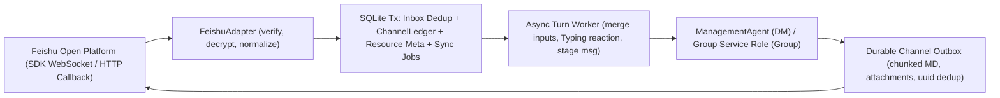

# 统一管理服务、服务角色与飞书渠道架构

本文说明控制台管理助手、平台级服务角色以及飞书应用机器人的核心架构。面向用户的配置与使用方式见 [管理助手、飞书应用机器人与群聊助手](../features/assistants-and-channels.md)。

## 1. 统一管理服务与管理助手（`src/management/`）

控制台设置表单、Web 管理助手与飞书私聊共享同一套 `ManagementService` 闭集契约，避免不同入口出现两套权限或状态机：

- **查询与命令契约**：
  - `POST /api/management/query`：只读查询目录（`list_projects`、`list_tasks`、`get_task`、`get_effective_config`、`get_usage`、`list_audit`、`search_knowledge` 等），统一通过 `resolveActor` 过滤项目范围。
  - `POST /api/management/commands`：写操作必须携带闭合 Schema 参数、`expected_revision`（冲突返回 `409 management_revision_conflict`）、操作者范围唯一 `idempotency_key` 与来源会话/消息引用；保存持久化回执（`succeeded` / `failed` / `unknown`）和变更 diff，支持按命令 ID 对账恢复。
- **无审批直执行 + 唯一高危确认例外**：授权范围内的命令直接执行并记审计；唯一例外是修改 `.github/workflows/` 的 `task.create(workflow_changes: true)`——模型调用时不直接建单，而是返回 `confirmation_required` 预览，仅当项目管理员在 Web 控制台点击确认卡片并由服务端签发 `console:conversation:*` 来源时才放行。
- **仓库接入归一**：管理助手原生覆盖已安装未启动仓库（`pending_repositories`）的只读探索与 `start_repository` 工具（超管或受信任组织管理员直接启动并同轮配置，未受信任组织落库 `onboarding_requests` 待超管审批）。
- **流式持久会话**：对话事件经 `GET /api/management/conversations/:id/events?stream=1` 以 NDJSON 推送，支持断线续读不重发、随时停止及首轮自动生成标题；对话上下文按 `authorization_revision` 隔离，降权后隐藏旧权限记录。

## 2. 服务角色体系（`src/service-roles/`）

平台将「项目工作角色」与「平台级服务角色」分离：

- **角色类型**：内置 `management-assistant`（固定全目录权限，与当前用户实时权限取交集）与 `repository-assistant`（群聊默认模板），支持超管在「全局设置 → 服务角色」新建全局模板，或项目管理员在「项目设置 → 角色 → 群助手角色」（`#/projects/<id>/roles?view=assistant-roles`）新建单项目群助手角色。群聊角色仅承载提示词与模型，权限完全归属群绑定。
- **独立子任务（`service_role_own_tasks`）**：管理助手与群聊助手均可调用 `start_own_task` / `continue_own_task` 在隔离上下文中深度分析并只带回结论；独立任务沿用当前会话权限与授权围栏，不进入业务 `tasks` 表。
- **阶段消息与静默结束**：服务角色默认配备 `send_message`（单轮上限 10 条，每并入新消息 +1）用于长任务进度播报；在非 `@` 群消息或会话定时任务中额外提供 `stay_silent`，显式区分「保持安静」与「需要回复」。
- **模型隔离与计费**：服务角色请求记入 `model_requests.service_role_id`；单仓库群同时关联 `repository_id` 计入项目成本，跨项目群不强行拆分。群绑定强制校验所选模型对范围内全部仓库均已授权，每轮请求前实时复核。

## 3. 飞书渠道架构与本地消息账本（`src/channels/`）

- **连接归属与传输安全**：
  - 支持全平台应用与组织专属应用（`owner_tenant` 不可变）；非超级管理员仅允许配置「企业自建 + SDK 长连接」（防 HTTP Verification Token / Encrypt Key 持有者伪造用户消息）。
  - 组织专属应用经 `confineActor` 强制隔离：群范围只能选本组织仓库，经其绑定的私聊身份仅在本组织内有效。
  - 所有应用权限集中在 `src/channels/feishu.ts` 的 `FEISHU_SCOPES` 单源声明，统一驱动导入 JSON 与自动权限巡检。
- **群绑定权限交集与围栏**：
  - 群绑定使用专用 service principal 保存范围与三维权限（GitHub 权限、项目任务权限、平台能力），生效权限 = 绑定权限 ∩ 范围 ∩ 授权人实时权限 ∩ 项目能力上限 ∩ App 安装权限。
  - 每轮执行绑定授权围栏（绑定版本、角色启停、授权人有效权限、历史清理水位）；群成员变动或普通历史消息编辑不破坏围栏，但当前轮源消息撤回或授权真实失效会立即中止该轮并阻断未发出消息。
- **本地消息账本与历史同步（`ChannelLedger`）**：
  - 以 `(provider, app_id, installation_tenant, chat_id)` 建唯一会话，原文与资源引用密封保存，实时版本优先于历史补读，撤回 tombstone 不可复活；历史同步按 50 条分页并独立分页拉取 thread，查询只读本地账本不回源飞书。
  - 会话列表（`GET /api/channels/conversations`）支持按 `connector_id` 过滤，统一在「飞书会话」（`#/conversations`）承接本地消息检索、会话定时任务（`timeline` 返回 `chat.can_view_schedules`，按 `ChannelSchedules.canView` 门控并支持 `?section=schedules` 自动展开）、显式历史重同步与超管按会话保留/清理策略；「个人设置 → 飞书绑定」（`#/identity/feishu`）仅承载个人绑定与群绑定两张列表卡片，并将群配置独立到 `#/identity/feishu/groups/new` 与 `#/identity/feishu/groups/<chat-id>`。
  - 附件按需流式下载（上限 100 MiB），以 AES-256-GCM 密封存于 `channel-resources/` 并校验 SHA-256，与撤回和保留清理级联删除；图片支持原生多模态直传与助手电脑离线处理回读。
- **回合消息并入与 Outbox 投递**：
  - 回合思考/工具执行期间到达的新消息落库 `channel_turn_inputs`，在下一轮自然模型请求前按序注入上下文，不打断当前推理；开始输出最终文本时暂停并入。
  - 发送 Outbox 对超长 Markdown 按双重 JSON 转义字节自动分段（低于飞书 30 KB 限制），每段与附件保留固定 `uuid`；超出飞书 1 小时去重窗口（留 5 分钟余量，55 分钟）仍未知的投递标为 `channel_delivery_unknown` 停止自动重发，防止重复刷屏。
  - **通用丰富交互卡片引擎（`src/channels/cards.ts`）**：飞书私聊、群聊与会话定时任务按需通过 `set_feishu_card` 暂存并校验 Card JSON 2.0（默认仍走 `post` 富文本，Web 控制台对话不暴露该工具），配套内置 `feishu-cards` Skill 按需通过 `read_skill` 读取。控制面强制白名单校验并按飞书 Card JSON 2.0 规范归一化组件与嵌套规则（根层级 `table`、列宽 `80px–600px`/`1%–100%`/`auto`、行高 `low`/`middle`/`high`/`auto`/`32px–124px`、表头样式与选项标签色值、移动端安全 VChart `chart_spec`、≤ 28 KB 序列化体积与 ≤ 190 元素、仅允许安全 `http(s)` 链接、禁止伪造 `img_key` 或注入原始回调），所有文本与数据均经统一脱敏；出站遭飞书 400/卡片格式拒绝时记录脱敏诊断日志并优雅降级为原生 `post` 发送，账本通过 `cardText` 统一索引正文与更新后内容。交互卡片采用「SQLite 轻量状态行 + 单卡只读加密文件」混合分层存储：元数据、授权围栏、并发版本号与可变 `state` 存于 `channel_interactive_cards`（14 天 TTL），不可变的 AES-256-GCM 密封卡片定义（`spec`）以原子落盘（先写 `fdatasync` 再提交行）存放在独立 `channel-cards/<shard>/<id>.enc` 目录（兼容读取历史内联 SQLite 行），由 `RetentionCleanup` / `ManualReclaim` 统一清理过期与孤儿文件并纳入存储统计；由控制面签发不透明 `{ card, act }` 令牌支持多视图切换（`views`）、服务端分页筛选（`paginated_list`）及受控后续触发（`actions`，以点击人自身身份进入标准入站流程并立即唤醒调度）；每次 `card.action.trigger`（兼容 WebSocket 与 HTTP）均实时复核连接、会话归属与授权围栏，视图切换/分页/筛选直接在回调响应中同步返回脱敏后的 `{ toast, card: { type: 'raw', data } }` 并同步刷新本地账本，实现毫秒级原地刷新；若因网络超时导致飞书重放同一 `event_id`，去重分支会在复核授权围栏后幂等返回当前已持久化状态对应的卡片（不二次推进状态），确保展示与服务端状态一致。
  - 群聊派活与私聊新建任务通过持久化结果队列回传结果卡片，每次发送前均复核绑定、范围与读取权限。
