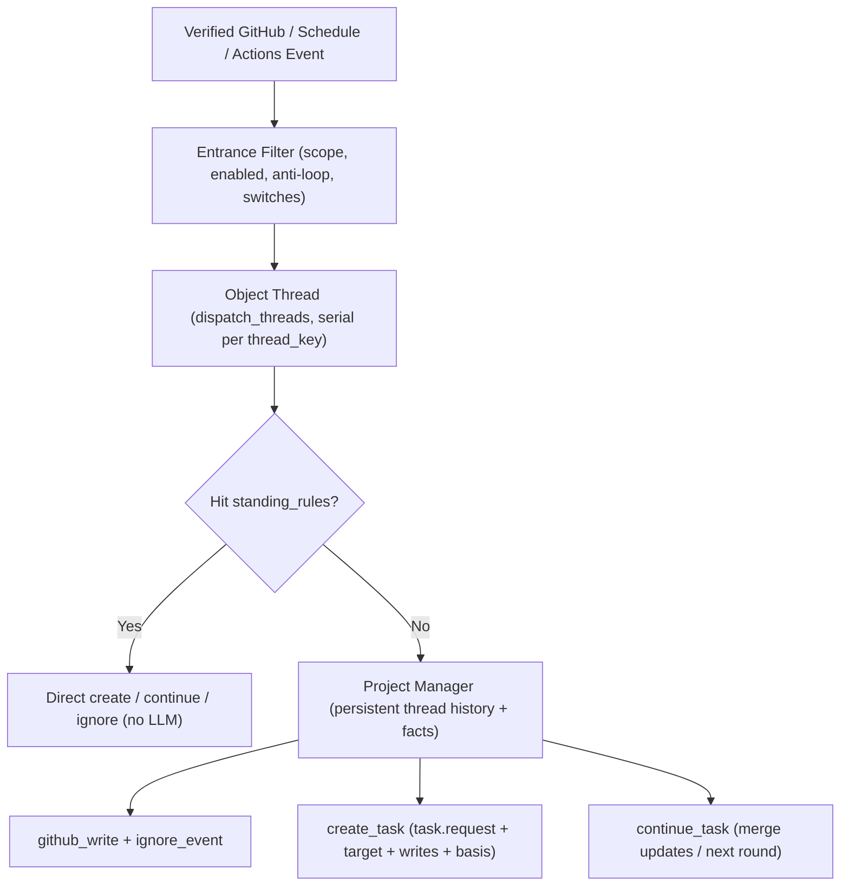
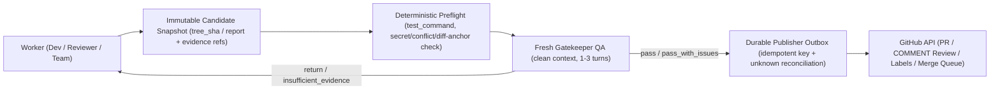

# 事件分派、通用任务引擎与交付验收

本文说明 launchpad 从接收 GitHub 事件到对象 Manager 分派、通用任务调度、协作执行、独立 QA 与幂等发布的完整核心设计。功能行为见 [GitHub 自动化](../features/github-automation.md) 与 [角色配置与规则](../features/roles-and-rules.md)。

## 1. 单对象持久 Manager 线程（`src/dispatch/`）

平台已退役早期固定工作类型目录，统一采用 **单对象持久 Manager 线程（`dispatch_threads`）+ 通用任务引擎（`kind = 'task.request'`）**：

- **确定性线程键**：
  - 根 Issue 及其关联的 bot PR 共用 `<repo>:issue:<issueNumber>`（使 Issue 检视、开发、bot PR 检查失败 `pull_request.checks_failed` 与合并冲突 `pull_request.conflicted` 唤醒在同一上下文中闭环决策）；
  - 独立 PR 使用 `<repo>:pr:<prNumber>`；
  - Actions 失败、发版本与定时检查归入各自确定性线程。
- **串行决策与常设规则**：同一 `thread_key` 严格串行处理并维护滚动摘要；例行事件优先命中无模型开销的 `standing_rules`（永不自动启动开发），需要判断的事件交由 Manager 使用内置六大场景或项目自定义提示词处理。
- **开发依据硬核验**：创建开发任务时，控制面在 `create_task` 入口强制校验 `basis`（`label` / `maintainer_request` / `project_rule`）并持久化记录，同时提供结构化认领事实（指派人、关联 PR、近期评论）供 Manager 判断，不依赖脆弱正则。
- **Bot PR 防自循环与后台巡检**：通过 `bot_pull_requests` 归属表与真实发布记录/actor 身份识别 bot 自有 PR（不轻信公开可伪造注释），过滤自身打开与推送事件；`BotPrWakeScanner` 结合 Webhook 检测检查失败（按 `(pr, head_sha, run_or_suite_id, attempt)` 聚合）与合并冲突（按 `(pr, head_sha, base_sha)` 单次去重），运行中收到的晚到事件在任务收尾或失败时自动回交 Manager。

## 2. 通用任务引擎、队列与恢复（`src/tasks/`）

- **统一任务抽象**：所有新任务统一为 `task.request`，携带通用检出目标 `target`（`issue` / `pr` / `branch` / `commit`）、版本化合同 `contract`（目标、范围、验收标准、交付终点）、可选直派角色 `executor_role` 与显式写入授权集合 `task_write_grants`（`review`、`pull_request`、`github`、`actions_rerun`）。
- **三重写入闸门**：每次外部写入同时校验 **项目能力上限 `capability_ceiling` ∩ 任务 `task_write_grants` ∩ 来源/角色实时授权**；`grant_writes` 允许 Manager 或管理员在不越过上限的前提下动态调整运行中任务的写入授权。
- **优先级队列与并发认领**：
  - 持久化 `priority`（`P0`–`P3`，默认 `P2`）与单调 `queue_seq`，在 `BEGIN IMMEDIATE` 事务中按优先级 + 序号原子认领，并受项目并发上限（1–32）约束；不抢占运行中任务。
  - **条件等待 vs 失败退避**：限流（`github_rate_limited`）、等待电脑/配置/PR head/事件订阅（`waiting_event`）属于条件等待，不消耗失败重试计数；真正执行失败按 5s → 15s → 45s → 135s → 300s 短退避，同码连续 5 次后转入每任务 **8 小时重试周期**。
- **无打断更新与下一轮续接**：
  - 排队或运行中的检视收到评论、编辑或 PR 新推送时直接写入更新收件箱；运行中在回合边界刷新 `../context/` 或原地推进 git worktree 到新 head（`workspace_advance`），不作废原任务。
  - 已发布检视收到新更新时在同一任务上启动下一轮（`round + 1`），通过 `updates_through` 游标保证已覆盖更新不重复开轮、未覆盖更新不遗漏。
- **任务协作与拆解**：
  - **父子拆解**：Manager 按需通过 `create_task(as_child=true)` 与 `wait_for_children` 拆解复杂目标并释放槽位，子任务完成不自动代表父任务通过。
  - **按需协调**：跨任务共享契约冲突可通过 `request_task_coordination` 提交持久化协调请求，由受限 Coordinator 角色产出版本化建议通知，在安全检查点由受影响任务确认采纳或异议。
  - **轻量事件订阅（`waiting_event`）**：任务可调用 `subscribe_event` 登记外部仓库事件并释放执行槽位，Webhook 到达直接唤醒或由 Manager 兜底关联，超时自动唤醒核查。

## 3. 交付候选、独立 QA 与幂等发布（`src/review/`、`src/github/`）

- **不可变候选快照与渐进披露**：代码交付固定工作树快照并保留 Git tree/commit 引用，测试生成的脏文件不进入候选；任务上下文与 QA 输入只携带精简索引和哈希引用（通过 `read_evidence` / `read_related_artifact` 按需分页读取），避免把数百 KB 原始日志塞进每轮模型请求。
- **轻量守门人独立 QA**：
  - 纯内部只读问答跳过 QA；对外交付（开 PR、正式检视、提报）先在共享任务工作区原地执行确定性预检（策略 `test_command`、敏感文件/冲突标记校验、行内评审 diff 锚点预检防止 422），再以全新上下文运行独立 QA，产出五类明确结论：`pass`、`pass_with_issues`、`return`、`insufficient_evidence`、`needs_human`。
  - 允许项目显式关闭 `delivery_gates.pull_request_qa`（前提是配置了有效 `test_command`）。
- **幂等发布与未知状态对账**：
  - 评论、行内 Review（恒为 `COMMENT`，自动关闭已修复旧线程）、分支推送与 PR 创建全部经过持久 Outbox 与稳定写入键；大仓库使用 `base_tree` 增量构建 Git tree 并校验返回 tree 与候选完全一致。
  - 网络中断导致远端结果未知时停留在 `waiting_publication`，重试前先按任务 marker/head 对账（bot 分支更新幂等则自动查证续发），避免重复发评论或开重复 PR。
- **自动合并与并行集成**：
  - 人工合并（`POST /api/tasks/:id/merge`）持久化合并意图，核验候选、QA 与远端检查并支持三路集成与 Merge Queue 入队；
  - Agent 经 `github_write PUT /pulls/{n}/merge` 或直接写默认分支时，统一经过 `auto_merge_policy` 策略校验与真实 `merge_request` 来源核实（协作者缓存或当前合法对话消息），并自动适配目标分支 Merge Queue。
- **动作失败扫描与发版本**：
  - `src/actions/` 结合 Webhook 与持久化固定时间窗分页扫描发现默认分支/版本标签失败运行，限制单 run 最多一次 `rerun_failed_run`。
  - `src/releases/` 强校验 SemVer 递增与新增提交，创建注释标签跟踪 Release 工作流，基于提交区间事实生成草稿，最终发布权始终留给人。
