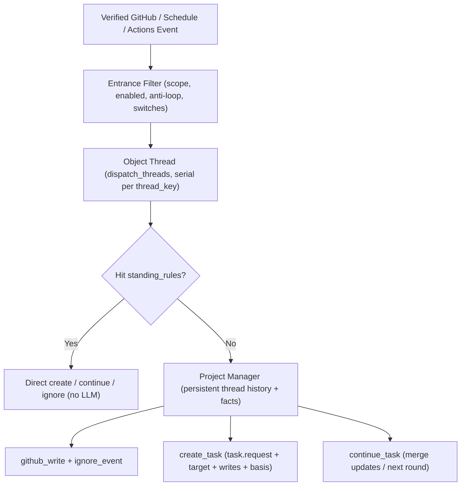
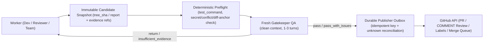

# 事件分派、通用任务引擎与交付验收

本文说明 launchpad 从接收 GitHub 事件到对象 Manager 分派、通用任务调度、协作执行、独立 QA 与幂等发布的完整核心设计。功能行为见 [GitHub 自动化](../features/github-automation.md) 与 [角色配置与规则](../features/roles-and-rules.md)。

## 1. 单对象持久 Manager 线程（`src/dispatch/`）

平台已退役早期固定工作类型目录，统一采用 **单对象持久 Manager 线程（`dispatch_threads`）+ 通用任务引擎（`kind = 'task.request'`）**：

- **确定性线程键**：
  - 根 Issue 及其关联的 bot PR 共用 `<repo>:issue:<issueNumber>`（使 Issue 检视、开发、bot PR 检查失败 `pull_request.checks_failed`、合并冲突 `pull_request.conflicted` 与内部巡检 `pull_request.patrol` 在同一上下文中闭环决策）；
  - 独立 PR 使用 `<repo>:pr:<prNumber>`；
  - Actions 失败、发版本与定时检查归入各自确定性线程。
- **串行决策与常设规则**：同一 `thread_key` 严格串行处理并维护滚动摘要；例行事件优先命中无模型开销的 `standing_rules`（永不自动启动开发），需要判断的事件交由 Manager 使用内置六大场景或项目自定义提示词处理。`continuations()` 为每个续接候选显式标记来源 `match: 'object' | 'subscription'`（并附带可选 `object_type` / `object_number`）：`standing_rules`（`continue` / `continue_active` / `continue_or_create`）与 `option.unless_continued` 严格仅匹配同对象任务（`match: 'object'`），避免仓库内其他 PR/Issue 的活跃 `event_subscriptions` 劫持当前对象事件或误抑制新检视。
- **开发依据硬核验**：创建开发任务时，控制面在 `create_task` 入口强制校验 `basis`（`label` / `maintainer_request` / `project_rule`）并持久化记录，同时提供结构化认领事实（指派人、关联 PR、近期评论）供 Manager 判断，不依赖脆弱正则。
- **Bot PR 防自循环、内部定期巡检与冲突防空烧**：通过 `bot_pull_requests` 归属表与真实发布记录/actor 身份识别 bot 自有 PR（不轻信公开可伪造注释），过滤自身打开与推送事件；`BotPrWakeScanner` 结合 Webhook 检测检查失败（按 `(pr, head_sha, run_or_suite_id, attempt)` 聚合）与合并冲突（按 `(pr, head_sha, base_sha)` 单次去重），运行中收到的晚到事件在任务收尾或失败时自动回交 Manager。同时，`bot_pr_states` 持久化每个未合入 open bot PR 的巡检元数据（`last_patrol_at`、`last_patrol_event_at`、`patrol_env_fingerprint`、`patrol_env_summary`、`patrol_head_sha`、`patrol_base_sha`、`patrol_status` 及冲突抑制字段 `conflict_suppressed_*`）：
  - **纯内部低频巡检（`pull_request.patrol`）**：复用扫描器的只读 GitHub 查询与限流保护，按配置周期（默认 `BOT_PR_PATROL_INTERVAL_MS` 6 小时、同 PR 冷却 `BOT_PR_PATROL_COOLDOWN_MS` 24 小时；环境/权限/能力指纹变化可绕过冷却及时复核）检查无活跃任务且无待决分派事件的非草稿 open bot PR；仅在命中明确变化信号（`environment_or_policy_changed`、`base_moved` + `checks_failed` / `conflicted`、`unresolved_changes_requested`、`stalled_task`）时向对象 Manager 线程投递 `source='control_plane'` 的 `pull_request.patrol` 事件（并附带 `changes_since_last_check` 与 `environment_changes`），对纯绿灯待人工合入 PR 仅刷新本地时间戳，零模型调用、零 GitHub 评论。全程严格停留在控制面内部，不写入 `schedule_events` / `notification_outbox` 且绝不触发飞书或任何外部通知渠道。
  - **抑制 `dirty` 冲突高频空烧**：当 Manager 对某 bot PR 的 `pull_request.conflicted`（或带冲突标记的 `pull_request.patrol`）在当前 `head_sha` 下明确 `ignore` 后，控制面在 `applyDecision` 内原子记录 `(head_sha, env_fingerprint, suppressed_at)` 抑制标记；在 `head_sha` 未变、环境/权限指纹未变且无新人类评论/评审前，兜底对账与主干推进 Webhook 不再随 `main` 每次前进重复投递 `pull_request.conflicted`，改为等待人类信号、环境变化或长冷却周期后经低频内部巡检复核；同时兼容 `github_app` 与 `bot_account` 双账号形态识别自身评论避免误解抑。
  - **按需兜底对账（#1396）**：扫描器仍每分钟运行一次，但只处理到期的 PR；调度状态存于 `bot_pr_states` 的 `reconcile_at`、`reconcile_due_at`、`reconcile_interval_ms`（毫秒）、`reconcile_fingerprint` 与 `reconcile_env`。到期条件依次为：距上次读取不足 `BOT_PR_RECONCILE_MIN_MS`（5 分钟）一律不读；`reconcile_due_at` 已到；`reconcile_env`（不含实时权限的本地环境指纹）与当前不同；或巡检周期已到且到期后尚未读过。没有到期 PR 的仓库不连接、不发请求。到期 PR 先经 `readBotPrSnapshots` 用 GraphQL 别名批量读取（每条 50 个，`state`、`isDraft`、`mergeable`、`updatedAt`、head/base OID、`baseRef` 当前 tip、head 提交的 `checkSuites`），摘要与 `reconcile_fingerprint` 相同且巡检未到期则不发 REST；不同则沿用原逐 PR REST 流程（`GET /pulls/<n>`，只有 GraphQL 显示 head 上有状态变化过的已完成且未通过的套件（失败、超时、`startup_failure`、取消等）时才补读 check runs/suites，冲突时按需读评论；REST 读取失败时不记录本次摘要，下轮按变化重读）。保存时有变化则间隔回到 5 分钟，否则翻倍至 `BOT_PR_RECONCILE_MAX_MS`（4 小时）。`markBotPrsForReconcile` 在 Webhook 入队时把相关 PR（PR 本身的事件/评审/评论、head 提交上的 check/status、推送分支、合入 PR 的目标分支）标为 `max(now, reconcile_at + 5 分钟)` 到期并复位间隔；读取期间被 Webhook 改过到期时间的 PR 保存时以 Webhook 为准。GraphQL 报 `RATE_LIMITED` 或窗口已用完时整轮停止、不回退 REST、不记录读取（PR 保持到期）；其他 GraphQL 失败时到期 PR 逐个走 REST，指纹改由 REST 结果计算。Webhook 触发的定向复查（`prFilter`）不参与调度，仍立即走 REST。

## 2. 通用任务引擎、队列与恢复（`src/tasks/`）

- **统一任务抽象与目标解析**：所有新任务统一为 `task.request`，携带通用检出目标 `target`（`issue` / `pr` / `branch` / `commit`）、版本化合同 `contract`（目标、范围、验收标准、交付终点）、可选直派角色 `executor_role` 与显式写入授权集合 `task_write_grants`（`review`、`pull_request`、`github`、`actions_rerun`）。其中 `target: { type: "issue", number, ref? }` 支持解析远端分支名作为检出基线与 PR `base`，且指名分支优先于既有 bot PR：只复用 `base` 与指名分支一致的开放 PR（未指名时沿用最新开放 PR），旧 PR 不动，新交付使用按基线区分的分支名（默认基线 `bot/issue-<N>`，其他基线 `bot/issue-<N>-<base>`（`/` 等字符写作 `-`），登记给当前任务）（去重键计入 `target.ref`；分支不存在明确报错 `target_branch_not_found` 而不回退默认分支；裸提交/标签仅允许只读任务，带 `pull_request` 写权限时报错 `target_ref_not_branch`）；仓库规则与 `.agents/skills/` 仍严格从项目可信基准分支（`policy.base_branch || defaultBranch`）加载。
- **全链路交付上下文透明化**：控制面通过 `buildDeliveryContext`（`src/tasks/delivery-context.ts`）从持久化字段确定性生成结构化 `delivery_context`（`target`、`base_branch`、`base_sha`、PR 基线语义说明、`goal`、`intended_delivery`、生效 `writes`），贯通 Task Manager、Dev 与 Observer（`reviewer`/`test`）；团队模式在 `latest_dev_result` 与 `delegate_role` 返回值中暴露 `delivery` 与改动文件数，在 `read_child_tasks` 暴露子任务 `target`/`base_branch`/`delivery`/`pr_url`，并在 Observer 输入中附带当前候选的变更文件摘要 `candidate_changes`。
- **团队提名 `delivery` 语义与子任务聚合**：`nominate_delivery` 支持可选 `delivery`（`pull_request` / `review` / `report`，仅 generic 任务生效且受父任务 `effectiveWrites` 约束），`validateNominationResult` 按实际目标收尾工具（`open_pull_request`/`post_review`/`submit_report`）校验而不再硬编码 `submit_report`。子任务结果不自动导入代码文件到父工作区：子任务已开出 PR（存在 `pr_url`）时，父任务缺省按 `report` 聚合汇报并保留 `child_pull_requests` 关联而不重复开 PR；父任务合同要求 `reviewable_pull_request` 且被提名子任务无 `pr_url` 时，未显式传入 `delivery` 明确拒收防静默降级。
- **任务一律以角色运行执行**：省略 `executor_role` 时由 Task Manager 团队协调（含重试报告评估），直派角色单独运行；Manager 开关退役前冻结、入口开关仍为关闭的旧任务，同样按退役开关解析、由 Manager 团队协调，不存在绕过角色的工具循环。
- **三重写入闸门**：每次外部写入同时校验 **项目能力上限 `capability_ceiling` ∩ 任务 `task_write_grants` ∩ 来源/角色实时授权**；`grant_writes` 允许 Manager 或管理员在不越过上限的前提下动态调整运行中任务的写入授权。
- **优先级队列与并发认领**：
  - 持久化 `priority`（`P0`–`P3`，默认 `P2`）与单调 `queue_seq`，在 `BEGIN IMMEDIATE` 事务中按优先级 + 序号原子认领，并受项目并发上限（1–32）约束；不抢占运行中任务。
  - **条件等待 vs 失败退避**：限流（`github_rate_limited`；`github_rate_limits` 按资源分窗口，REST 请求只看 `core`、`POST /graphql` 只看 `graphql`，GraphQL 以 200 加 `RATE_LIMITED` 错误回复的用尽同样按限流处理）、等待电脑/配置/PR head/事件订阅（`waiting_event`）属于条件等待，不消耗失败重试计数；真正执行失败按 5s → 15s → 45s → 135s → 300s 短退避，同码连续 5 次后转入每任务 **8 小时重试周期**。
  - **失败解释**：`src/agent/failures.ts` 负责错误归类、重试判断及解释组装，按错误码显示的处理提示集中在 `src/agent/failure-actions.ts`。
  - **排队票语义**：新任务进入队列、失败任务重试都取新票；用户 `暂停` 后 `重试`（`paused` + `error_code='user_pause'` 且 `attempt` 未前进）保留原 `queue_seq`，回到原位置继续。新建即暂停的任务从未占位，启动时入队尾；`adopt-config` 会推进 attempt，按重规划取新票。该重建触发器的语句在启动时以同一写事务 `DROP`/`CREATE`，旧数据库重开后即生效。
- **无打断更新与多轮持续任务（检视与 bot PR 开发）**：
  - 排队或运行中的检视或开发任务收到评论、编辑、检查失败、冲突或 PR 新推送时直接写入 `review_updates`；运行中在回合边界刷新 `../context/` 或原地推进 git worktree 到新 head（`workspace_advance`），不作废原任务。
  - **已发布检视下一轮**：处于 `succeeded` 的检视收到新更新时，由 `continueFinishedReview` 在同一任务上启动下一轮（`round + 1`），通过 `updates_through` 游标保证已覆盖更新不重复开轮、未覆盖更新不遗漏。
  - **开放 bot PR 持续多轮开发任务**：1 个开放中的 bot PR 对应 1 个按 `round` 持续演进的 `task.request` 主开发任务。首轮开出 PR 进入 `pr_opened`（或无代码推送轮次进入 `completed`）后作为可续接休眠态（不占并发槽位）；当该开放 PR 再次收到评论、评审、检查失败、合并冲突或内部巡检信号时，`continuations()` 按 `bot_pull_requests.source_task_id` 精确匹配该 PR 的主任务（多基线同 Issue PR 互不串扰；旧 `development.issue` 遗留 PR 允许回退新建统一的 `task.request` 供后续轮次复用）暴露在 `work.continue`，`genericRefusal()` 同时拒绝为已有可续接任务的开放 PR 重复新建 `pull_request` 任务（返回 `bot_pr_task_resumable`）。Object Manager 调用 `continue_task` 后，由 `continueDevelopmentTask` 递增 `round`/`attempt`、保持 `workspace_id`/`generation` 与 `role_instances` 会话/Harness 状态、记录 `round_started_history_id` 与 `previous_delivery`、清空本轮候选/验收槽位、刷新 `task_execution_configs` 并固化 `executor_role = NULL`（完整保留 `task_history` 与 `model_requests` 成本汇总）。PR 合入或关闭后，`isBotPrOpen()` 返回 `false`，不再暴露续接，后续清理按 `pr_closed` 回收工作区、worktree 与 CLI 会话状态；PR 关闭或转为草稿时同时取消其 `source_task_id` 上仍在运行/排队的任务。
  - **原地 worktree 复用与远端 head 对齐**：`runRequest` 在 `round > 1` 且项目电脑 `generation` 未变化时，拉取该 PR 实时上下文（PR 对象、diff 文件、评论、评审与可信基准分支 Skill）后优先调用 `workspace.advance` 原地将既有 worktree 对齐到远端最新 `head_sha`（保留 `node_modules`/构建缓存、同步 `worktreeMoved` 与 `snapshot_*` / `workspace_base_head_sha`，防止覆盖人类在 GitHub 推送的提交）；若旧 worktree 缺失、被共享或容器重建（`generation` 变化），自动降级为新建 `workspace_id` 并记录日志。`nominationSource`、`candidateParticipation` 与 `latestRoleCandidate` 按 `round_started_history_id` 隔离当前轮次，阻止提名上一轮的过时 `dev` 结果；`Publisher` 全链路统一使用 `this.scope`（`${task.id}:round:${round}`）生成幂等键并原地 `PATCH /pulls/:number`。
  - 每次发布决定都以 `publication_decision` 记入任务历史：发布写 `publish`，Manager 推迟（`manager_disposition` 的 continue/wait，含 Harness 回合结束未提名）写 `defer`，发布后仍有未覆盖更新续接下一轮写 `next_round`，都带覆盖范围、未覆盖与顺延的更新编号、轮次和来源引用。`read_publication_context` 用 `decisions` / `latest_decision` 返回这些可审计决定，与 `publication_state` 的尝试记录各自独立分页（`next_before` / `decisions_next_before` 及截断标记）。覆盖范围无法取得时记 `coverage: unavailable` 与 `null` 计数，不写成零。
- **PR 开发任务统一由 Task Manager 编排**：bot PR 开出后平台不再自动检视，所有携带 `pull_request` 写权限的 `task.request` 任务（无论是首轮 Issue 开发还是第 2+ 轮 PR 修订）在分派入口（`checkDecision`/`mapShorthandWork`）、任务创建入口（`POST /api/tasks`）与执行入口（`runRequest`）均统一归一化为 `executor_role = NULL` 经 `runTeam` 由 Task Manager 掌舵，取消单角色 `dev` 开发工作流分叉；非 PR 写权限任务（如 `reviewer` 检视、`test` 诊断、`dev` Actions 排查）仍保持直派单角色执行。Task Manager 在首轮及后续修订轮次按改动范围与风险决定是否委派独立 `reviewer`/`test`（纯文案/注释/文档小改可跳过并在 `checks_note` 说明；纯回复或重跑等无需改代码轮次可由 `dev` 经 `submit_report` 收尾），复用同一 `dev` 实例处理返修与后续轮次。提名事实由 `candidateParticipation`（`src/roles/participation.ts`）按当前轮次计算并传递给 Manager 与 QA，作为判断事实而非硬门禁。
- **任务协作与拆解**：
  - **父子拆解**：Manager 按需通过 `create_task(as_child=true)` 与 `wait_for_children` 拆解复杂目标并释放槽位，子任务完成不自动代表父任务通过。任一已返回子任务仍立即唤醒父任务；若全部未返回子任务都停在 `waiting_environment` / `waiting_configuration`，父任务详情用 `childBlockSummary` 汇总各子任务的状态、原始错误码与恢复条件并提供子任务入口。聚合原因与恢复入口由每个子任务自身的 `failureCause` / `explainFailure`（状态 + 错误码）推导：所有子任务指向同一设置页时才给出对应入口，归因不一致或无设置页时回退为中性说明与子任务入口，不按等待状态猜测。父任务自身状态和事件契约（`task_children_pending`、`children_waiting`）保持不变，重复轮询不产生子任务返回事件。
  - **跨任务只读查询与显式依赖等待**：原独立 `Task Coordinator` 角色与顾问式请求/通知/签收流程已退役，Manager 直接使用 `list_project_tasks` / `read_project_task` 按需分页读取同项目任务记录，用 `relate_task` 记录任务关联（不挂起运行中任务），并在存在明确先后依赖时调用 `wait_for_tasks`（支持 `delivered` / `merged` 条件、环检测与释放执行槽位，依赖满足或阻塞后自动唤醒）。历史 `task_coordinations` / `coordination_notices` 表仅保留只读兼容，升级前滞留在 `waiting_coordination` 且无显式依赖的旧任务会在 tick 自动恢复到 Manager。
  - **轻量事件订阅（`waiting_event`）**：任务可调用 `subscribe_event` 登记外部仓库事件并释放执行槽位，Webhook 到达直接唤醒或由 Manager 兜底关联，超时自动唤醒核查。跨对象订阅候选在 `work.continue` 中标记为 `match: 'subscription'`，仅允许 Object Manager 结合 `pending_subscriptions` 显式 `continue_task` 唤醒；续接时 `join()` 只执行订阅结算（`resolveSubscriptionsByManager`）与日志记录，不将来源事件的 `review_updates`、`move_to_sha`、`target.ref`、`revision`、`bot_pr_requests` 或线程 `active_task_id` 写入目标任务。

## 3. 交付候选、独立 QA 与幂等发布（`src/review/`、`src/github/`）

- **不可变候选快照、HEAD 漂移护栏与 QA 交接摘要**：代码交付固定工作树快照并保留 Git tree/commit 引用，测试生成的脏文件不进入候选；`runner/workspace.mjs` 的 `workspace_finalize` 返回实际 `head_sha`，控制面在 `open_pull_request` 校验与 QA 确定性预检中拦截非冲突解冲/集成场景下的工作区 `HEAD` 脱离发布基线（`workspace_head_drifted`），防止向错误目标分支发出全量跨分支差异 PR。任务上下文与 QA 输入只携带精简索引和哈希引用（通过 `read_evidence` / `read_related_artifact` 按需分页读取），同时在 QA 输入顶层提供不会被 `boundedCandidate` 折叠的 `delivery_handoff`（目标与合同目标、预期 vs 实际交付方式、基线与 `head_matches_baseline`、变更路径增删改摘要及 `.github/workflows/` 标记、提名来源与说明）。
- **轻量守门人独立 QA**：
  - 纯内部只读问答跳过 QA；对外交付（开 PR、正式检视、提报）先在共享任务工作区原地执行确定性预检（策略 `test_command`、HEAD 基线一致校验、敏感文件/冲突标记/凭据扫描与行内评审 diff 锚点预检防止 422；其中 `privateKeyBlock` 文本启发式仅对任意层级测试目录 `tests?`/`__tests__`/`specs?` 及 `.test.`/`.spec.`/`test_*`/`*_test.*` 豁免，真实注册凭据 `redactor.contains` 与 `dirtyPathPattern` 保持严格不豁免），再以全新上下文运行独立 QA，产出五类明确结论：`pass`、`pass_with_issues`、`return`、`insufficient_evidence`、`needs_human`。
  - 允许项目显式关闭 `delivery_gates.pull_request_qa`（前提是配置了有效 `test_command`）。
- **幂等发布与未知状态对账**：
  - 评论、行内 Review（恒为 `COMMENT`，自动关闭已修复旧线程）、分支推送与 PR 创建全部经过持久 Outbox 与稳定写入键；大仓库使用 `base_tree` 增量构建 Git tree 并校验返回 tree 与候选完全一致。
  - 当候选变更实际涉及 `.github/workflows/` 时，`Publisher.branch` / `publishRequestPullRequest` 在推送分支前按需向 GitHub App 申请短期 `workflows: write` 安装令牌（用完即撤销）；若安装未授予 `Workflows: Read and write`，则在写入任何 Git 对象前以 `github_workflows_permission_missing`（`waiting_permission`）中止并提示开通。
  - 网络中断导致远端结果未知时停留在 `waiting_publication`，重试前先按任务 marker/head 对账（bot 分支更新幂等则自动查证续发），避免重复发评论或开重复 PR。
- **自动合并与并行集成**：
  - 人工合并（`POST /api/tasks/:id/merge`）持久化合并意图，核验候选、QA 与远端检查并支持三路集成与 Merge Queue 入队；
  - Agent 经 `github_write PUT /pulls/{n}/merge` 或直接写默认分支时，统一经过 `auto_merge_policy` 策略校验与真实 `merge_request` 来源核实（协作者缓存或当前合法对话消息），并自动适配目标分支 Merge Queue。
- **动作失败扫描与发版本**：
  - `src/actions/` 结合 Webhook 与持久化固定时间窗分页扫描发现默认分支/版本标签失败运行，限制单 run 最多一次 `rerun_failed_run`。Webhook 记下的待处理 attempt 在下一次 5 秒 tick 处理，时间窗扫描只作兜底，每 10 分钟一次；一轮失败后该仓库暂停 10 分钟，期间送达的 `workflow_run` 会把重试提前到下一次 tick。每个仓库的已连接客户端跨 tick 复用，令牌剩余不足 15 分钟、仓库行（账号、所有者、全名）、账号凭据或所在安装的本地 revision（安装的权限、事件订阅、范围变化时递增）变化时吊销并重新 `connect`，出错、关闭功能或服务关闭时吊销；默认分支在本地没有来源，改名要到下一次 `connect`（令牌寿命内，最长约 1 小时）才被读到。
  - `src/releases/` 强校验 SemVer 递增与新增提交，创建注释标签跟踪 Release 工作流，基于提交区间事实生成草稿，最终发布权始终留给人。
