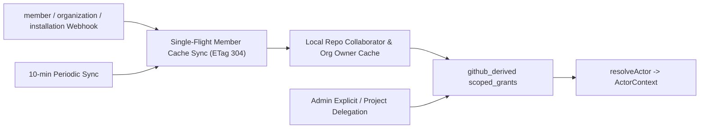

# 身份登录、安装档案与统一授权

本文说明 launchpad 如何解耦「用户身份登录」「GitHub App 安装事实档案」与「统一服务端授权（`ActorContext`）」。面向用户的接入与权限说明见 [登录、系统初始化与仓库接入](../features/onboarding-and-access.md)。

## 1. 核心数据与身份模型

- **不可变数字主键**：一个租户对应 GitHub 数字 `owner_id`，一个项目对应数字 `repository_id`，一个外部用户绑定 `provider + host + numeric_user_id`；登录名和仓库名仅作为展示快照，改名不会合并或破坏身份。
- **双 App 职责分离**：
  - **独立 OAuth App**（`/auth/github/start`、`/auth/github/callback`）：仅用于控制台用户登录，固定请求**空 `scope`**，采用浏览器绑定 `state`（10 分钟单次事务消费）+ `S256 PKCE`，只读取 `/user` 核实身份；若上游返回额外 scope 则直接拒绝。
  - **仓库 GitHub App**：仅负责仓库连接、安装同步、成员权限核验与自动化执行；manifest 默认只申请仓库级权限，不申请组织级 `Members` 权限，使仓库管理员无需组织 Owner 审批即可自助安装。

## 2. GitHub App 安装档案与持久化同步（`src/installations/`）

安装档案独立于项目启停与控制台角色，用 `(github_host, app_id, installation_id)` 唯一标识，即使零仓库、暂停或已卸载也完整留痕。

- **事务内事件归档**：已验签的 `installation`、`installation_repositories`、`installation_target` 事件在同一事务中落库永久加密事件（`installation_events`）、投影变更与持久化同步任务（`installation_sync_jobs`），Webhook 响应链路绝不同步调用 GitHub API。
- **租约式全量同步**：后台 Worker 每秒扫描待处理与过期租约（60 秒租约自动续期）任务，并每 10 分钟全量对账；仅当所有分页完整性校验通过后才原子提交快照，任何局部失败（403/429/网络/分页不一致）保留上一份有效快照并标记 `completeness = error`，绝不误判为卸载或零仓库。
- **即时撤权与自动恢复**：
  - 卸载、暂停、移出仓库或 `all → selected` 范围收缩在 Webhook 事务内立即阻断受影响任务（进入 `waiting_permission` / `github_installation_access_revoked`）。
  - 范围重算确认仓库重新合法后，引擎自动将等待中的任务放回队列，无需人工点击重试。
- **三类独立回调**：App 注册回调（`/onboarding/github/callback`）、安装 Setup 回调（`/onboarding/github/setup`）与用户 OAuth 回调相互独立；Setup 回调必须经 OAuth 验证会话与安装归属复核，防止伪造 `installation_id`。

## 3. 本地成员缓存与派生授权（`src/identity/`）

为了避免用户登录或日常操作被跨安装串行 GitHub API 阻塞，平台按安装与仓库维护持久化本地成员缓存：

- **纯仓库权限下的成员发现**：在默认无组织 `Members` 权限时，同步器签发单轮只读安装令牌（结束前撤销），以 `/repos/{owner}/{repo}/assignees`（真实仓库成员，排除 Public 仓外部陌生人）合并 `/collaborators`，再按已绑定账号查询 `/collaborators/{username}/permission` 定档五级角色（`admin`/`maintain`/`write`/`triage`/`read`），全程利用 `ETag` / `304 Not Modified` 节省配额，并回读 `repository_id` 防止改名/转移串库。
- **秒级登录与容错**：OAuth 登录命中就绪缓存时直接派生授权并生效；冷启动尚未完成首次同步时登录不阻塞，后台单飞同步并通过 `/api/auth/me` 报告进度。遇到 429/5xx/网络故障时保留上一份已证实缓存并退避，不误撤有效权限。
- **Webhook 联动撤权**：`github_app_authorization.revoked`、`member.removed`、`organization.member_removed` 立即挂起/撤销对应身份与派生授权并触发缓存刷新。

## 4. 统一授权与授权版本（`ActorContext`）

- **`ActorContext` 契约**：`resolveActor` 仅在可信服务端构造，包含 `principal_id`、`tenant_id`、`project_id?`、`channel`、`capabilities`（`tasks.read/write/manage_own`、`roles.edit`、`knowledge.read/write/review`、`schedules.manage`、`config.write`、`release.manage`、`grants.manage`）与 `authorization_revision`。客户端 JSON、IM 文本或模型参数不可伪造 Actor。
- **两类委派与防固化**：
  - 超级管理员显式委派（`policy: independent`）独立持久；
  - 项目管理员项目内委派（`policy: project_delegation`）动态依赖授予人自身有效权限，检测授予链防循环互授，授予人失权时受授权限自动暂停。
- **`authorization_revision` 语义**：仅在账号**失去**原有有效权限时递增（增权或不变不递增）。
  - 控制台 Web 写请求在落库与调 GitHub 前按实时授权重验，不因版本数字变化误拒正常写操作；
  - 后台长链路（管理助手对话历史分段、待发渠道消息、定时投递、个人助手电脑围栏）绑定授权版本，一旦降权立即隔离旧上下文并阻断后续敏感投递。
- **外部身份绑定（`ExternalBindings`）**：采用 5 分钟一次性双端证明 challenge，在事务内消费并绑定 `(provider, connector, external_tenant, external_actor)` 到平台 `principal_id`，无自填外部 ID 接口，解绑后原归属不可被他人接管。
