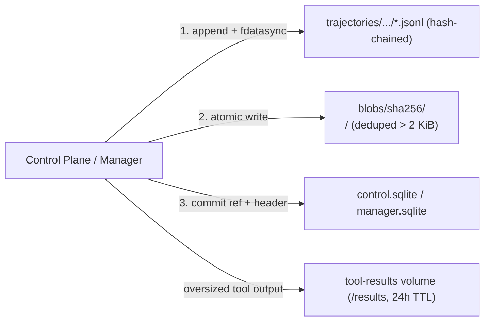

# 存储架构、轨迹文件、工作区与项目知识引擎

本文说明控制面与 manager 的存储分层、JSONL 哈希链轨迹、数据库压缩与空间保护、共享 Git Worktree 工作区以及项目知识自由文件引擎的核心设计。

## 1. SQLite + 轨迹文件 + Blob 存储架构（`src/storage/`、`manager/trajectories.mjs`）

为避免大块模型请求、工具输出和仓库文件清单撑爆 SQLite，平台将「轻量元数据/状态/计费」与「大块正文」彻底分离：

- **JSONL 哈希链轨迹**：按运行/会话轮次/分派尝试写入 0600 权限的 `.jsonl` 文件，每行含 `seq` 与上一行 `sha256`（`prev`）；模型请求采用增量记录（仅写相对上一次请求的新增消息，最多连续 64 次增量后写完整快照）。
- **定位串与统一读取层（`src/storage/payloads.ts`）**：数据库行仅留小表头（供索引和列表查询）与定位串 `<file_id>:<offset>:<length>:<sha256>`；写顺序严格保证「先写文件并 `fdatasync`，再提交数据库引用」，绝不出现悬空引用。读取时按定位串核对长度与哈希，损坏或截断返回 `trajectory_corrupt` / `trajectory_truncated`，重复工具调用校验失败直接止损不盲目重放。
- **单份事实与轮询免记账（`src/tasks/trace.ts`、`src/agent/workspace.ts`、`manager/projects.mjs`）**：只读轮询与探活调用（`workspace_agent_poll`、`workspace_harness_poll`、`workspace_agent_live`、`workspace_agent_runtime`、`workspace_agent_progress`）走无状态直发路径，不写 `task_tools`、`manager.operations` 与 `task_history` 的 `operation` 快照；仅保留有副作用的操作（命令、写文件、检出、发布）的状态轨迹。运行日志只在 `task_logs` 单份保存（大日志落轨迹文件），不再通过触发器复制为 `task_history.runtime_log`，`traceSource('task_logs:<id>')` 直接读取原表并兼容历史 `runtime_log` 行。
- **共享内容寻址 Blob 与渠道加密文件**：超过 2 KiB 的任务文件清单/补丁以 `sha256` 去重落盘，按项目引用计数清理；飞书附件（`channel-resources/<shard>/<id>.enc`）与交互卡片只读定义（`channel-cards/<shard>/<id>.enc`）均以 AES-256-GCM 密封原子落盘、SQLite 仅存轻量元数据与状态，由定期/手动回收统一清扫过期与孤儿文件并计入存储页统计。
- **工具结果独立卷（`tool-results`）**：超过批次预算或被上下文折叠的工具输出脱敏写入 `/tool-results/<电脑归属>/<id>.utf8`（24 小时自动清理），以只读方式挂入对应容器的 `/results`，兼顾分页读取与容器内脚本处理。
- **脱敏边界**：写入轨迹前剥离私有推理与已登记凭据原值（至少 8 字符，避免误伤普通文本），并对工具回执/事件/操作表剥离内联图片 base64；对外发布到 GitHub/飞书/公开看板额外执行令牌形态（含分段安装令牌、PEM/PGP 私钥块、Base64/URL 编码形态）白名单脱敏。

## 2. 数据库压缩、按天回收与剩余空间保护

- **WAL 封顶与启动压缩（`manager/compaction.mjs`）**：两个 SQLite 连接均设 `PRAGMA journal_size_limit = 512 MiB`；启动前若空闲页 > 30% 且 > 1 GiB 且磁盘余量充足，自动执行 `VACUUM INTO` 切换为 `auto_vacuum = INCREMENTAL` 并做 `integrity_check` 原子替换；后续后台每 10 分钟分步 `incremental_vacuum` 无停机归还空间。
- **按天数清理**：控制面启动后及每日分批按保留天数清理过期轨迹文件、Webhook 正文、超龄 `commit_checks` 与已结束 `event_subscriptions`；manager 默认每小时清理关闭超过 2 天的重复操作正文（过期后重放返回 `410 operation_result_expired`）。
- **三层剩余空间保护**：
  1. 低于保留空间（总容量 5% 与 50 GiB 取小）时暂停后台迁移写入并告警；
  2. 新任务启动前校验数据盘底线（≥ 10 GiB 或近期单任务峰值的 3 倍）；
  3. 项目电脑 `runner/disk.mjs` 实时监控工作卷（< 1% 或 < 1 GiB 判定写满），拒绝写盘并返回 `disk_full` 进入等待环境，不消耗失败重试次数。

## 3. 代码快照与共享 Git Worktree 工作区（`src/agent/git-cache.ts`、`src/projects/worktrees.ts`）

- **控制面 Bare Mirror + 增量 Pack 同步**：控制面在 `/data/git-cache/<repo_id>.git` 维护只读裸镜像（令牌仅经一次性进程环境传入 `git fetch`，不落配置或日志），向项目电脑 `/workspace/git/repo.git` 仅传输缺失对象的 pack，并把提交固定在 `refs/bot/commits/<sha>`；镜像不可用时自动降级到 GitHub API 逐文件构建快照。
- **按需延迟绑定 Worktree**：准备阶段只同步对象库，任务首次读代码或跑命令时才绑定 `/workspace/worktrees/<id>`（软链到任务目录 `repo`）；纯不碰代码的任务不创建 worktree。
  - 只读任务优先复用同提交、无改动的就绪 worktree（保留 `.gitignore` 忽略的依赖和构建缓存）；
  - 写任务始终独占新建 worktree；观察者与独立 QA 各自绑定停在候选提交上的只读 worktree；
  - 写索引前自动检测并清理超过 10 秒且无活跃 git 进程持有的残留 `*.lock`。
- **定期回收**：每小时按任务生命周期清理 `/workspace/tasks` 与 `/workspace/worktrees`：未结束任务仅保留当前 `workspace_id`、未释放的 `worktree_bindings`、当前代次可续接的角色实例/CLI 状态目录、待恢复/集成来源目录、未决候选快照目录、未结束后续任务的父目录及 30 分钟内活跃目录，旧尝试（`superseded_attempt`）与已发布旧检视轮次（`superseded_round`）的目录在下一次清理释放并按原因统计；开放 PR 关联工作区保留至合并/关闭后下一轮清理，已结束任务默认保留 1 天、失败保留 7 天。存储页同时列出每个未结束任务当前持有的目录数，便于及时发现异常增长。

## 4. 项目知识自由文件与版本引擎（`src/memory/`、`manager/file-tree.mjs`）

- **单源物理存储与共享组权限契约**：每个仓库独立的持久笔记卷挂在项目电脑 `/workspace/project-notes`（`../notes/`），是项目共享长期知识的唯一事实源；旧 SQLite `project_memories` 轨已淘汰并停止新写入（历史 `project_memories` 活跃非仓库文档条目经 `src/memory/migration.ts` 安全、幂等迁出到 `../notes/migrated-memories/*.md`，绝不覆盖已有同名文件；`authority="repository"` 仓库文档保留在仓库内；`traceSource` 仅在旧表存在时按项目权限只读回放历史引用）。由 `manager` 直接提供文件操作，项目电脑未启动或重置代次时仍完整可用。`manager`（`0:10001`，`cap_drop: [ALL]` 无 `CAP_DAC_OVERRIDE`）与项目电脑（`10001:10001`）通过共享组 `10001` 协作：
  - `runner/workspace.mjs` 对经任务软链（如 `/workspace/tasks/<ws>/notes/...`）或绝对路径落入知识卷的读写统一解析软链后路由至 `Notes` 协议（`0o660` 原子写入 + 历史/目录索引），禁止 `outsideRepo` 绕过以 `0o600` 裸写知识卷；
  - `runner/note-path.mjs` 与 `manager/file-tree.mjs` 在知识卷创建目录后显式 `chmod 0o770`（抵消 `manager` 的 `umask 0077`），并在属主访问时自愈缺失的组读写位；
  - 若卷内存在历史遗留的不可读条目（`EACCES`/`EPERM`），目录扫描跳过该条目并在 `quarantined` 中以 `reason: 'permission_denied'` 报告而不阻断其余健康文件；单文件读取遇权限错误返回 `503 note_permission_denied` 而非模糊的 `manager_unavailable`。
- **稳定 ID、正文检索与崩溃可恢复移动**：
  - 卷内 `.write-history/file-tree.json` 在文件锁内维护不可变文件 ID、内容寻址历史版本 blob 与移动 pending journal（崩溃重启按 inode 对账续完；若源/目标变成非普通文件导致归属不可确认，进入 `note_move_uncertain` 拒绝读写以防数据损坏；运维恢复必须停写、整卷备份并恢复经隔离验证的移动前整卷快照，严禁手工删除 pending journal，步骤见[部署、升级与运维](../features/deployment-and-operations.md#4-数据卷备份与存储维护)）。
  - `FileTree.list` 在带检索词或开启 `preview=1` 时同时检索文件路径与文本正文（受单文件 512 KiB 与单次 32 MiB 扫描上限保护，触顶时返回 `scan_limited: true`，跳过二进制与不可读 blob），返回带命中上下文的预览摘要 `preview` 与命中位置 `match_in`。
  - 历史迁出的文件名 stem 按 UTF-8 字节截断至 ≤200 字节以适配单段 255 字节上限；仅明确的单条路径/内容校验错误（如 `400 invalid_note_path`、`invalid_note_content`、`413 payload_too_large`）写入 `project_memory_migrations`（`skipped_invalid`）避免反复重试，认证/卷归属/路由缺失（`401`/`403`/`404`）等项目级或瞬时错误保持 `failed` 可重试，且启动后台迁移重试受次数上限约束。
- **全入口直连与写入凭据脱敏一致性**：
  - 控制台 `/api/repositories/:id/knowledge-files`、管理助手/群聊助手（`src/memory/management.ts`：`search_knowledge`、`read_knowledge`、`knowledge_versions`、`knowledge.revise`）、`TaskToolGateway`（`src/roles/gateway.ts`）与工作角色工具（`search_project_memory`、`read_project_memory`、`remember_project_memory`）统一直连 `manager/file-tree` 物理笔记卷，按项目授权边界（`knowledge.read` / `knowledge.write`）鉴权，不再维护角色受众隔离（`audience: role:<id>`）、审批流（`review`）、`supersedes` 链、`knowledge_fence` 或 `ProjectMemory.context()` 硬编码召回；旧 `/api/(repositories|projects)/:id/(memories|knowledge)*` 接口返回 `410 project_memory_api_removed`。
  - 所有经控制面或代理写入物理笔记卷的路径（控制台 `knowledge-files` / `notes` API、`knowledge.revise`、`remember_project_memory`、存量迁出、Pi 网关及直连 `write_file("../notes/...")`、Native `write_file("../notes/...")`）统一执行已登记凭据脱敏。
