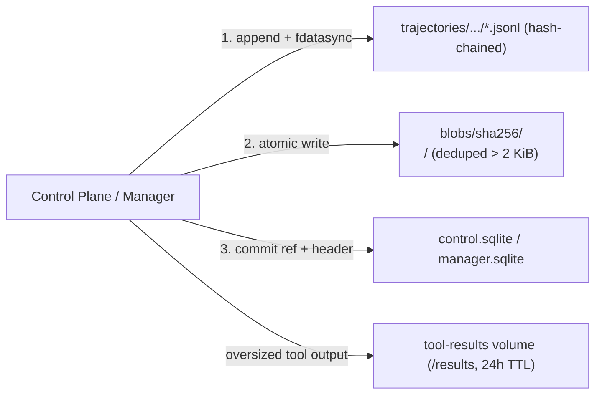

# 存储架构、轨迹文件、工作区与项目知识引擎

本文说明控制面与 manager 的存储分层、JSONL 哈希链轨迹、数据库压缩与空间保护、共享 Git Worktree 工作区以及项目知识自由文件引擎的核心设计。

## 1. SQLite + 轨迹文件 + Blob 存储架构（`src/storage/`、`manager/trajectories.mjs`）

为避免大块模型请求、工具输出和仓库文件清单撑爆 SQLite，平台将「轻量元数据/状态/计费」与「大块正文」彻底分离：

- **JSONL 哈希链轨迹**：按运行/会话轮次/分派尝试写入 0600 权限的 `.jsonl` 文件，每行含 `seq` 与上一行 `sha256`（`prev`）；模型请求采用增量记录（仅写相对上一次请求的新增消息，最多连续 64 次增量后写完整快照）。
- **定位串与统一读取层（`src/storage/payloads.ts`）**：数据库行仅留小表头（供索引和列表查询）与定位串 `<file_id>:<offset>:<length>:<sha256>`；写顺序严格保证「先写文件并 `fdatasync`，再提交数据库引用」，绝不出现悬空引用。读取时按定位串核对长度与哈希，损坏或截断返回 `trajectory_corrupt` / `trajectory_truncated`，重复工具调用校验失败直接止损不盲目重放。
- **共享内容寻址 Blob 与渠道加密文件**：超过 2 KiB 的任务文件清单/补丁以 `sha256` 去重落盘，按项目引用计数清理；飞书附件（`channel-resources/<shard>/<id>.enc`）与交互卡片只读定义（`channel-cards/<shard>/<id>.enc`）均以 AES-256-GCM 密封原子落盘、SQLite 仅存轻量元数据与状态，由定期/手动回收统一清扫过期与孤儿文件并计入存储页统计。
- **工具结果独立卷（`tool-results`）**：超过批次预算或被上下文折叠的工具输出脱敏写入 `/tool-results/<电脑归属>/<id>.utf8`（24 小时自动清理），以只读方式挂入对应容器的 `/results`，兼顾分页读取与容器内脚本处理。
- **脱敏边界**：写入轨迹前剥离私有推理与已登记凭据原值（至少 8 字符，避免误伤普通文本），并对工具回执/事件/操作表剥离内联图片 base64；对外发布到 GitHub/飞书/公开看板额外执行令牌形态（含分段安装令牌、PEM/PGP 私钥块、Base64/URL 编码形态）白名单脱敏。

## 2. 数据库压缩、按天回收与剩余空间保护

- **WAL 封顶与启动压缩（`manager/compaction.mjs`）**：两个 SQLite 连接均设 `PRAGMA journal_size_limit = 512 MiB`；启动前若空闲页 > 30% 且 > 1 GiB 且磁盘余量充足，自动执行 `VACUUM INTO` 切换为 `auto_vacuum = INCREMENTAL` 并做 `integrity_check` 原子替换；后续后台每 10 分钟分步 `incremental_vacuum` 无停机归还空间。
- **按天数清理**：控制面启动后及每日分批按保留天数清理过期轨迹文件、Webhook 正文、超龄 `commit_checks` 与已结束 `event_subscriptions`；manager 默认每小时清理关闭超过 2 天的重复操作正文（过期后重放返回 `410 operation_result_expired`）。
- **三层剩余空间保护**：
  1. 低于保留空间（总容量 5% 与 50 GiB 取小）时暂停后台迁移写入并告警；
  2. 新任务启动前校验数据盘底线（≥ 10 GiB 或近期单任务峰值的 3 倍）；
  3. 项目电脑 `runner/disk.mjs` 实时监控工作卷（< 1% 或 < 1 GiB 判定写满），拒绝写盘并返回 `disk_full` 进入等待环境，不消耗失败重试次数。

## 3. 代码快照与共享 Git Worktree 工作区（`src/agent/git-cache.ts`、`src/projects/worktrees.ts`）

- **控制面 Bare Mirror + 增量 Pack 同步**：控制面在 `/data/git-cache/<repo_id>.git` 维护只读裸镜像（令牌仅经一次性进程环境传入 `git fetch`，不落配置或日志），向项目电脑 `/workspace/git/repo.git` 仅传输缺失对象的 pack，并把提交固定在 `refs/bot/commits/<sha>`；镜像不可用时自动降级到 GitHub API 逐文件构建快照。
- **按需延迟绑定 Worktree**：准备阶段只同步对象库，任务首次读代码或跑命令时才绑定 `/workspace/worktrees/<id>`（软链到任务目录 `repo`）；纯不碰代码的任务不创建 worktree。
  - 只读任务优先复用同提交、无改动的就绪 worktree（保留 `.gitignore` 忽略的依赖和构建缓存）；
  - 写任务始终独占新建 worktree；观察者与独立 QA 各自绑定停在候选提交上的只读 worktree；
  - 写索引前自动检测并清理超过 10 秒且无活跃 git 进程持有的残留 `*.lock`。
- **定期回收**：每小时按任务生命周期清理 `/workspace/tasks` 与 `/workspace/worktrees`（未结束任务与开放 PR 关联工作区不删，已合并/关闭 PR 下一轮删，成功/取消默认保留 1 天、失败保留 7 天，且保护 30 分钟内活跃目录）。

## 4. 项目知识自由文件与版本引擎（`src/memory/`、`manager/file-tree.mjs`）

- **单源物理存储**：每个仓库独立的持久笔记卷挂在项目电脑 `/workspace/project-notes`（`../notes/`），由 `manager` 直接提供文件操作，项目电脑未启动或重置代次时仍完整可用。
- **稳定 ID 与崩溃可恢复移动**：卷内 `.write-history/file-tree.json` 在文件锁内维护不可变文件 ID、内容寻址历史版本 blob 与移动 pending journal（崩溃重启按 inode 对账续完；若源/目标变成非普通文件导致归属不可确认，进入 `note_move_uncertain` 拒绝读写以防数据损坏；运维恢复必须停写、整卷备份并恢复经隔离验证的移动前整卷快照，严禁手工删除 pending journal，步骤见[部署、升级与运维](../features/deployment-and-operations.md#4-数据卷备份与存储维护)）。
- **与 `ProjectMemory` 兼容和授权隔离**：
  - 统一对外暴露自由文件 API（`knowledge-files`）与兼容记忆 API（`memories`），支持 `expected_revision` 并发保护、角色受众隔离（`project` vs `role:<id>`）、历史版本只读与仓库权威文档只读校验（按默认分支可达合并提交与真实 blob SHA 晋升，篡改或变更返回 `source_changed`）。
  - 角色恢复时比对可见记忆集合，仅在主体范围变化或先前可见记忆被删除/收窄时清空会话重建，避免信息越权残留。
