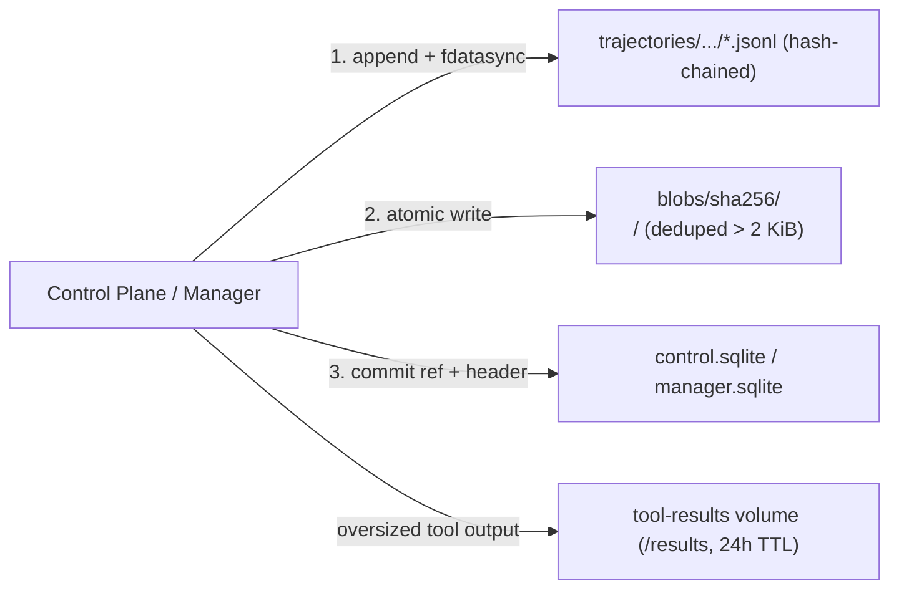

# 存储架构、轨迹文件、工作区与项目知识引擎

本文说明控制面与 manager 的存储分层、JSONL 哈希链轨迹、数据库压缩与空间保护、共享 Git Worktree 工作区以及项目知识自由文件引擎的核心设计。

## 1. SQLite + 轨迹文件 + Blob 存储架构（`src/storage/`、`manager/trajectories.mjs`）

为避免大块模型请求、工具输出和仓库文件清单撑爆 SQLite，平台将「轻量元数据/状态/计费」与「大块正文」彻底分离：

- **JSONL 哈希链轨迹**：按运行/会话轮次/分派尝试写入 0600 权限的 `.jsonl` 文件，每行含 `seq` 与上一行 `sha256`（`prev`）；模型请求采用增量记录（仅写相对上一次请求的新增消息，最多连续 64 次增量后写完整快照）。
- **定位串与统一读取层（`src/storage/payloads.ts`）**：数据库行仅留小表头（供索引和列表查询）与定位串 `<file_id>:<offset>:<length>:<sha256>`；写顺序严格保证「先写文件并 `fdatasync`，再提交数据库引用」，绝不出现悬空引用。读取时按定位串核对长度与哈希，损坏或截断返回 `trajectory_corrupt` / `trajectory_truncated`，重复工具调用校验失败直接止损不盲目重放。
- **运行快照（`task_runs.context_snapshot` / `config_snapshot`，#1403）**：每次运行开始时记录的上下文与配置快照超过 2 KiB 时写入该运行的轨迹文件（一条 `event` 记录），数据库列只留表头 `{"$trajectory": <定位串>, schema_version, sha256, original_bytes, complete, …}`；上下文与该任务上一次运行相同（`sha256` 与大小一致且文件未过期）时直接复用上一条记录，不重复写入。所有读取（`traceSource` 的 `task_runs:<id>:context|config`、运行列表 `include_snapshots=1`、角色恢复 `recoverRoleCheckpoint`）统一经 `runSnapshot()`，迁移前后读出的文本一致；存量旧行由后台迁移的 `task_runs` 阶段搬到任务的 `legacy` 轨迹文件。快照随运行轨迹文件按轨迹保留天数清理（默认不限期）。
- **单份事实与轮询免记账（`src/tasks/trace.ts`、`src/agent/workspace.ts`、`manager/projects.mjs`）**：只读轮询与探活调用（`workspace_agent_poll`、`workspace_harness_poll`、`workspace_agent_live`、`workspace_agent_runtime`）走无状态直发路径，不写 `task_tools`、`manager.operations` 与 `task_history` 的 `operation` 快照；仅保留有副作用的操作（命令、写文件、检出、发布）的状态轨迹。运行日志只在 `task_logs` 单份保存（大日志落轨迹文件），不再通过触发器复制为 `task_history.runtime_log`，`traceSource('task_logs:<id>')` 直接读取原表并兼容历史 `runtime_log` 行。
- **共享内容寻址 Blob、角色意见箱与渠道加密文件**：超过 2 KiB 的任务文件清单/补丁以及 `development_candidates` 的文件数组（`files`、`snapshot_files`、`skipped_files`）以 `sha256` 去重落盘（SQLite 仅存轻量元数据与引用，存量旧行由后台迁移自动外置，分支发布确认后自动剥离内联 base64 正文），按项目引用计数清理；飞书附件（`channel-resources/<shard>/<id>.enc`）与交互卡片只读定义（`channel-cards/<shard>/<id>.enc`）均以 AES-256-GCM 密封原子落盘、SQLite 仅存轻量元数据与状态，由定期/手动回收统一清扫过期与孤儿文件并计入存储页统计。**角色意见箱（`src/feedback/storage.ts`）** 采用「SQLite 轻量索引表 `feedback_entries`（零大正文/快照列、不设 `repositories(id)` 外键、冻结 `repository_full_name`，删除项目后历史意见仍保留）+ 明文 gzip 压缩文件 `<dirname(dbPath)>/feedback/<id[:2]>/<id>.json.gz`（生产路径 `/data/feedback/...`，不加密以便离线用 `gunzip` 直接排查）」：写入前经 `configuredRedactor`、`publicContent`、`redactEgress` 脱敏并通过 `assertSecretFree` fail-closed 拦截凭据泄漏，以 `0o600` 临时文件写入 → `fdatasyncSync` → 原子 `renameSync` 后再提交 SQLite 索引（含幂等去重唯一索引 `(idempotency_scope, idempotency_key) WHERE idempotency_key IS NOT NULL`）；读取采用 `O_RDONLY | O_NOFOLLOW` + `fstatSync().isFile()` + 解压长度上限 + `payload_sha256` 校验，任何缺失、符号链接、篡改或损坏均 fail-closed 返回 `409 feedback_payload_corrupt`；`StorageReport` 将 `store.feedbackDir` 计入 `storageFootprint` 与 `summary.known.feedback`，`RetentionCleanup` 每日与手动回收均清扫 >1 小时孤儿 `.json.gz`/`.tmp` 文件，并按可选 `feedback_days`（默认 `null` 永久保留，范围 `[1, 3650]`）裁剪超龄意见。
- **高频索引保障**：`task_runs` 在 `task_id` 之外同时维护 `operation_id`、`(lease_scope, status)` 与 `role_instance_id` 索引，避免大库下租约、操作去重与角色实例查询退化为全表扫描。
- **工具结果独立卷（`tool-results`）**：超过批次预算或被上下文折叠的工具输出脱敏写入 `/tool-results/<电脑归属>/<id>.utf8`（24 小时自动清理），以只读方式挂入对应容器的 `/results`，兼顾分页读取与容器内脚本处理。
- **项目隔离只读工具卷（`project-tools`，`src/projects/tools.ts`、`src/projects/tools-archive.ts`）**：所有写入统一经控制面流式落盘至 `/project-tools/<repository_id>/staging-<id>/`（零整包内存缓冲防 OOM），接收流前校验文件系统安全预留（低于预留直接返回 `507 project_tools_disk_full`），支持单文件与纯 Node 流式/FD 解压 `.tar.gz`/`.zip`（拒绝路径穿越、`..`、绝对路径、硬链、设备/FIFO 及逃逸符号链接；增量 `merge` 模式先核验当前生效快照目录存在性，缺失时 fail-closed 返回 `409 project_tools_revision_missing_on_disk`，随后通过硬链接复用未改动文件且覆写前先 `unlink` 保护旧快照不可变），封存前强制校验单快照配额（默认 20 GiB，超管可在 1–200 GiB 调整；历史保留版本与活跃版本共享未改动硬链接）、常见凭据文件名（`.env`、`*.pem`、`*.key`、`id_rsa` 等）与 `configuredRedactor` 已登记密钥明文，校验通过后清理可能由崩溃遗留的同号未提交孤儿目录再原子 `rename` 为 `rev-<N>` 并提交 `project_tool_state` / `project_tool_revisions` 与 `audit`。GC 保留当前生效版本与最近 3 个历史版本，清理前调用 manager `GET /v1/project-tools/mounts` 核验（manager 不可达时失败关闭），绝不删除任意运行中项目电脑或助手电脑正在挂载的版本；删除项目时在事务与提交后清理数据库记录及 `/project-tools/<repository_id>/` 目录。`StorageReport` 在 `refresh()` 预计算每项目工具卷状态并通过 `storageFootprint(..., byProject: true)` 统计磁盘实际占用（硬链接只计一次、`view()` 零额外表扫描），纳入存储页项目占比与采集明细，且 `project-tools` 卷带 `department.bot.kind: project-tools` 标签避免在 `docker_volumes` 中重复计费。
- **脱敏边界**：写入轨迹前剥离私有推理与已登记凭据原值（至少 8 字符，避免误伤普通文本），并对工具回执/事件/操作表剥离内联图片 base64；项目电脑操作的输入和工具回执由 `manager/trajectory-redaction.mjs` 在写入轨迹前处理；对外发布到 GitHub/飞书/公开看板额外执行令牌形态（含分段安装令牌、PEM/PGP 私钥块、Base64/URL 编码形态）白名单脱敏。

## 2. 数据库压缩、按天回收与剩余空间保护

- **WAL 封顶与启动压缩（`manager/compaction.mjs`）**：两个 SQLite 连接均设 `PRAGMA journal_size_limit = 512 MiB`；启动前若空闲页 > 30% 且 > 1 GiB 且磁盘余量充足，自动执行 `VACUUM INTO` 切换为 `auto_vacuum = INCREMENTAL` 并做 `integrity_check` 原子替换；后续后台每 10 分钟分步 `incremental_vacuum` 无停机归还空间。
- **按天数清理**：控制面启动后及每日分批按保留天数清理过期轨迹文件、Webhook 正文、超龄 `commit_checks` 与已结束 `event_subscriptions`；manager 默认每小时清理关闭超过 2 天的重复操作正文（过期后重放返回 `410 operation_result_expired`）。
- **三层剩余空间保护**：
  1. 低于保留空间（总容量 5% 与 50 GiB 取小）时暂停后台迁移写入并告警；
  2. 新任务启动前校验数据盘底线（≥ 10 GiB 或近期单任务峰值的 3 倍）；
  3. 项目电脑 `runner/disk.mjs` 实时监控工作卷（< 1% 或 < 1 GiB 判定写满），拒绝写盘并返回 `disk_full` 进入等待环境，不消耗失败重试次数。

## 3. 代码快照与共享 Git Worktree 工作区（`src/agent/git-cache.ts`、`src/projects/worktrees.ts`）

- **控制面 Bare Mirror + 增量 Pack 同步**：控制面在 `/data/git-cache/<repo_id>.git` 维护只读裸镜像（令牌仅经一次性进程环境传入 `git fetch`，不落配置或日志），向项目电脑 `/workspace/git/repo.git` 仅传输缺失对象的 pack，并把提交固定在 `refs/bot/commits/<sha>`；镜像不可用时自动降级到 GitHub API 逐文件构建快照。
- **按需延迟绑定 Worktree**：准备阶段只同步对象库，任务首次读代码或跑命令时才绑定 `/workspace/worktrees/<id>`（软链到任务目录 `repo`）；纯不碰代码的任务不创建 worktree。
  - 只读任务优先复用同提交、无改动的就绪 worktree（保留 `.gitignore` 忽略的依赖和构建缓存）；
  - 写任务始终独占新建 worktree；观察者与独立 QA 各自绑定停在候选提交上的只读 worktree；
  - 写索引前自动检测并清理超过 10 秒且无活跃 git 进程持有的残留 `*.lock`。
- **定期回收**：每小时按任务生命周期清理 `/workspace/tasks` 与 `/workspace/worktrees`：未结束任务仅保留当前 `workspace_id`、未释放的 `worktree_bindings`、当前代次可续接的角色实例/CLI 状态目录、待恢复/集成来源目录、未决候选快照目录、未结束后续任务的父目录及 30 分钟内活跃目录，旧尝试（`superseded_attempt`）与已发布旧检视轮次（`superseded_round`）的目录在下一次清理释放并按原因统计；开放 PR 关联工作区保留至合并/关闭后下一轮清理，已结束任务默认保留 1 天、失败保留 7 天。存储页同时列出每个未结束任务当前持有的目录数，便于及时发现异常增长。每个角色最新的检出快照（`role_candidate`）不按 `task_id`+`type` 逐行回表扫描任务全部历史：每个任务只在首次经现有索引读取一次（`task_history_run` 取其 run，`task_history_run_type` 按 run 取候选，另读无 run 的行），此后只按 rowid 读表尾新增行；启动后首次存储页刷新或清理逐任务预热并让出事件循环，存储页刷新在项目之间也让出。

## 4. 项目知识自由文件与版本引擎（`src/memory/`、`manager/file-tree.mjs`）

- **单源物理存储与共享组权限契约**：每个仓库独立的持久笔记卷挂在项目电脑 `/workspace/project-notes`（`../notes/`），是项目共享长期知识的唯一事实源；旧 SQLite `project_memories` 轨已淘汰并停止新写入（历史 `project_memories` 活跃非仓库文档条目经 `src/memory/migration.ts` 安全、幂等迁出到 `../notes/migrated-memories/*.md`，绝不覆盖已有同名文件；`authority="repository"` 仓库文档保留在仓库内；`traceSource` 仅在旧表存在时按项目权限只读回放历史引用）。由 `manager` 直接提供文件操作，项目电脑未启动或重置代次时仍完整可用。`manager`（`0:10001`，`cap_drop: [ALL]` 无 `CAP_DAC_OVERRIDE`）与项目电脑（`10001:10001`）通过共享组 `10001` 协作：
  - `runner/workspace.mjs` 对经任务软链（如 `/workspace/tasks/<ws>/notes/...`）或绝对路径落入知识卷的读写统一解析软链后路由至 `Notes` 协议（`0o660` 原子写入 + 历史/目录索引），禁止 `outsideRepo` 绕过以 `0o600` 裸写知识卷；
  - `runner/note-path.mjs` 与 `manager/file-tree.mjs` 在知识卷创建目录后显式 `chmod 0o770`（抵消 `manager` 的 `umask 0077`），并在属主访问时自愈缺失的组读写位；
  - 若卷内存在历史遗留的不可读条目（`EACCES`/`EPERM`），目录扫描跳过该条目并在 `quarantined` 中以 `reason: 'permission_denied'` 报告而不阻断其余健康文件；单文件读取遇权限错误返回 `503 note_permission_denied` 而非模糊的 `manager_unavailable`。
- **稳定 ID、正文检索与崩溃可恢复移动**：
  - 卷内 `.write-history/file-tree.json` 在文件锁内维护不可变文件 ID、内容寻址历史版本 blob 与移动 pending journal（崩溃重启按 inode 对账续完；若源/目标变成非普通文件导致归属不可确认，进入 `note_move_uncertain` 拒绝读写以防数据损坏；运维恢复必须停写、整卷备份并恢复经隔离验证的移动前整卷快照，严禁手工删除 pending journal，步骤见[部署、升级与运维](../features/deployment-and-operations.md#4-数据卷备份与存储维护)）。
  - `FileTree.list` 在带检索词或开启 `preview=1` 时同时检索文件路径与文本正文（受单文件 512 KiB 与单次 32 MiB 扫描上限保护，触顶时返回 `scan_limited: true`，跳过二进制与不可读 blob），返回带命中上下文的预览摘要 `preview` 与命中位置 `match_in`。
  - 历史迁出的文件名 stem 按 UTF-8 字节截断至 ≤200 字节以适配单段 255 字节上限；仅明确的单条路径/内容校验错误（如 `400 invalid_note_path`、`invalid_note_content`、`413 payload_too_large`）写入 `project_memory_migrations`（`skipped_invalid`）避免反复重试，认证/卷归属/路由缺失（`401`/`403`/`404`）等项目级或瞬时错误保持 `failed` 可重试，且启动后台迁移重试受次数上限约束。
- **全入口直连与写入凭据脱敏一致性**：
  - 控制台 `/api/repositories/:id/knowledge-files`、管理助手/群聊助手（`src/memory/management.ts`：`search_knowledge`、`read_knowledge`、`knowledge_versions`、`knowledge.revise`）、`TaskToolGateway`（`src/roles/gateway.ts`）与工作角色工具（`search_project_memory`、`read_project_memory`、`remember_project_memory`）统一直连 `manager/file-tree` 物理笔记卷，按项目授权边界（`knowledge.read` / `knowledge.write`）鉴权，不再维护角色受众隔离（`audience: role:<id>`）、审批流（`review`）、`supersedes` 链、`knowledge_fence` 或 `ProjectMemory.context()` 硬编码召回；旧 `/api/(repositories|projects)/:id/(memories|knowledge)*` 接口返回 `410 project_memory_api_removed`。
  - 所有经控制面或代理写入物理笔记卷的路径（控制台 `knowledge-files` / `notes` API、`knowledge.revise`、`remember_project_memory`、存量迁出、夜间整理工具、Pi 网关及直连 `write_file("../notes/...")`）统一执行已登记凭据脱敏；助手 `HOME` 目录的 `~/memory/` 写入（含 live 助手电脑 `write_file`、控制台轻量记忆管理 API 与夜间整理工具）亦经 fd 锚定防符号链接逃逸校验（`O_DIRECTORY | O_NOFOLLOW` + `/proc/self/fd` 验证）并统一经 `configuredRedactor` 脱敏。
  - **`.write-history` 历史裁剪与孤立 Blob 回收（`runner/notes.mjs`、`manager/file-tree.mjs`、`src/storage/retention.ts`）**：`POST /v1/projects/:id/file-tree/prune` 在文件锁内按 `project_notes_keep_versions`（默认 50）与 `project_notes_keep_days`（默认 30）的并集裁剪每文件历史修订（始终保留最新版本），确认全部历史索引可读后执行 fail-closed 孤立 `.write-history/blobs/` 回收；由每日 `RetentionCleanup` 与手动「立即回收」统一调度。

## 5. 全平台夜间自动记忆整理引擎（`src/memory/consolidation-*.ts`）

控制面内置纯后台记忆整理引擎（`MemoryConsolidationService`），以独立系统提示词（`docs/prompts/memory-consolidation.md`）统一维护三类长期记忆轨，**不进入用户定时任务，也不产生任何飞书外发消息或 GitHub 写操作**：

- **三轨覆盖与隔离**：
  1. **项目共享知识（`project`，`../notes/`）**：覆盖全部已启用项目；仅执行轻量 `workspace_init` 挂载 `../notes/`，**绝不检出默认分支代码或创建 git worktree**，避免把多分支差异误判为过时内容。提供全量分页/检索只读工具访问 `../notes/`（含版本历史）、全量历史 `tasks`、`task_history`/`task_logs`/`task_tools`/JSONL 轨迹正文（经 `traceSource` + `traceClean` + `configuredRedactor`）与 `dispatch_threads`，以及 `save_project_note` / `move_project_note` / `delete_project_note`（软删入 `.write-history` 支持控制台一键恢复）。
  2. **飞书群聊助手私有记忆（`group_assistant`，群 `~/memory/`）**：覆盖全部启用且活跃的群绑定；经短时助手电脑运行（`egress: false`、`fileTools: 'none'`、`commands: false`），写/删工具硬性限定在 `~/memory/<subpath>`（拒绝 `~/memory` 目录本身、越界路径、敏感凭据文件名与符号链接）。全量只读检索本地消息账本（严格执行 `deleted=0`、`sensitive=0`、`retained_after` 与当前授权 `fence`）、会话摘要、本地成员缓存（零飞书 API 调用）、本群自管任务及群权限允许的项目上下文。
  3. **个人管理助手私有记忆（`personal_assistant`，个人 `~/memory/`，跨 Web 控制台与绑定飞书私聊共享）**：覆盖全部活跃且具备助手使用资格的人类账号；全量只读检索本人非 onboarding Web 管理会话（受 `authorization_revision` 与当前租户约束）、本人已绑定且未过期的飞书私聊账本（`channel_personal_owners` 联合有效 `external_identities`）、自管任务与授权项目上下文，写/删同样硬性限定在 `~/memory/<subpath>`。
- **固定 Pi 后端与无单次上限契约**：
  - 整理会话固定采用 `roleHarness('pi')`（无其他后端选项），不设人工 `max_turns` / `max_tokens` / `max_wall_ms` 截断上限，依靠 Pi SDK 自动上下文压缩、`ResultSession` `/results/` 外置分页与实时 `guard()` 中止机制保障长历史自由深读。
  - 全协议平台模型统一经控制面透传模型网关（`src/harness/model-gateway.ts`）转发，为 `task.kind === 'memory.consolidation'` 按范围实施模型鉴权，真实 API Key 绝不进入项目电脑或助手电脑，全部用量统一归入 `model_requests`。
- **调度、让位与生命周期一致性**：
  - 默认全局开启（`settings.memory_consolidation.enabled = true`，窗口 `02:00`–`05:00`，支持跨零点窗口与逻辑日归属），**不设增量活动门控**；按逻辑日对全部已启用范围（`enabled_override ?? global.enabled`）以确定性哈希错峰排队，受全局 `max_concurrency`（1–8）约束，单逻辑日单范围经 `UNIQUE(scope_kind, scope_id, logical_day) WHERE trigger='nightly'` 保证至多运行一次（失败不刷屏重跑，重启时 `interruptConsolidationRuns` 收口遗留 `running` 记录）。
  - 夜间触发遇实时工作占用（项目并发满或删除中、群存在运行中回合、个人存在待处理/运行中管理消息）自动让位延后；运行中 `guard()` 持续核对范围启用状态、授权/代次/模型权限与手动停止信号。
  - 模型优先级固定为「范围专用 → 全局默认共享模型 → 主体自有模型」，不可用或权限不覆盖时记录 `skipped`（`model_unavailable`）绝不静默切换；项目删除、群停用/连接器删除与模型删除分别级联停止在途整理并清理对应状态、历史记录或模型引用。

## 6. 统一可复用文件同步与冲突处理引擎（`src/sync/`、`runner/sync-client.mjs`）

为支撑分布式 Linux Docker 节点与非阻塞助手预热，同时保留容器内目录直接供 `rg`/`jq`/`sed`/`python` 本地批处理的体验，平台建设**唯一一套可复用**的文件同步与冲突处理引擎（`FileSyncEngine`），不依赖 NFS/FUSE，6 类宿主机目录仅通过声明式 `SyncNamespacePolicy` 与轻量 `SyncNamespaceAdapter` 接入，严禁各自重复实现同步或合并逻辑：

- **6 类平台目录的声明式策略映射（`src/sync/namespaces.ts`、`src/sync/adapters.ts`）**：

| 命名空间 | 容器挂载路径 | 模式 | 不可变 | 冲突策略 | 脱敏 / 历史 | 底层权威源与同步特性 |
| --- | --- | --- | --- | --- | --- | --- |
| `tool-results` | `/results` | `ro` | 是 | `reject` | 否 / 否 | 绑定 `ToolResultFiles`（`/tool-results/<owner>`），支持 `?paths=...` 单文件懒拉取 |
| `project-tools` | `/opt/project-tools` | `ro` | 否（版本化） | `reject` | 否 / 否 | 直接复用 `project_tool_revisions.manifest` 与 `sha256` 增量同步 `rev-<N>`，支持受控内部相对软链 |
| `agent-tools` | `/opt/agent-tools` | `ro` | 否（版本化） | `reject` | 否 / 否 | 按 `linux/<arch>`（可选 `<product>@<version>`）增量缓存对应 CLI 与 `node`/`uv` 运行时，保留可执行位与受控内部相对软链 |
| `skill-store` | `/opt/bot-skills` | `ro` | 是（内容寻址） | `reject` | 否 / 否 | 按 `projects/<repoId>`、`service` 或精确 `sets/<hash>` 增量同步并硬链接复用 |
| `project-notes` | `../notes/` | `rw` | 否 | `merge_or_conflict_copy` | 是 / 是 | 共享 `VersionedDirectoryAdapter`（或单机 `ManagerProjectNotesAdapter` 桥接 `/v1/projects/:id/file-tree`），沿用 `.write-history` |
| `assistant-homes` | `~/memory/` | `rw` | 否 | `merge_or_conflict_copy` | 是 / 是 | 与 `project-notes` 复用同一 `VersionedDirectoryAdapter` + `.write-history`，仅同步 `memory/` 子树（`/workspace` 与 `/tmp` 保持临时卷不同步） |

- **统一协议、CAS 对象缓存、生命周期与 `BlobStore` 抽象（`src/sync/http.ts`、`src/sync/blob-store.ts`、`src/sync/storage.ts`、`runner/sync-client.mjs`）**：
  - 控制面在单一业务端口提供受控 HTTP 端点：`GET /sync/:namespace/:scope/manifest?since_rev=...&paths=...`、`POST /sync/:namespace/:scope/blobs/fetch`、`GET /sync/:namespace/:scope/blobs/:sha256`、`POST /sync/:namespace/:scope/blobs/put`、`POST /sync/:namespace/:scope/commit`、`GET /sync/:namespace/:scope/conflicts` 与 `GET /sync/:namespace/:scope/history?path=...`；同时为超级管理员提供持久化的令牌管理接口 `GET /api/sync/tokens`、`POST /api/sync/tokens`、`DELETE /api/sync/tokens/:id`（受会话/Origin/CSRF 与 `superAdmin` 保护，签发与吊销写入 `audit`）。
  - SQLite `sync_scope_revisions` 与 `sync_scope_entries` 为全部 6 类命名空间维护统一的单调范围修订号与单文件增量变更检查点，兼容控制台或宿主机带外修改；当底层卷根目录或已同步/已注册作用域的物理目录缺失或不可读时，适配器 **fail-closed 返回 `503 sync_scope_unavailable`**，严禁返回空清单导致客户端误删本地文件。
  - 控制面抽象 `BlobStore` 接口（默认 `LocalDiskBlobStore` 落在 `store.syncBlobsDir`，即 `bot-data/sync-blobs/blobs/sha256/<aa>/<bb>/<hash>`，独立于轨迹 `blobs/` 以避免与 `trajectory_blobs` 的仓库级引用计数产生跨模块 GC 冲突，并预留 `presignGet`/`presignPut` 供后续接入 S3/MinIO 预签名直传）。
  - SQLite `sync_blob_refs(namespace, scope, sha256, bytes, staged, updated_at)` 同时承担**作用域级 CAS 归属隔离**与**可回收引用计数**：`sync-blobs/` 计入 `StorageReport`（`host.known.sync_blobs`）；删除项目（`deleteProjectRecords` / `ProjectRemoval`）与清理助手 HOME（`AssistantHomes.clear` / `sweepSealed`）级联删除对应 `sync_*` 行并清扫无引用 blob；每日 `RetentionCleanup` 与 `ManualReclaim` 自动裁剪超龄 `sync_conflicts`（30 天 / 单范围 1000 条）、未提交暂存引用（24 小时）、旧缓存引用（30 天）、过期/已吊销 `sync_tokens`（7 天）及无引用 blob 与残留 `.tmp-*`；各只读适配器的路径哈希缓存统一采用有界 LRU（`ScopedBlobPathCache`）。
  - 客户端 `runner/sync-client.mjs` 维护按 `sha256` 索引的本地 `CasCache` 缓存池（跨命名空间/作用域共享，未变文件与命中缓存文件 **0 字节传输**）：`ro` 非可执行文件优先硬链接物化（跨文件系统自动降级拷贝），`rw` 与可执行文件始终原子拷贝物化以防就地编辑污染 CAS；可写目录原子维护 `.sync-base.json`（记录每文件 `revision` 与 `sha256` 基线），且 `.sync-*` 已在 `runner/notes.mjs`、`runner/note-path.mjs`、`runner/note-catalog.mjs`、`src/projects/knowledge-files.ts`、`src/memory/project.ts`、`AssistantHomes.list` 与 `runner/assistant-files.mjs` 中与 `.write-*`/`.expired-*` 统一视为内部保留项并隐藏。
- **单文件粒度三层冲突处理（仅 `rw` 命名空间，`src/sync/merge3.ts`、`src/sync/engine.ts`）**：
  - 提交按单文件独立结算，不同文件并发写互不阻塞；`base_revision === current_revision`（或向已软删路径以 `base_revision === 0` 新建）直接提交。若与控制台并发保存发生写竞态（`note_revision_changed` / `note_path_conflict`），适配器映射为 `sync_revision_race` 并由引擎做有界刷新重试（最多 3 次）重新进入三层冲突判定，避免原始 `note_revision_changed` 穿透客户端；`ManagerProjectNotesAdapter.readRevision` 仅将 `404` 视为版本缺失，5xx/网络错误原样上抛。
  - **第 1 层（自动三方合并）**：同文件基线落后时，控制面严格从当前作用域适配器历史版本读取 `base` + `current` 与本次提交 `local` 执行 Myers 差异 + 纯文本三方行级合并；不同段落/行修改与收敛修改自动无冲突合入新版本。
  - **第 2 层（`interactive` 真冲突）**：同行/重叠/同点插入真冲突、二进制冲突或删改冲突返回 HTTP `409 sync_conflict` 及 `base / current / local` 原文、冲突块与 diff3 标记，保留本地文件与基线交由在线 Agent 语义合并重提（`SyncClient.acceptServerBase`）。
  - **第 3 层（`background` 真冲突与夜间整理让位）**：主文件 `current` 原样保留不动，将未自动合并的本地版本写入旁路冲突副本 `<stem>.conflict-<actorTag>-<ts><ext>`（过长扩展名 >64 字节自动并入 stem 截断，严格满足 POSIX 255 字节段长上限并防同名碰撞），同步记入 `.write-history` 与 SQLite `sync_conflicts` 表，零静默覆盖、零丢数据；当请求启用 `skip_if_human_edited`（夜间记忆整理）且历史修订显示 `base_revision` 之后存在人工修改（`user:*` / `console`）时，安全跳过并返回 `skipped_human_edited`。
- **安全边界与脱敏拦截**：
  - 所有 `/sync/*` 端点要求受控作用域 Bearer 令牌（`bsync_<id>.<secret>`，`SyncTokenService` 将令牌哈希持久化存储于 SQLite `sync_tokens`，常时哈希比对并绑定 `(namespace, scope, mode)` 授权与有效期，且已纳入 `runner/credential-redaction.mjs` 自识别脱敏规则）；`actor` 身份严格锚定认证主体不可伪造。
  - `blobs/fetch`、`GET /blobs/:sha256`、`commit`（`content_sha256` 与 `base_sha256`）全链路强制校验目标哈希归属当前授权 `(namespace, scope)`（`sync_blob_refs` 或当前作用域权威历史），`loadRevisionBytes` 绝不读取未核验的全局 CAS 哈希，彻底阻断跨作用域 CAS 探测、复制或借 `409 base_content` 越权读数据；`ro` 命名空间拒绝一切写操作（`403 sync_namespace_readonly`）。
  - 对 `redact: true` 命名空间（`project-notes`、`assistant-homes`），默认采用 **`redactionPolicy: 'reject'`**（与 `project-tools` 一致的 fail-closed 拦截策略，保持严格 CAS 哈希一致）：含已登记凭据、令牌模式或 PEM 私钥块的文本与二进制载荷在进入 `BlobStore` 前即返回 `400 sync_secret_detected`（仅附带不含密钥原文的 `reason`）且不落盘；引擎同时保留可选 `redactionPolicy: 'redact'` 模式供定制命名空间显式启用服务端原地脱敏回传。敏感路径（`.env`、`*.pem`、`*.key`、`id_rsa`、`.ssh/`、`.aws/` 等）一律 fail-closed 拒绝（`400 sync_sensitive_path`）。
  - 服务端与客户端双重校验路径规范化（拒绝 `..`、绝对路径、反斜杠、控制字符、`.git`、`.write-*`、`.expired-*`、`.sync-*`）与 `O_DIRECTORY | O_NOFOLLOW` / `lstat` 符号链接防护，禁止任何符号链接逃逸或借 `push` 外泄宿主机文件。
