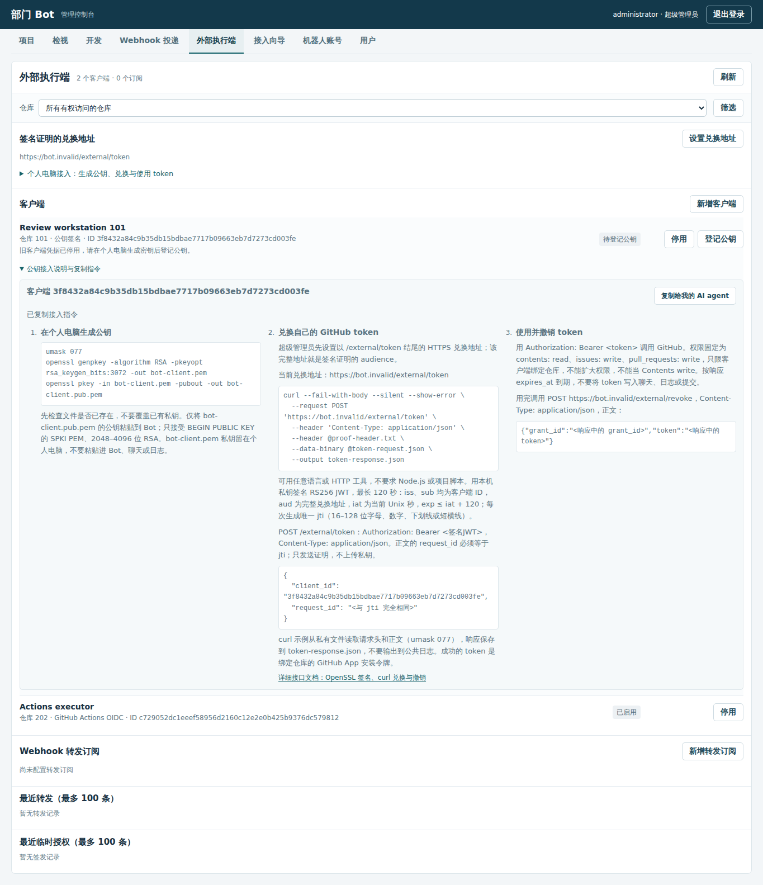
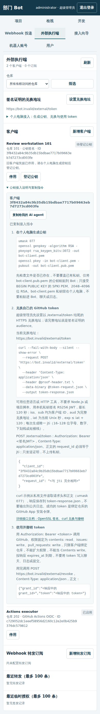

# 外部执行端：临时授权与事件转发

外部执行端可继续使用自己的检视工具。Bot 负责验证 GitHub 投递、过滤转发，并在执行端完成工作后兑换 Bot 身份的临时 GitHub 凭据。两项功能均默认关闭，没有预置客户端、仓库或订阅。

## 一次完整接入

1. 超级管理员登记 GitHub App 和目标仓库，并在 App 安装中授予 Contents read、Issues write、Pull requests write。外部凭据兑换只支持 GitHub App；不会把机器人账号的长期 Token 当作临时凭据分发。
2. 在管理入口的「外部执行端」选择「新增客户端」，绑定一个仓库。个人电脑选择公钥签名认证；GitHub Actions 选择 OIDC。项目管理员只能配置分配给自己的仓库。
3. 个人电脑在本机生成 RSA 密钥，只向 Bot 登记 SPKI PEM 公钥；私钥不离开个人电脑。管理页显示公钥指纹，支持更换公钥或停用客户端。超级管理员先在本页设置实际 HTTPS 兑换地址，作为签名证明的固定 audience。
4. 新增转发订阅，指定接收 URL、事件和动作。例如事件 `pull_request`，动作 `opened,ready_for_review,synchronize`，勾选排除草稿。保存后显示一次签名密钥，在接收端保存并校验签名。客户端私钥与转发签名密钥分开管理。
5. 外部接收端收到消息后，按转发 ID 去重，再运行原来的检视工具。检视完成后调用公开的临时凭据接口，再用取得的令牌请求 GitHub 评论／Review API。完成后调用撤销接口。

若只想使用外部检视，可保留仓库 enabled，但关闭内置 review_enabled；转发订阅有自己的启用开关，不依赖内置模型或检视开关。两边同时启用时都会处理事件，Bot 不会自动关闭其中一边。

## 管理页中的接入说明

兑换地址下方提供个人电脑接入步骤；新增客户端时，公钥输入框旁可展开密钥生成命令。每个公钥客户端（包括待登记的旧客户端）下方都有「公钥接入说明与复制指令」，登记或更换公钥的表单也提供同一说明。展开后点击「复制给我的 AI agent」，取得含该客户端 ID、绑定仓库 ID 和已配置兑换地址的纯文本指令。地址未配置时，指令会要求超级管理员先设置，再重新复制，不生成示例地址。GitHub Actions OIDC 客户端不显示这套个人电脑公钥流程。

以下使用测试数据展示桌面和窄屏入口，实际操作以页面中的客户端与兑换地址为准。





## 个人电脑认证与兑换

公开 Webhook 监听入口提供 `POST /external/token`，管理 API 保留在独立管理入口。HTTPS 反向代理应路由 `/hooks/github/` 和 `/external/`。超级管理员在「外部执行端 → 设置兑换地址」填写实际完整 HTTPS 地址，以 `/external/token` 结尾；不从传入 Host 头推导信任地址。项目管理员可读取该地址，不能修改。

在个人电脑生成新的密钥文件，私钥留在本机，公钥粘贴到管理页：

```sh
umask 077
openssl genpkey -algorithm RSA -pkeyopt rsa_keygen_bits:3072 -out bot-client.pem
openssl pkey -in bot-client.pem -pubout -out bot-client.pub.pem
```

支持 RSA 2048–4096 位、SPKI PEM 公钥（`BEGIN PUBLIC KEY`），不接受私钥或 SSH 格式。Bot 保存公钥与指纹，不生成、接收或分发客户端私钥。每个客户端仍绑定一个仓库。

取得页面中的客户端 ID 后，用任意语言或 HTTP 工具按下述接口规则兑换，不要求 Node.js 或下载项目脚本。完整的[接口说明与 OpenSSL＋curl 示例](external-token-api.md)包含本机签名、POST 兑换、调用 GitHub 和撤销；URL 必须与管理页登记的兑换地址完全一致。`scripts/external-token.mjs` 仅作为可选实现保留。

使用 RS256 签名 JWT，header 为 `alg: RS256`、`typ: JWT`，payload：

```json
{
  "iss": "<客户端ID>",
  "sub": "<客户端ID>",
  "aud": "<管理页配置的完整HTTPS兑换地址>",
  "iat": 1700000000,
  "exp": 1700000120,
  "jti": "<至少16位的随机唯一ID>"
}
```

时间戳需使用发送时的当前 Unix 秒，`exp - iat` 不得超过 120 秒，允许五秒时钟偏差。`jti` 使用 16–128 位字母、数字、下划线或短横线，推荐随机 24 字节编码。请求头是 `Authorization: Bearer <签名JWT>`、`Content-Type: application/json`；正文为 `{ "client_id": "<客户端ID>", "request_id": "<与jti完全相同>" }`。这是 JSON 凭据 broker，采用私钥签名认证，不是完整 OpenID Provider 或标准 OAuth 表单端点。

服务端用登记公钥验签，精确校验客户端、audience、时间与一次性标识，拒绝其他算法和外部密钥 URL。签发前在事务中持久占用 request_id 和身份摘要；同一个签名换 request_id 也无法重放，重启后同样有效。更换公钥或停用客户端会在后续请求及签发中途的版本复核中生效。

成功响应包含 `grant_id`、`token`、`token_type: Bearer`、`expires_at`、`repository_id` 和权限。`token` 是 GitHub App 对指定单仓库的安装令牌，权限固定为 `contents: read`、`issues: write`、`pull_requests: write`，不含 Contents write。客户端不能扩大权限或更换仓库，签发时复核仓库、所有者和 App 安装关系。

响应使用 `Cache-Control: no-store`，不进入 Webhook 归档。数据库保存公钥、请求／身份摘要、令牌摘要和签发状态，不保存客户端私钥、原始签名 JWT 或 GitHub Token。每客户端每小时最多 20 次兑换，失败签发也占用配额；上游结果未知时该请求仍被消耗，不能反复签发。

GitHub 安装令牌通常有效一小时，以实际 `expires_at` 为准。它仍是 Bearer 凭据，不能限定到单条 PR 或只调用某个 API。内置检视保持 COMMENT，外部可信工具需遵守仓库策略。更换客户端公钥或停用只阻止新的签发；已经领取的 GitHub Token 需主动撤销或等待到期。Bot 不分发 App 私钥、入口签名密钥、模型 Key 或长期账号 Token。

撤销使用 `POST /external/revoke`，正文 `{ "grant_id": "<签发ID>", "token": "<已领取令牌>" }`。不需要管理会话，但必须匹配该签发记录的令牌摘要；重复撤销幂等。

## 已有客户端迁移

升级自动将旧 client_secret 客户端改为「待登记公钥」，清除旧凭据摘要。客户端 ID、仓库、启停意图、订阅和历史保留；旧凭据立即不能兑换。原项目管理员在该客户端点击「登记公钥」，提交个人电脑生成的公钥即可恢复使用，无需重建客户端或订阅。不会在 Bot 服务器代生成个人私钥，也不保留旧凭据认证回退。

## GitHub Actions OIDC

客户端选择 GitHub Actions OIDC 时使用 GitHub 签发的身份，不登记个人电脑公钥。管理员需要配置精确的 audience、subject、工作流仓库名、不可变仓库 ID、组织 ID、workflow_ref 和分支 ref。只信任 GitHub 的固定 issuer `https://token.actions.githubusercontent.com` 及其 JWKS，验证 RS256、签名、nbf/iat/exp、最大十分钟身份年龄和 jti。

兑换接口和请求正文相同，Authorization 改为 GitHub 签发的 OIDC JWT。必须满足所有已登记身份条件；若包含 job_workflow_ref，也必须匹配登记的工作流。仅接受 schedule、workflow_dispatch、repository_dispatch 事件和明确登记的分支，拒绝 PR 身份。相同 JWT 身份只能兑换一次，记录持久化，重启后也不能重放。这是凭据 broker，不是完整的 OpenID Provider，也没有把任意传入的 JWT 当作受信任身份。

## 转发协议

接收端须可从 Bot 控制面访问。默认只接受 HTTPS，并拒绝解析到私网、回环或本地地址的目标。若接收端位于部门内网，由部署管理员在 Docker 环境变量 `BOT_FORWARD_PRIVATE_HOSTS` 中显式批准准确主机名，逗号分隔，不支持通配符。例如可登记自己的内网接收主机；不要批准管理服务或元数据地址。只有这些主机允许 HTTP 和私网连接。

DNS 检查在每次投递前执行，连接固定使用已验证的地址；不跟随重定向。网络及响应超时有界。接收端不需要开放项目容器端口，Bot 也不会改变现有项目容器的网络隔离。

请求为 JSON，包含：

```json
{
  "version": 1,
  "id": "<稳定的转发ID>",
  "subscription_id": "<订阅ID>",
  "client_id": "<授权客户端ID>",
  "repository_id": "<仓库ID>",
  "event": "pull_request",
  "delivery_id": "<GitHub delivery ID>",
  "received_at": "<首次归档时间>",
  "payload": { "action": "opened", "pull_request": {} }
}
```

`X-Bot-Delivery` 与正文 id 相同；`X-Bot-Event` 给出事件类型；`X-Bot-Signature-256` 为 `sha256=` 加 HMAC-SHA256 的十六进制摘要，计算输入是收到的原始请求字节，密钥为订阅签名密钥。应先验签再解析和执行，校验头部 ID 与正文 ID 一致，并持久保存已处理的转发 ID。原 GitHub Authorization、Cookie 和签名头不会转发；正文不包含客户端私钥或临时令牌。

归档与转发入队在同一 SQLite 事务中完成，验签失败、范围外仓库、不匹配事件和草稿不会入队。重复 delivery 不重复入队。后台在提交后投递，2xx 视为已接收；网络故障、408、429 和 5xx 指数退避重试，最多五次，其他状态失败。返回 2xx 前，接收端应已可靠接收任务，而不必等待长时间检视完成。不要让耗时检视阻塞有五秒超时的 Webhook 响应。

转发采用至少一次投递。响应丢失或 Bot 重启时可能再次发送同一个 ID，接收端负责幂等；不能把内存去重当作生产保证。订阅变更、停用或客户端公钥更换会取消尚未发送的旧任务；已经发出的网络请求无法撤回。失败投递可在管理页面重试，仍使用同一个转发 ID。

## 管理 API

这些接口使用既有登录会话和 CSRF 校验，列表即使不筛选，也只返回项目管理员已分配仓库的数据。

| 路径 | 方法 | 内容 |
| --- | --- | --- |
| `/api/external/settings` | GET / PUT | 读取固定 token_audience；只有超级管理员可保存完整 HTTPS 兑换地址 |
| `/api/external/clients` | GET / POST | 客户端列表／创建；字段 name、repository_id、auth_type；private_key_jwt 必须提供 public_key，OIDC 提供 trust |
| `/api/external/clients/:id` | GET / PATCH | 读取元数据、公钥与指纹；enabled 启停、public_key 登记或更换公钥 |
| `/api/external/subscriptions` | GET / POST | 列表／创建，字段 client_id、name、url、filters；签名密钥只在创建时返回 |
| `/api/external/subscriptions/:id` | GET / PATCH | 更新 name、url、filters、enabled 或 rotate_secret；读取不含密钥 |
| `/api/external/deliveries` | GET | 最近 100 条转发状态、尝试次数与错误码 |
| `/api/external/deliveries/:id/retry` | POST | 重试失败投递 |
| `/api/external/grants` | GET | 最近 100 条签发记录，无原始凭据和身份 JWT |

列表均可用 repository_id 筛选。订阅签名密钥只在创建／轮换时显示一次。公钥可读，客户端私钥永不上传或回显。凭据兑换失败不降级为长期 PAT，不调用模型或读取其他项目材料。

## 参考

- [GitHub App 安装令牌及权限限制](https://docs.github.com/en/rest/apps/apps#create-an-installation-access-token-for-an-app)
- [撤销安装令牌](https://docs.github.com/en/rest/apps/installations#revoke-an-installation-access-token)
- [GitHub Actions OIDC 身份字段](https://docs.github.com/en/actions/reference/security/oidc)

- [OAuth 非对称客户端认证建议](https://www.rfc-editor.org/rfc/rfc9700.html#section-2.5)
- [JWT 客户端认证与防重放](https://www.rfc-editor.org/rfc/rfc7523.html#section-3)
