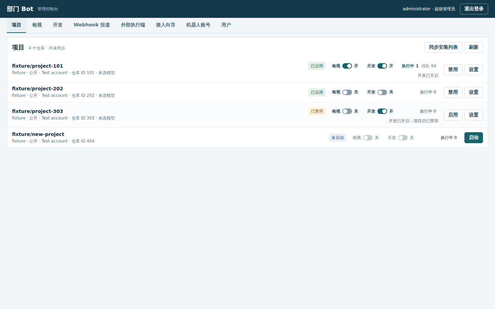
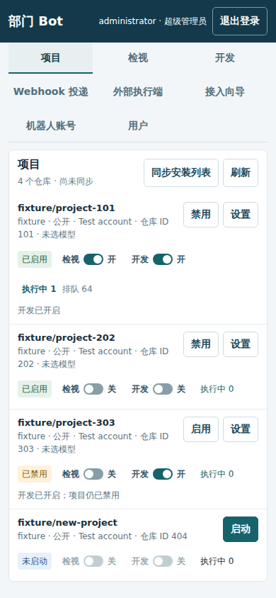
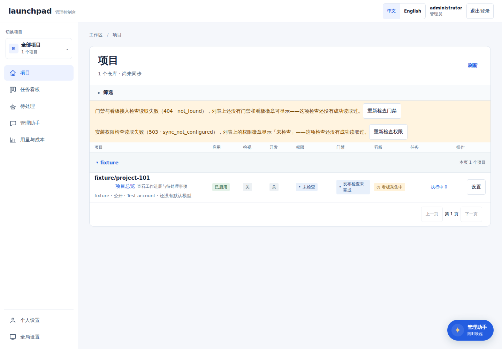
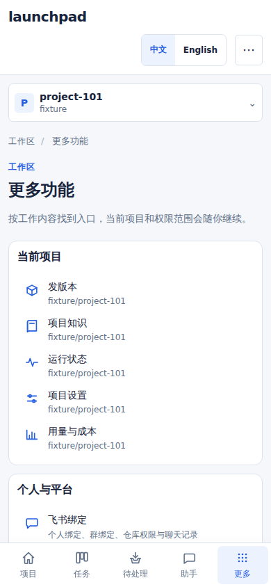

# 控制台、项目总览、知识库、发版本与公开看板

本文介绍 launchpad 控制台的日常使用界面、项目追踪视图、项目知识库、手动发版本以及公开看板。前端壳层与 API 设计见 [控制台前端架构与管理 API 总览](../design/console-and-api.md)。

## 1. 控制台导航与项目列表

控制台采用「左侧工作区侧栏 + 右侧固定顶栏」布局（手机端自动切换为底部四入口「项目 / 待处理 / 助手 / 更多」）：

- **全部项目范围**：项目列表（`#/projects`）、待处理（`#/inbox`）、管理助手（`#/management`）、用量与成本（超管，普通管理员在「更多」中进入），底部固定「个人设置」与「全局设置（仅超管）」。
- **单项目范围**：通过侧栏项目切换器进入单个项目后，侧栏展示项目总览、待处理、管理助手、发版本、项目知识、运行状态与项目设置（共 8 个类别：基本设置、监听与触发、机器配置、角色、模型、定时任务与通知、外部执行、成员）。
- **项目列表快捷操作**：每行展示项目状态、**检视 / 开发快捷开关**（即能力上限快捷切换）、权限/事件缺口提示、**公开看板开关**、实时执行中/排队任务数，以及「项目设置 / 启动 / 开始接入」入口。

## 2. 项目总览、任务详情与待处理中心

### 项目总览四视图（`#/projects/<id>/overview`）

控制台不再使用旧式跨项目自定义任务看板，所有单项目工作集中到总览的四个视图中，并每 5 秒原地刷新状态：

1. **角色视图（默认）**：按启用角色列出后端与模型、容量上限、当前运行中任务及排队队列。
2. **任务视图（`overview/tasks`）**：支持按状态分组（进行中 / 排队中 / 待处理 / 已完成 / 全部）与关键词检索，每行直观展示关联 Issue/PR、CI 检查简标与横向**角色流转框图**。
3. **Issue 进展（`overview/issues`）**：将所有关联任务聚合回 Issue，归入 7 个互斥状态（已开 PR、开发中、需补充信息、需人工决定、开发受阻、无需/暂不开发、待检视），支持展开完整检视结论与 Manager 分派链路。
4. **PR 进展（`overview/prs`）**：将任务聚合回 PR，归入 6 个互斥状态（需人工处理、跟进修改中、检视中、已检视、草稿、待检视），支持筛选「仅 Bot PR」并展开完整处理链路。

### 独立任务详情与新建任务

- **任务详情（`#/tasks/<id>`）**：展示任务目标与验收标准、关联 Issue/PR 与实时同步的 GitHub Actions 检查状态、可点击定位的角色流转框图，以及按「角色运行 → 单步工具/命令执行」两层折叠的过程时间线（运行中每 2 秒增量更新输出，只展示公开输出与命令，不暴露私有推理）。故障任务直接标明原因分类与下一步操作建议；父任务的全部未返回子任务都在等待项目电脑或配置时，详情会汇总每个子任务的编号、状态、错误码与恢复条件，提供可直接打开子任务的入口。汇总原因取自各子任务自身的错误归因：一致时才给出项目电脑、角色或模型配置入口，不一致时只提供中性的子任务入口，不猜测设置页。
- **手动新建任务（`#/projects/<id>/new-task`）**：填写原始需求、目标、范围、验收条件与交付类型（报告或可检视 PR）。
- **待处理中心（`#/inbox`）**：汇总需要人工关注的任务（失败、暂停、配置待补、环境/权限/发布等待、需重新规划）以及未受信任组织的仓库启动申请；已被新任务取代、对象已关闭或超期临时失败的任务会自动移出，保持列表清爽。

## 3. 项目知识库（`#/projects/<id>/knowledge`）

每个仓库拥有独立持久的「项目知识」空间，与项目电脑内的 `../notes/`（`/workspace/project-notes`）互通，电脑未启动、重建或重置代次时数据均完整保留：

- **目录树与预览**：左侧目录树浏览文件与子目录、右侧预览 UTF-8 文本/Markdown（支持 Mermaid 流程图）或下载二进制文件，支持跨全部目录按文件名、路径和文本正文搜索并展示命中预览摘要。
- **编辑与版本历史**：支持新建目录/文件、重命名/移动、在线编辑（带并发版本冲突检测与对比、写入自动脱敏已登记凭据）、删除与从历史版本恢复（恢复创建新版本，不覆盖历史）；管理助手、群聊助手与项目内工作角色统一读写同一份物理知识文件。

## 4. 手动发版本（`#/projects/<id>/releases`）

超级管理员或项目管理员可在项目「发版本」页执行受控发布（前提：仓库配置了发布 CI 与版本标签触发的 `.github/workflows/release.yml`）：

1. **版本预检**：输入目标 SemVer 版本（如 `v1.2.3`、`v1.2.3-rc.1`）并核对完整提交 SHA。相对上一可达版本标签无新增提交，或版本号未高于上一版本时，页面与服务端均拒绝确认。
2. **自动打标签与跟踪 CI**：确认后由 GitHub App 创建注释标签并跟踪对应 Release 工作流；运行失败不会自动重跑，也不会移动或删除同名标签，可按需触发 AI 运行分析排查日志。
3. **发行说明草稿与人工发布**：全部 job 成功后，控制面基于本次版本区间内的真实提交与已合并 PR（如仓库存在 `.agents/skills/release-notes/SKILL.md` 则按该规则组织）创建 GitHub Release 草稿，最终由人在页面编辑并点击 **「正式发布」**。

## 5. 公共 Dashboard 与单仓公开看板

launchpad 随同一业务端口（`8791`）内置托管公开看板，**无需控制台登录**即可访问，也不依赖 GitHub Pages：

- **公共 Dashboard（`<公网入口>/dashboard/`）**：汇总所有开启看板的仓库的社区统计指标（Issue、PR、贡献者、增长与版本）。
- **单仓看板（`<公网入口>/boards/<owner>/<repo>/`）**：展示单仓的 Issue/PR 概览、发版记录、近 30 天 Actions 运行态势，以及各 workflow/job 成功率、耗时中位数/P90 与定时运行趋势图（自动从 Check Run 输出的 Markdown 表格、JUnit XML 或简单 JSON 产物提取指标）。
- **可见性开关**：项目列表与基本设置中的「看板」开关独立控制单个仓库的公开与否（**公开仓默认开启，私有仓默认关闭**；超管开启私有仓看板后其数据将无需登录对外公开，关闭后立即停止对外展示）。
