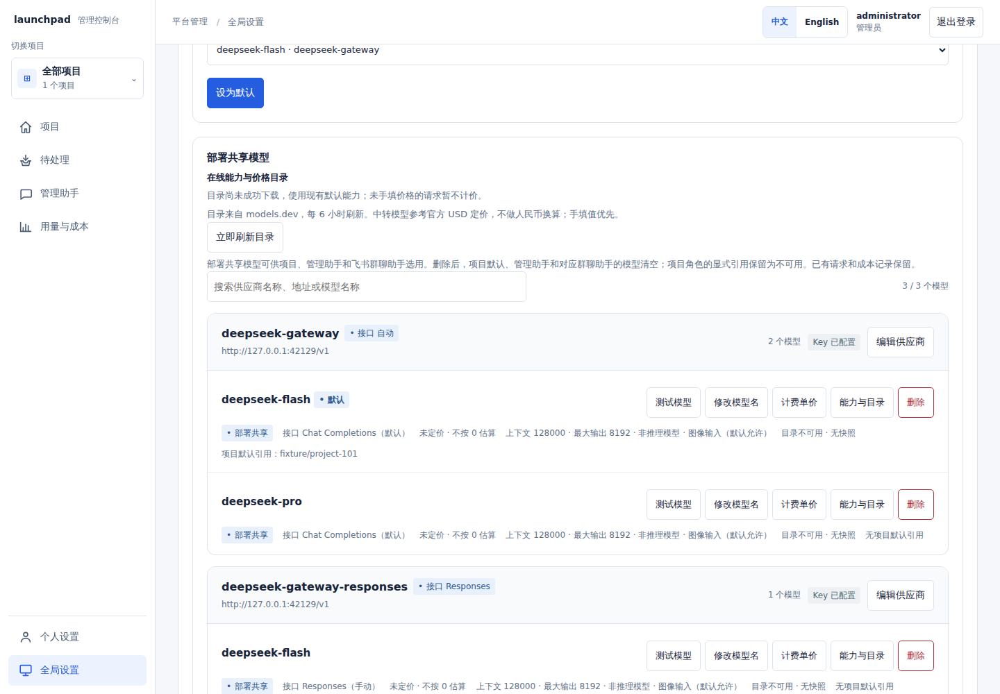

# 模型连接与用量成本

launchpad 支持按供应商统一管理兼容 Chat Completions 的模型连接、按两层结构灵活分配模型，并透明追踪模型 token、费用与任务耗时。

## 1. 供应商与模型配置

模型配置分为两类：

- **部署共享模型**（「全局设置 → 模型」，仅超级管理员可增删改）：默认对所有项目可用，超管也可将其限定授权给部分仓库；项目管理员在项目页只读查看并选用。
- **项目专属模型**（项目「模型」页，项目管理员与超管可管理）：仅归属当前项目，保存即视为可信，可向该端点发送本项目代码与日志。

### 统一供应商表单与探测

同一范围、同一请求地址下的模型按供应商分组展示，支持统一操作：

- **URL 解析规则**：按填写路径原样使用——去掉末尾 `/` 与 `/chat/completions` 后得到基址，对话请求发往 `<基址>/chat/completions`，模型列表取自 `<基址>/models`；系统**不会自动补加或删除 `/v1`**（不以 `/v1` 结尾时会给出提醒，但允许保存）。
- **获取模型列表与测试模型**：表单内置「获取模型列表」（最多拉取 200 个模型 ID，支持多选或手动填写）与单条「测试模型」（发送最小探测请求校验连通性），15 秒超时且不回显 API Key。
- **凭据安全与批量维护**：API Key 在服务端加密保存、永不回显；编辑供应商时留空 Key 保持原值，支持独立「撤销供应商 Key」；修改 URL 或填写新 Key 会原子更新该组模型。
- **模型能力与目录（models.dev）**：每条模型支持自动匹配或手动覆盖上下文窗口、最大输出、推理能力与图像输入（`image_input`，未匹配目录时默认允许尝试直传）；目录每 6 小时自动刷新，超管可手动立即刷新。
- **删除影响预检**：删除模型前会先列出当前使用它的项目默认配置、角色显式引用与初始化默认设置，确认后销毁密封 Key，但保留历史请求与费用记录。

## 2. 两层模型选择

项目任务使用简洁的两层模型解析规则：

1. **项目默认模型**：在项目「模型」页指定（`policies.model_id`），作为该项目全部角色的默认模型。
2. **按角色覆写**：在项目「角色」页为个别角色（如 `manager`、`reviewer`、`dev`、`test`、`qa`）单独指定模型；未指定的角色自动继承项目默认模型。

- **严格失败关闭**：若角色显式绑定的模型被删除、撤销 Key 或取消项目授权，任务会停在「配置待补」等待修复，**绝不静默降级或切换到其他模型**。
- **服务角色与群聊模型**：全局服务角色（如管理助手）仅选用部署共享模型；项目群助手角色可选本项目专属模型或已授权的共享模型；飞书群使用的模型必须对群绑定范围内的**每一个项目**均可用。

## 3. 用量与成本统计（`#/costs`）

- **计费单价**：可在项目「模型」页（专属模型）或「全局设置 → 模型」（共享模型）设置每百万 token 的输入、输出与缓存命中单价（支持 USD / CNY），留空字段自动继承同币种 models.dev 目录价。改价只影响新请求，不回溯改写历史账本。
- **多维度统计**：按浏览器本地时区汇总所选日期范围（默认近 30 天，最长 366 天）与授权项目范围内的：
  - 每日堆叠费用柱状图、项目费用占比、输入/输出/缓存命中 token 与加权缓存命中率（若当前范围无已计价记录，自动切换按 token 展示，不伪造 0 费用）；
  - 按工作类别统计的任务数量与累计执行耗时（仅计实际执行区间，不含排队与等待）。
- **统计口径**：不同币种分别汇总、不作汇率换算；缺少单价或上游未返回 usage 的请求单独标注为未知，不按免费计算；仅统计经控制面代理的模型请求，不含外部执行端自行调用的费用。
