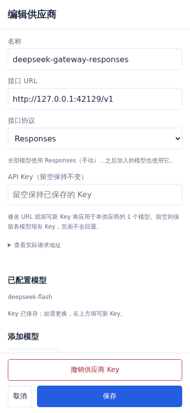
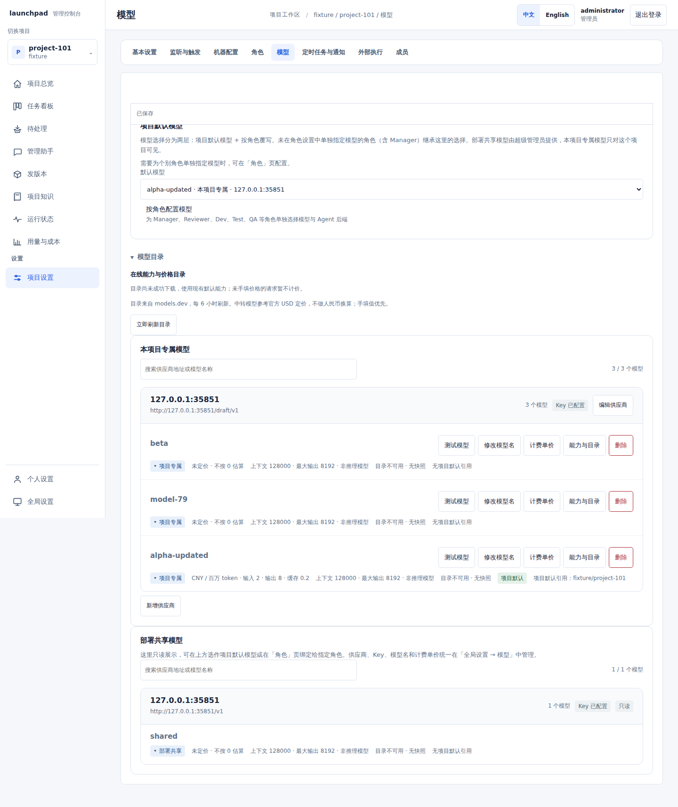
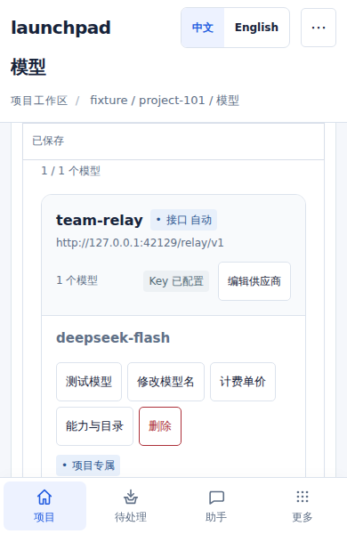

# 模型连接与用量成本

launchpad 支持按供应商统一管理 Chat Completions、Responses 与 Anthropic Messages 三种接口的模型连接、按两层结构灵活分配模型，并透明追踪模型 token、费用与任务耗时。

## 1. 供应商与模型配置

模型配置分为两类：

- **部署共享模型**（「全局设置 → 模型」，仅超级管理员可增删改）：默认对所有项目可用，超管也可将其限定授权给部分仓库；项目管理员在项目页只读查看并选用。
- **项目专属模型**（项目「模型」页，项目管理员与超管可管理）：仅归属当前项目，保存即视为可信，可向该端点发送本项目代码与日志。

### 统一供应商表单与探测

供应商是同一范围（部署共享，或同一项目）内同名的一组模型，模型列表按供应商分组展示，支持统一操作：

- **供应商名称**：新增供应商时必须填写名称（最多 100 个字符），默认取地址主机名，可随时修改；同一范围内名称不能重复（不区分大小写，重复时提示「已有同名供应商」），不同项目之间可以同名。同一个地址可以建多个不同名称的供应商，例如同一网关分别以 Chat Completions 和 Responses 接入，各自给不同角色选用。模型列表的搜索也匹配供应商名称。
- **接口协议**：每个供应商只有一个接口协议，可选「自动」、Chat Completions、Responses 或 Anthropic Messages。选定的协议写到供应商的全部模型上，之后加入该供应商的模型继承它。「自动」时每个模型按「URL 后缀 → models.dev 目录 → 默认」推断（默认为 Chat Completions，OpenAI 官方地址上的 codex 模型默认 Responses），表单在选择框下方显示推断结果和来源。鉴权头没有单独设置：手动选 Anthropic Messages 时用 `x-api-key`，手动选另外两种协议时用 `Bearer`，「自动」时按目录和地址推断。模型列表的供应商标题显示名称和协议设置，每个模型显示实际使用的协议和来源（手动、URL、目录、默认），事后可据此确认某个模型走的是哪种接口。平台不支持一个模型同时使用多种协议，也**不做跨协议格式转换**——为角色选用平台模型时，所选模型的实际接口协议必须在该角色后端支持的协议范围内。
- **URL 解析规则**：按填写路径使用，末尾的 `/` 会去掉。Chat Completions 去掉 `/chat/completions` 后得到基址，对话请求发往 `<基址>/chat/completions`、模型列表取自 `<基址>/models`，系统**不会自动补加或删除 `/v1`**（不以 `/v1` 结尾时会给出提醒，但允许保存）；Responses 以 `/responses` 结尾时原样使用，否则接上 `/responses`，只填主机时接上 `/v1/responses`；Anthropic Messages 以 `/messages` 结尾时原样使用，否则接上 `/messages`，地址不以 `/v1` 结尾时接上 `/v1/messages`。表单里的「查看实际请求地址」按所选协议显示真实地址。
- **获取模型列表与测试模型**：表单内置「获取模型列表」（最多拉取 200 个模型 ID，支持多选或手动填写）与单条「测试模型」（发送最小探测请求校验连通性），按表单所选协议发送，15 秒超时且不回显 API Key。
- **凭据安全与批量维护**：API Key 在服务端加密保存、永不回显；编辑供应商时留空 Key 保持原值，支持独立「撤销供应商 Key」；修改名称、协议、URL 或填写新 Key 会原子更新该组模型。地址和协议只能在供应商上修改，单个模型不能改成别的地址或协议。改名称和协议不改变模型版本，已固定配置的任务不会因此停下。
- **模型能力与目录（models.dev）**：每条模型支持自动匹配或手动覆盖上下文窗口、最大输出、推理能力与图像输入（`image_input`，未匹配目录时默认允许尝试直传）；目录每 6 小时自动刷新，超管可手动立即刷新。
- **删除影响预检**：删除模型前会先列出当前使用它的项目默认配置、角色显式引用与初始化默认设置，确认后销毁密封 Key，但保留历史请求与费用记录。

## 2. 两层模型选择

项目任务使用简洁的两层模型解析规则：

1. **项目默认模型**：在项目「模型」页指定（`policies.model_id`），作为该项目全部角色的默认模型。
2. **按角色覆写**：在项目「角色」页为个别角色（如 `manager`、`reviewer`、`dev`、`test`、`qa`）单独指定模型；未指定的角色自动继承项目默认模型。

- **严格失败关闭**：若角色显式绑定的模型被删除、撤销 Key 或取消项目授权，任务会停在「配置待补」等待修复，**绝不静默降级或切换到其他模型**。
- **统一透传模型网关与凭据隔离**：所有平台模型（不论角色使用 `pi`、`claude_code`、`codex`、`icode` 还是 `workswarm`）均统一经控制面只读 Unix Socket 透传网关访问上游模型——长期 API Key 始终留在控制面，绝不进入项目电脑或助手电脑，即使关闭容器外网（`egress=false`）也可正常调用平台模型。
- **Claude Code 与 Codex「项目电脑内自行配置」模式（`local_config`）**：这两个容器化后端在角色配置的「模型来源」中支持切换为「项目电脑内自行配置（不注入模型配置）」。该模式与平台模型网关完全正交：选择后平台不签发模型网关调用权限（`model:invoke`）、不注册网关会话，也不注入任何模型地址、API Key、`--model`、`config.toml` 或 `-c model_provider`，且不要求项目已配置平台模型；运行前 runner 仅从项目电脑的 `/workspace/home` 复制白名单配置文件（Claude Code：`.claude/settings.json`、`.claude/.credentials.json`；Codex：`.codex/config.toml`、`.codex/auth.json`）到当前会话的隔离目录，运行结束后立即清除副本。若对应配置文件均不存在，任务会以 `claude_local_config_missing` 或 `codex_local_config_missing` 停在「配置待补」，绝不回退到平台模型。管理员可在「项目设置 → 机器配置」的只写入口中写入或删除这些配置文件（控制面不读取、不保存、不回显文件内容；注意 `/workspace/home` 内的凭据对同项目任意 Agent 原生 Shell 可见）。
- **选择时可区分同名模型**：项目默认模型、角色模型、全局设置的初始化默认模型、管理助手和群聊绑定等所有选择模型的地方，选项都显示为「模型名 · 供应商名称」，两个供应商下的同名模型可以区分。
- **管理助手与群聊模型**：平台级管理助手仅选用部署共享模型；飞书群聊助手直接在群绑定中选择模型（单仓库群可选本项目专属模型或已授权的共享模型，多仓库或整个组织群选用覆盖全部范围的共享模型；若组织群使用受限共享模型且该组织后续新增了未获授权的仓库，群会失败关闭并暂停直到补齐授权或更换模型，尚无已启用项目的空组织拒绝受限共享模型）；飞书群使用的模型必须对群绑定范围内的**每一个项目**均可用。

## 3. 用量与成本统计（`#/costs`）

- **计费单价**：可在项目「模型」页（专属模型）或「全局设置 → 模型」（共享模型）设置每百万 token 的输入、输出与缓存命中单价（支持 USD / CNY），留空字段自动继承同币种 models.dev 目录价。改价只影响新请求，不回溯改写历史账本。
- **多维度统计**：按浏览器本地时区汇总所选日期范围（默认近 30 天，最长 366 天）与授权项目范围内的：
  - 每日堆叠费用柱状图、项目费用占比、输入/输出/缓存命中 token 与加权缓存命中率（若当前范围无已计价记录，自动切换按 token 展示，不伪造 0 费用）；
  - 按工作类别统计的任务数量与累计执行耗时（仅计实际执行区间，不含排队与等待）。
- **统计口径**：不同币种分别汇总、不作汇率换算；缺少单价或上游未返回 usage 的请求单独标注为未知，不按免费计算；所有平台模型调用统一经控制面透传模型网关记入 `model_requests` 账本（不含外部执行端自行调用的费用）。在「项目电脑内自行配置」模式下，Codex 按 CLI 原生事件记入 `model_requests` 账本，Claude Code 在运行记录与轨迹 `external_model_usage` 中记录 CLI 上报的模型名与 token 用量（暂不单独写入 `model_requests` 账本），无平台模型单价时均不伪造费用。
