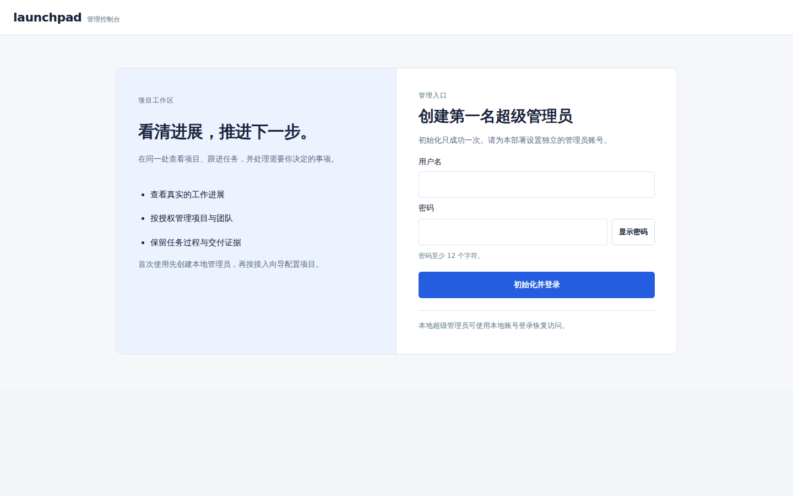
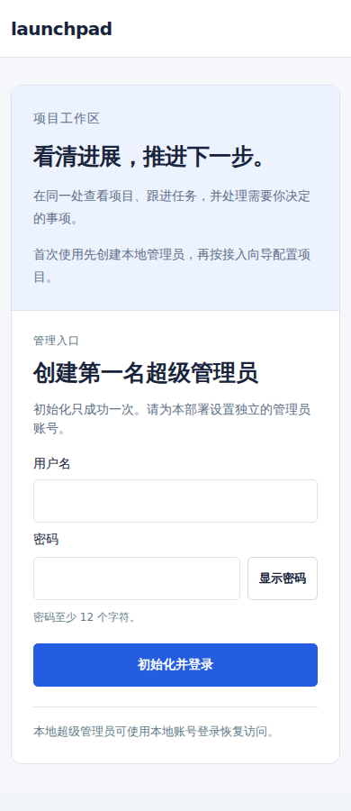
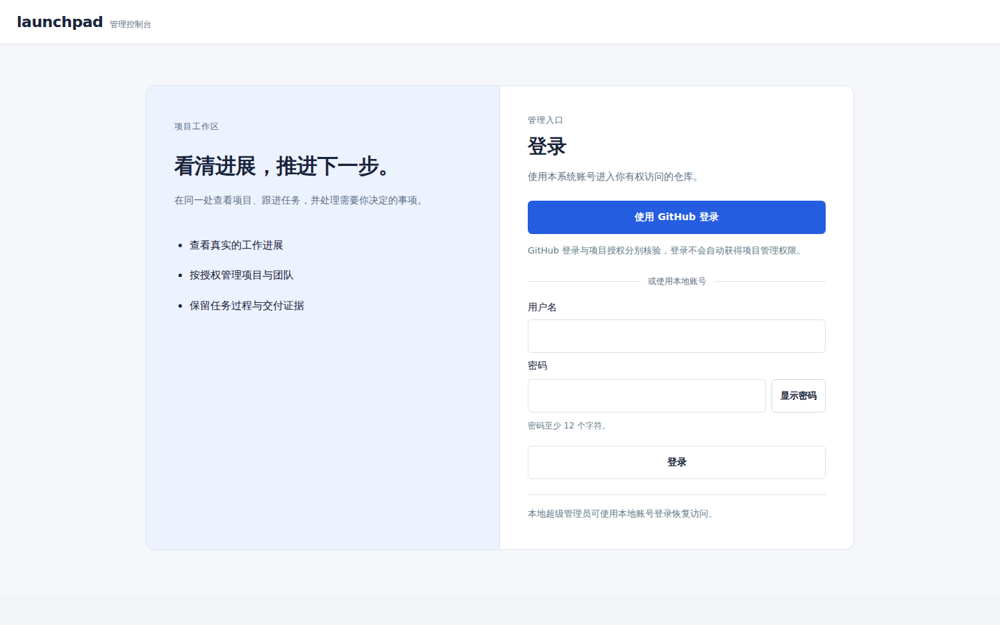
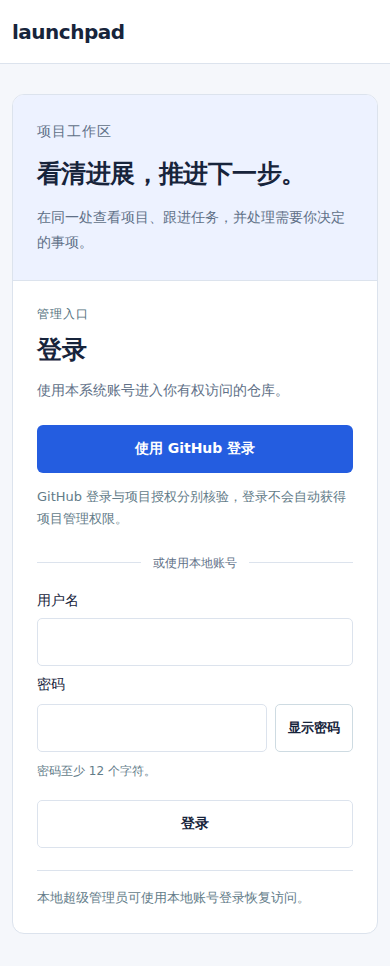
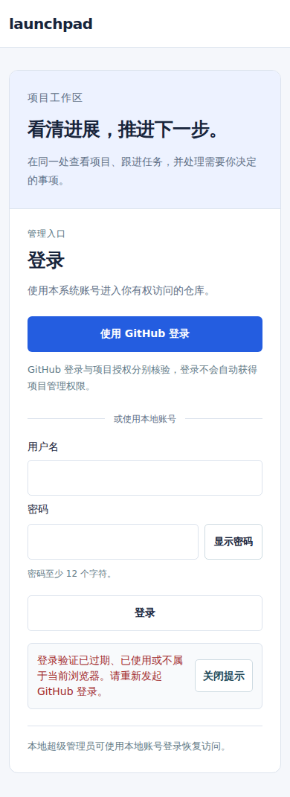
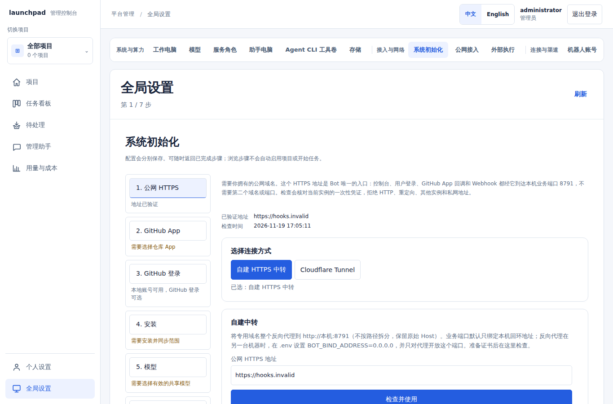
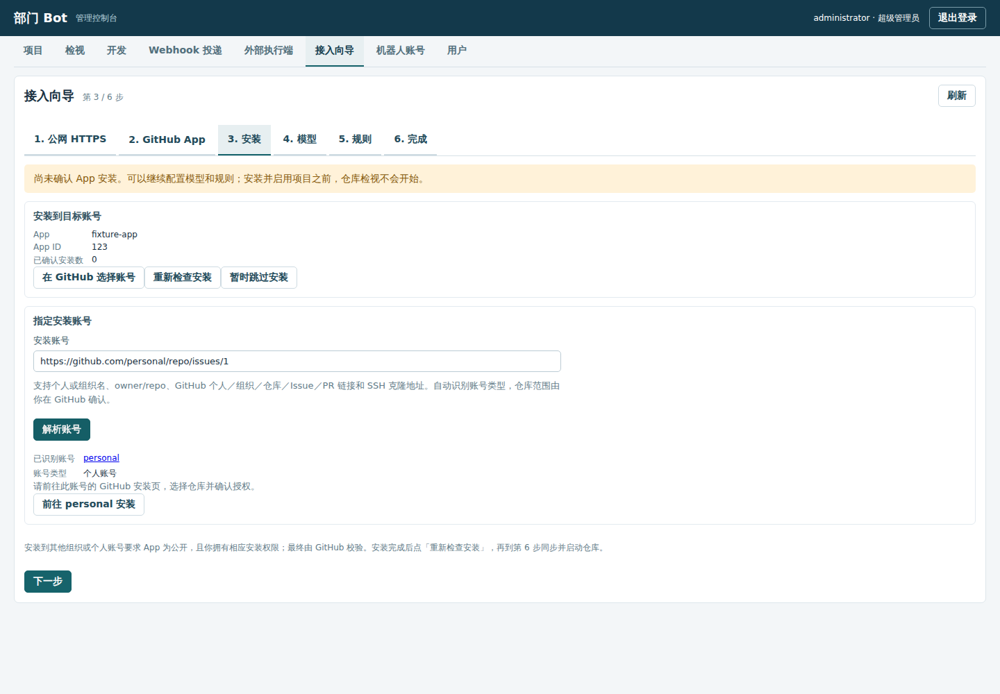
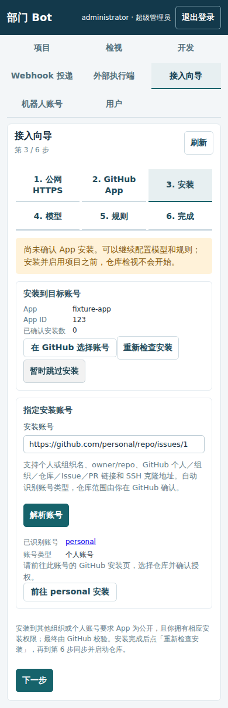

# 登录、系统初始化与仓库接入

本文说明如何登录 launchpad 控制台、完成新部署的系统初始化、把代码仓库接入平台，以及如何管理成员权限。底层身份与授权设计见 [身份登录、安装档案与统一授权](../design/identity-and-installations.md)。

## 1. 首次初始化与控制台登录

- **首位管理员初始化**：全新部署访问统一入口（如 `http://127.0.0.1:8791/`）时，页面提示「创建第一名管理员」（用户名 + 12–256 位密码）。初始化仅允许成功一次，之后首页固定呈现登录入口。
- **双登录入口**：
  - **GitHub 登录（推荐）**：超级管理员配置独立 OAuth App 后启用。登录只请求空 `scope` 核实公开 GitHub 身份，不申请 `repo` 或组织写权限；新登录的 GitHub 账号默认无平台权限，只按仓库真实协作者/管理员角色获得对应项目权限，不会自动合并同名本地账号。
  - **本地恢复账号**：保留用户名/密码登录，作为首位管理员与离线恢复入口；本地账号登录后可在「个人设置 → 身份与权限」绑定 GitHub 身份。

## 2. 系统初始化（仅超级管理员）

首次登录后，超级管理员在「全局设置 → 系统初始化」（`#/settings/onboarding`）按七步完成整套部署接入：

1. **公网 HTTPS 入口**：准备唯一 HTTPS 域名（控制台、登录、GitHub 回调与 Webhook 共用业务端口 `8791`）。可选自建 HTTPS 反向代理或内置 Cloudflare Tunnel（粘贴 token 或完整 `cloudflared` 命令，路由指向 `http://webhook:8791`），点击「检查并使用」校验本实例归属后生效。
2. **仓库 GitHub App**：选用已登记 App 或通过 manifest 创建新 App（默认仅申请仓库级权限 `contents`、`issues`、`pull_requests`、`statuses`、`actions`、`checks` 写及 `metadata` 读，不申请组织级权限；订阅 `issues`、`pull_request`、`issue_comment`、`pull_request_review`、`pull_request_review_comment`、`check_run`、`status`）。已有 App 可随时使用「检查权限和事件订阅」核对缺项。
3. **GitHub 用户登录**：使用**独立的 OAuth App**（不复用仓库 GitHub App），填写 Homepage URL 与 `<统一入口>/auth/github/callback`，填入 Client ID 与 Client Secret 后启用。
4. **安装到 GitHub 账号**：输入组织名、个人账号名或仓库链接解析目标账号，跳转到 GitHub 定向安装页选择仓库范围，返回后点击「重新检查安装」。
5. **配置模型**：添加部署共享模型（支持「获取模型列表」与「测试模型」）。
6. **查看内置规则**：了解内置默认规则和角色配置入口。
7. **同步并启用首批仓库**：同步安装列表，为需要的仓库启动检视（自动开发默认关闭）。

## 3. 把一个代码仓接入 launchpad

面向仓库维护者（仓库 Admin / 组织 Owner）与超级管理员，接入分两步：

### 第一步：安装 GitHub App 并同步

1. 打开 App 安装页（如 `https://github.com/apps/agent-ci-infra-bot/installations/select_target`），勾选目标仓库（支持公开或私有仓库，要求至少有一个提交，不限开发语言）。
2. 在控制台项目列表点击「同步安装列表」，仓库将出现在「待接入的仓库」中。

### 第二步：在管理助手中完成分析与启动

仓库接入直接在常规 **管理助手**（`#/management` 或已绑定飞书私聊）中完成：

1. 在「待接入的仓库」点击 **开始接入**，页面自动进入管理助手并预填接入提示词（已启动项目可在其管理助手「推荐列表」点 **运行仓库接入助手** 核对配置）。
2. **只读分析与仓库画像**：确认前助手只读分析仓库的 README、`AGENTS.md`/`CONTRIBUTING.md`、目录结构、构建测试脚本、`.github/workflows/`、`.agents/skills/`、分支保护和标签用法，输出仓库画像并提出最多 5 个关键选项。
3. **确认启动与落盘配置**：你在对话中确认后，助手调用 `start_repository` 与标准管理命令完成启动与配置：
   - **超级管理员或受信任组织的仓库管理员**：直接启动仓库并应用能力上限、测试命令、监听事件、本仓库约定（追加到 Manager 与启用角色提示词）、缺失标签与定时检查。
   - **未受信任组织的仓库管理员**：提交启动申请，超级管理员在「待处理」顶部卡片（或飞书私聊通知）同意并选择模型/能力上限（可顺带信任该组织）或拒绝。
   - **CI 改动建议**：若涉及修改 `.github/workflows/`，你在对话中确认方案后，助手直接通过 `task.create` 创建普通 bot PR 开发任务（推送分支时按需申请 GitHub App 的 `workflows: write` 权限），最终由人工检视并合并 PR。

> 超级管理员也可不经管理助手，在项目列表直接点击「启动」选择模型与能力上限；并在「全局设置 → 项目管理 → 受信任的组织」中信任指定组织，允许其仓库管理员按组织默认模型与能力上限自助启动新仓库。

## 4. 权限体系与成员管理

### 权限来源

| 来源 | 说明 | 对应项目权限 |
| --- | --- | --- |
| 平台超级管理员 | 本地初始化或由其他超管授予 | 全局设置、全部项目、用户与账号管理 |
| GitHub 继承权限 | 由仓库 GitHub App 本地成员缓存自动派生，登录即生效，后台每 10 分钟与 Webhook 联动同步 | 个人安装本人 / 组织 Owner / 仓库 Admin → 项目管理员；Write / Maintain → 项目成员（提问、创建与管理本人任务）；Triage / Read → 项目读者（只读查看） |
| 超级管理员手工分配 | 在「全局设置 → 用户」按单个仓库或整个组织分配 | 分配范围内的项目管理员 |
| 项目内委派 | 项目管理员在项目「成员」页按 GitHub 用户名授予只读、成员或项目管理员 | 不能超出授予人自身权限；授予人失权时该委派自动暂停，不支持循环互授 |

### 日常身份操作

- **个人身份与权限页（`#/identity`）**：查看当前 GitHub 连接状态、已启动仓库、待接入仓库、当前组织范围切换与个人飞书绑定；可通过「重新验证 GitHub 权限」立即复核权限或解除 GitHub 绑定。
- **禁用与删除项目**：
  - **禁用**：停止接收新事件、中止运行中任务并停止项目电脑，保留全部数据，后续可重新启用。
  - **删除**（仅超管）：仅在仓库已从 GitHub 删除、移出安装或暂停安装导致完全无法访问时允许；当场向 GitHub 核对后清理项目记录、容器、网络与笔记卷（工作卷与审计保留）。权限不足的仓库不能删除，列表会显示「权限不足」「事件未订阅」等具体缺项提示。
- **人工把关清单**：接入后建议始终为默认分支开启 **分支保护（或规则集）与必需检查**，亲自检视并合并修改 CI 的 PR，并确认私有仓是否需要开启公开看板。
