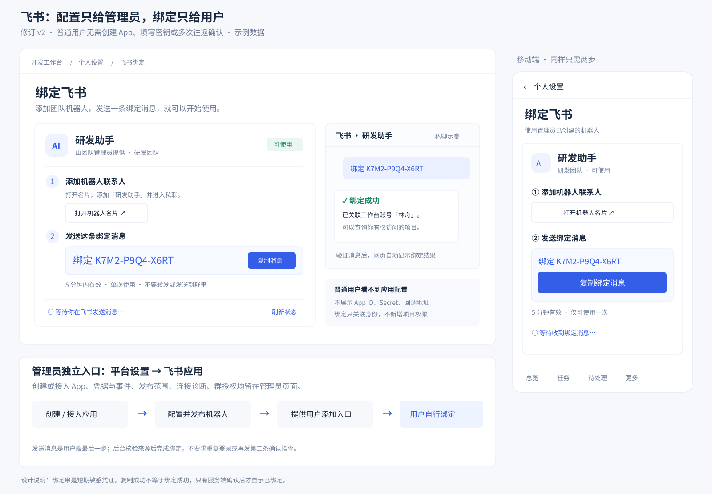
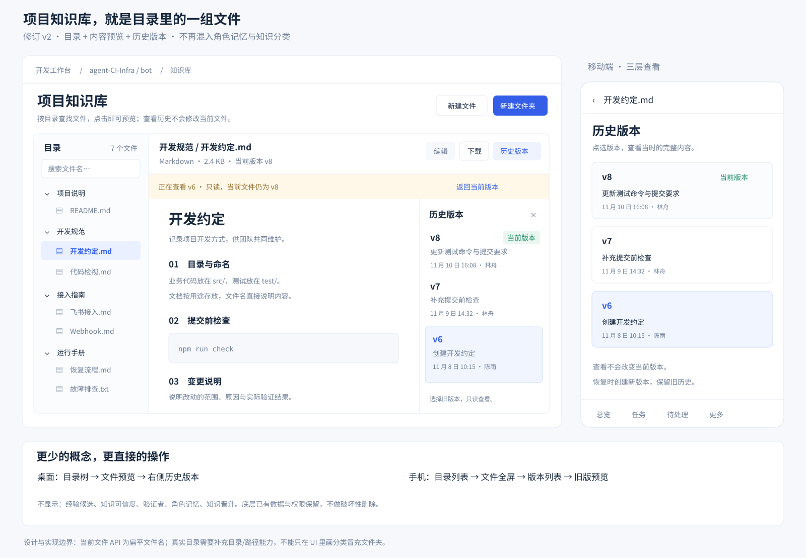

# 全站桌面与移动界面设计

总计划：[#223](https://github.com/agent-CI-Infra/bot/issues/223)。本目录用于设计评审与实现参考，不是生产前端实现。

- 原始设计基线：`51a743159963efe9036268a989b0059f9f5a1215`。
- 首轮建单 main：`753fd7820854ad6221b9bb0d73ba94f38c6196b1`。接入页保留新增的单端口与 GitHub 登录流程。
- 飞书 / 知识库 v2 核对基线：`9bf491e9be66301e3867e9db6e273b410d9d7f48`。
- 资料分支：`docs/interface-design-20261110`；只维护本目录，不修改业务代码。

## 2026-11-10：飞书与知识库设计修订（优先于旧稿）

**飞书 #236：管理员管理 App；普通用户添加已有机器人并发送绑定串。**

管理员入口沿用 `#/settings/feishu`，负责创建/接入应用、凭据、事件、发布范围和诊断。普通用户入口沿用 `#/identity/feishu`，只显示可用机器人、添加联系人入口、本人一次性绑定串与绑定状态。正常登录后，向对应机器人私聊发送完整绑定串就是用户的最后一步，不再要求先发“绑定”再往返 OAuth 和第二次确认。成功必须依据服务端确认；绑定不增加项目或群权限。

**知识库 #232：真实目录 + 文件预览 + 历史版本。**

默认左目录右预览，历史版本按需展开；手机按目录→文件→历史逐层查看。移除经验候选、可信度、验证者、角色记忆和知识晋升 UI。旧 `memory` 场景由 `file-history` 替换，不删除底层数据或权限；角色记忆后续需求仍归 #174。当前文件 API 为扁平文件名，真实目录需要服务端能力，不能用浏览器分类冒充。

本节与 #236 / #232 的最新正文是两个模块的验收依据；旧 `previews/channel.svg`、`previews/knowledge.svg` 及此前全站原型中的相应旧页保留作历史参考，不要求按旧稿实现。其他模块设计不变。

## 图片与原始资料范围

原目录包含 14 张模块级桌面/移动配对预览 SVG、4 张原始交互图 SVG。本次新增 2 张 v2 模块预览；旧图不删除，以保留修订记录。

模块预览用于表达布局与交互，不是逐像素 PNG 截图。原桌面参考视口 1920×1200，手机 390×844。手机首屏之外的内容不表示功能被删除。此前完整设计包 `project_interface_design_desktop_mobile.zip` 中的 171 张 PNG、可点击原型、全站图册与完整说明没有全部复制到本分支。

图中任务、模型、时间、身份、用量、绑定串均为示例；示例编号不指向真实同号 issue。未实现的 Agent、目录、角色容量等能力不能靠画面宣称已可用，原型检查不能代替真实业务验收。

## 57 个场景的唯一归属（含 v2 替换）

| Issue | 模块 | 页面 / 详情场景 | 数量 | 当前图片 |
|---|---|---|---:|---|
| [#224](https://github.com/agent-CI-Infra/bot/issues/224) | 公共设计系统 | `more`；全站公共壳 | 1 | [架构](flows/01_information_architecture.svg)、[响应式](flows/04_responsive_interactions.svg) |
| [#225](https://github.com/agent-CI-Infra/bot/issues/225) | 登录、初始化、接入与身份 | `login`、`setup`、`onboarding`、`identity` | 4 | [预览](previews/login.svg) |
| [#226](https://github.com/agent-CI-Infra/bot/issues/226) | 项目工作区与公开看板 | `projects`、`overview`、`inbox`、`decision`、`project-settings`、`members`、`public-board` | 7 | [预览](previews/overview.svg) |
| [#227](https://github.com/agent-CI-Infra/bot/issues/227) | 状态看板、任务详情、新建 | `board`、`task`、`new-task` | 3 | [预览](previews/board.svg) |
| [#228](https://github.com/agent-CI-Infra/bot/issues/228) | 角色容量与队列 | `role-board` | 1 | [预览](previews/role-board.svg)、[交互](flows/02_task_and_queue_flow.svg) |
| [#229](https://github.com/agent-CI-Infra/bot/issues/229) | AI 团队与 Manager | `team`、`role`、`manager`、`dispatch`、`dispatch-detail`、`skills`、`stages` | 7 | [预览](previews/role.svg)、[配置交互](flows/03_configuration_and_release.svg) |
| [#230](https://github.com/agent-CI-Infra/bot/issues/230) | 模型与供应商 | `models`、`provider`、`shared-models` | 3 | [预览](previews/models.svg) |
| [#231](https://github.com/agent-CI-Infra/bot/issues/231) | 项目电脑与外部执行 | `environment`、`environment-edit`、`executors`、`executor` | 4 | [预览](previews/environment.svg) |
| [#232](https://github.com/agent-CI-Infra/bot/issues/232) | **文件式知识库 v2** | `knowledge`、`article`（文件预览）、`file-history`（替代旧 `memory`） | 3 | [v2 预览](previews/knowledge-files-v2.svg) |
| [#233](https://github.com/agent-CI-Infra/bot/issues/233) | CI 与版本发布 | `gates`、`releases`、`release-new`、`release` | 4 | [预览](previews/release.svg)、[交互](flows/03_configuration_and_release.svg) |
| [#234](https://github.com/agent-CI-Infra/bot/issues/234) | 计划与通知 | `schedules`、`schedule`、`notifications`、`delivery` | 4 | [预览](previews/schedule.svg) |
| [#235](https://github.com/agent-CI-Infra/bot/issues/235) | 管理助手与审批 | `chat`、`approval` | 2 | [预览](previews/chat.svg) |
| [#236](https://github.com/agent-CI-Infra/bot/issues/236) | **飞书 v2：用户绑定 / 管理员应用** | 个人 `identity/feishu`、管理员 `settings/feishu`（替代旧 `channels`、`channel` 混合页） | 2 | [v2 预览](previews/feishu-binding-v2.svg) |
| [#237](https://github.com/agent-CI-Infra/bot/issues/237) | 平台、安装、账号与用户 | `installations`、`installation`、`platform`、`public-access`、`accounts`、`account`、`users`、`user` | 8 | [预览](previews/platform.svg) |
| [#238](https://github.com/agent-CI-Infra/bot/issues/238) | 用量、审计、Webhook | `costs`、`activity`、`webhooks`、`webhook` | 4 | [预览](previews/activity.svg) |
| | **合计** | **57 个设计场景；本次为替换，不新增重复归属** | **57** | |

## 原始交互图

这些图继续适用于未修改模块；如涉及飞书绑定和知识库，以上 v2 图和 issue 最新正文优先。

- [全站信息架构](flows/01_information_architecture.svg)
- [任务与角色队列](flows/02_task_and_queue_flow.svg)
- [角色配置与版本发布](flows/03_configuration_and_release.svg)
- [桌面与移动交互对照](flows/04_responsive_interactions.svg)

## 实施边界

1. 先完成 #224 公共基础，各模块桌面/移动共同验收。新增后端能力与 UI 分层，未接入时不显示假成功。
2. #215 对象任务迁移不因旧原型标签回退。#228 复用 #197 和原任务/assignment/run/租约，不建立平行任务系统。
3. Agent 与模型根据真实注册/能力显示；OpenCode 依赖 #172，JiuwenSwarm 未注册时不能宣称可用；externalModel 不伪造平台模型覆写。
4. 品牌由 #218 决定，截图中的工作台名称不是另一次品牌决定。
5. 飞书应用管理员配置与个人绑定在前后端同时隔离，消息来源须真实核验；绑定不增加授权。
6. 文件目录不得扩大既有项目/角色数据可见性；历史版本和只读来源不能因为界面简化而丢失。
7. 现有能力、新增聚合、新增后端分别验收；服务端权限、版本冲突、历史快照、独立 QA、GitHub 门禁和未知写入查证不被 UI 绕过。
8. 实现 PR 提供真实页面截图、相关测试和未覆盖项；不能用原型检查代替产品业务测试。
