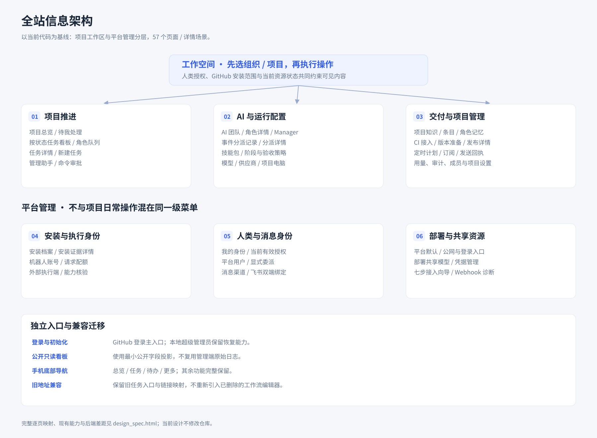
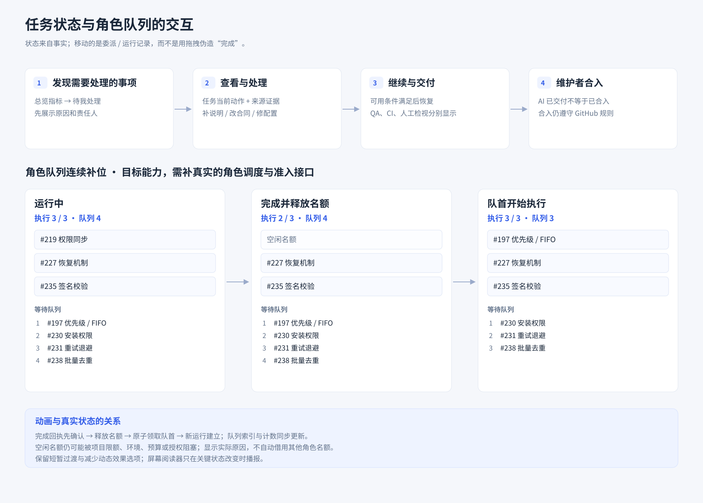
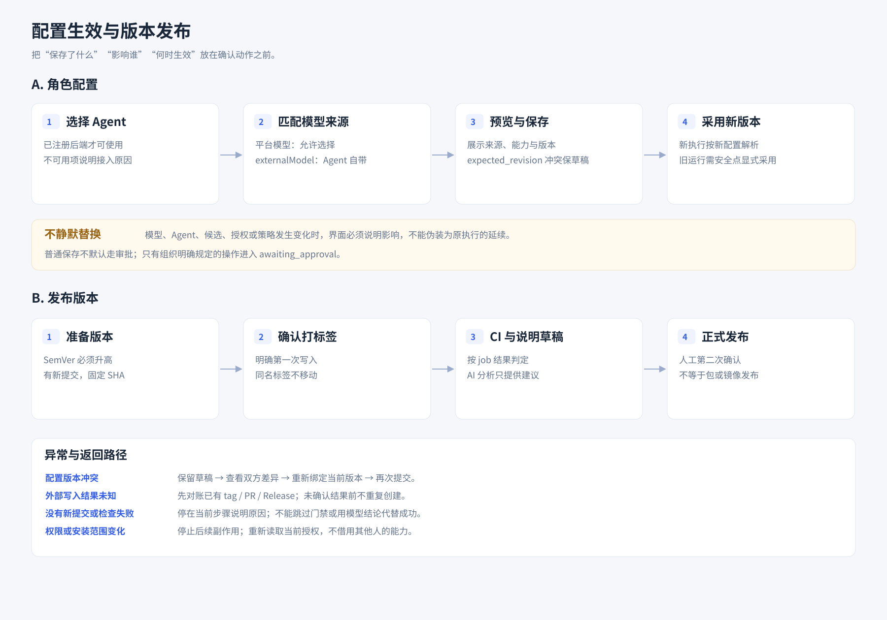
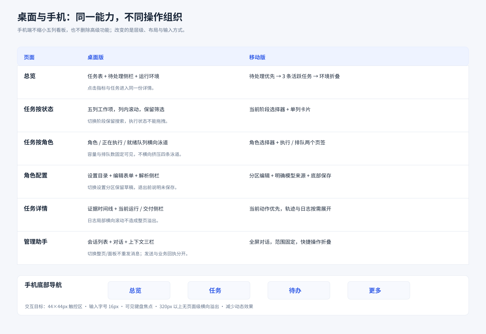

# 全站桌面与移动界面设计

总计划：[#223](https://github.com/agent-CI-Infra/bot/issues/223)。本目录用于开发议题中的设计评审与实现参考，不是生产前端实现。

- 设计代码基线：`51a743159963efe9036268a989b0059f9f5a1215`。
- 建单时 main：`753fd7820854ad6221b9bb0d73ba94f38c6196b1`。接入相关页面必须保留之后新增的单端口与 GitHub 登录流程。
- 专用资料分支：`docs/interface-design-20261110`；只增加本目录文件，不修改业务代码。

## 图片与原始资料范围

本目录包含 **14 张模块级桌面/移动配对预览 SVG、4 张原始交互图 SVG**。各模块 issue 已内嵌对应预览，点击图片或下表链接可查看。

配对预览依据此前交付的可点击原型导出，保留主要布局、颜色和文字；部分装饰图标简化，不是逐像素的 PNG 截图。桌面视口为 1920×1200，移动首屏为 390×844；首屏以外还有内容，并不表示其他功能已删除。

**此前完整设计包 `project_interface_design_desktop_mobile.zip` 中的 171 张 PNG、可点击原型、全站图册和完整设计说明没有全部复制到本分支。** 本次在 GitHub 上归档模块预览和交互图，57 个场景的开发范围完整列在以下 issue 中。

画面中的任务编号、标题、时间、模型、身份及运行数均为示例；示例编号不指向仓库同号真实 issue。设计中的角色容量、模型或 Agent 选项，不构成当前已实现/可运行能力的证明。原型演示与检查记录不能替代真实业务测试。

## 57 个场景的唯一归属

每个页面场景只归属一个模块，公共组件由 #224 提供。桌面和移动端在同一 issue 共同验收。

| Issue | 模块 | 页面 / 详情场景 | 数量 | 图片 |
|---|---|---|---:|---|
| [#224](https://github.com/agent-CI-Infra/bot/issues/224) | 设计系统、响应式导航与公共交互 | `more`；另为全站提供公共壳 | 1 | [信息架构](flows/01_information_architecture.svg)、[响应式交互](flows/04_responsive_interactions.svg) |
| [#225](https://github.com/agent-CI-Infra/bot/issues/225) | 登录、初始化、接入与身份 | `login`、`setup`、`onboarding`、`identity` | 4 | [桌面 / 移动](previews/login.svg) |
| [#226](https://github.com/agent-CI-Infra/bot/issues/226) | 项目工作区与公开看板 | `projects`、`overview`、`inbox`、`decision`、`project-settings`、`members`、`public-board` | 7 | [桌面 / 移动](previews/overview.svg) |
| [#227](https://github.com/agent-CI-Infra/bot/issues/227) | 状态看板、任务详情与新建 | `board`、`task`、`new-task` | 3 | [桌面 / 移动](previews/board.svg) |
| [#228](https://github.com/agent-CI-Infra/bot/issues/228) | 角色容量、就绪队列与补位 | `role-board` | 1 | [桌面 / 移动](previews/role-board.svg)、[任务与队列交互](flows/02_task_and_queue_flow.svg) |
| [#229](https://github.com/agent-CI-Infra/bot/issues/229) | AI 团队、Manager、技能与阶段 | `team`、`role`、`manager`、`dispatch`、`dispatch-detail`、`skills`、`stages` | 7 | [桌面 / 移动](previews/role.svg)、[配置生效交互](flows/03_configuration_and_release.svg) |
| [#230](https://github.com/agent-CI-Infra/bot/issues/230) | 项目 / 共享模型与供应商 | `models`、`provider`、`shared-models` | 3 | [桌面 / 移动](previews/models.svg) |
| [#231](https://github.com/agent-CI-Infra/bot/issues/231) | 项目电脑与外部执行端 | `environment`、`environment-edit`、`executors`、`executor` | 4 | [桌面 / 移动](previews/environment.svg) |
| [#232](https://github.com/agent-CI-Infra/bot/issues/232) | 项目知识、版本与角色记忆 | `knowledge`、`article`、`memory` | 3 | [桌面 / 移动](previews/knowledge.svg) |
| [#233](https://github.com/agent-CI-Infra/bot/issues/233) | CI 门禁与版本发布 | `gates`、`releases`、`release-new`、`release` | 4 | [桌面 / 移动](previews/release.svg)、[发布交互](flows/03_configuration_and_release.svg) |
| [#234](https://github.com/agent-CI-Infra/bot/issues/234) | 定时计划、订阅与通知 | `schedules`、`schedule`、`notifications`、`delivery` | 4 | [桌面 / 移动](previews/schedule.svg) |
| [#235](https://github.com/agent-CI-Infra/bot/issues/235) | 管理助手与命令审批 | `chat`、`approval` | 2 | [桌面 / 移动](previews/chat.svg) |
| [#236](https://github.com/agent-CI-Infra/bot/issues/236) | 飞书渠道、身份绑定与群范围 | `channels`、`channel` | 2 | [桌面 / 移动](previews/channel.svg) |
| [#237](https://github.com/agent-CI-Infra/bot/issues/237) | 平台、安装、账号与用户管理 | `installations`、`installation`、`platform`、`public-access`、`accounts`、`account`、`users`、`user` | 8 | [桌面 / 移动](previews/platform.svg) |
| [#238](https://github.com/agent-CI-Infra/bot/issues/238) | 用量、审计与 Webhook 诊断 | `costs`、`activity`、`webhooks`、`webhook` | 4 | [桌面 / 移动](previews/activity.svg) |
| | **合计** | **57 个唯一页面场景，无遗漏、无重复归属** | **57** | |

## 四张交互图

### 1. 全站信息架构

### 2. 任务与角色队列

### 3. 配置生效与发布

### 4. 桌面与移动交互对照

## 实施边界

1. 先完成 #224 公共基础，再迁移业务模块。新增角色准入/队列的数据契约与 UI 分层，未接入时明确不可用，不用模拟数据制造成功路径。
2. #215 统一 Issue/PR 对象任务是已有依赖；原型中旧的“对象 × 工作类型”标签不能被当成阻止迁移的新要求。
3. #228 复用 #197 的优先级/FIFO 与原任务、assignment、run 和租约，不建立平行任务系统。项目并发与角色并发分别计算。
4. Agent 与模型根据实际注册和兼容性显示；OpenCode 依赖 #172，JiuwenSwarm 未注册时不得显示为可用。外部 Agent 自带模型时不伪造平台模型覆写。
5. 品牌统一按 #218，截图中的旧工作台名称不是新增品牌决定。
6. 现有能力重设计、新增前端聚合、新增后端能力分别验收。服务端权限、版本冲突、历史快照、独立 QA、GitHub 门禁和未知写入查证不得被简化界面绕过。
7. 图中未完整呈现的加载/空/错误/无权限/冲突/过期场景，以各 issue 的验收要求补齐。实现 PR 需提供真实产品截图与测试，不直接沿用原型检查结论。
