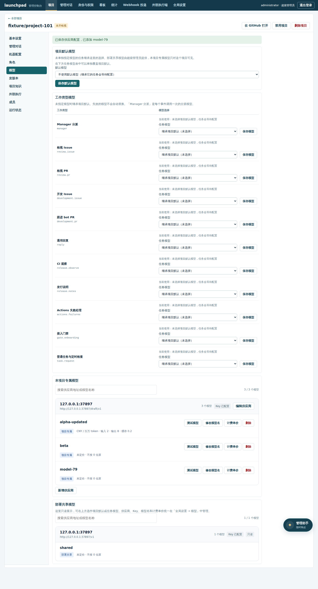
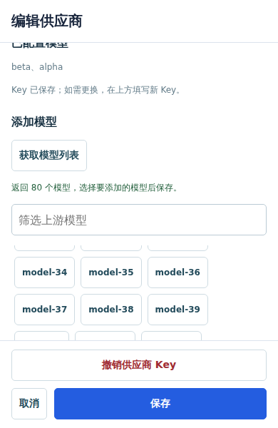

# 模型连接与供应商编辑

项目模型与部署共享模型复用同一个供应商列表、编辑器和版本事务。列表可按供应商地址或模型名搜索，显示 Key 配置状态、项目/共享来源、每百万 token 的单价，以及当前项目默认和工作类型显式引用。只读共享列表仍可在本地搜索，搜索只改变可见条目，不发送写请求，也不提供连接或凭据编辑。没有价格时显示未定价，不按 0 估算；实际角色模型与继承来源仍从角色设置查看。

编辑器依次展示连接信息、模型选择、测试及保存影响。模型列表与已选项各自限高滚动，显示已选数量；手机使用全屏编辑器，输入至少 16px、底部操作区与内容滚动分开。URL 保留用户填写的路径，实际请求地址由既有端点解析接口给出，不自动添加或删除 `/v1`。

## 测试草稿

「测试当前连接」使用当前表单 URL、待测试模型名和新填写 Key；编辑已有供应商时，Key 留空由服务端复用已保存的 Key。读取响应不会返回 Key，测试不保存 URL、模型名、凭据或计费信息。测试只证明这一条模型和本次请求的结果，获取模型列表不证明所有模型可用。

已有模型的 `POST /api/models/<id>/test` 保留空正文测试已保存配置的兼容行为。若提交草稿字段，必须带当前模型 `version`，可包含 `api_url`、`api_key` 和 `model_name`。版本失配在请求上游前拒绝；草稿字段和保存的 Key 均受原模型编辑权限限制，项目管理员不能测试共享 Key 或其他项目的 Key。

## 版本冲突

供应商 URL、Key 与模型增加仍通过原有 provider transaction 原子保存，提交成员与版本集合。冲突时保留表单和待添加模型；「读取最新版本并比较」读取同一项目或共享范围内的最新供应商，列出服务器地址及模型名称，保留用户字段，明确核对后才再次保存。该操作不混入同地址的其他项目或共享模型。

撤销 Key、删除模型仍是独立危险操作。取消编辑不保存字段；关闭编辑器会清空内存中的 Key 输入。价格保存只影响新请求，已有成本继续使用历史快照。

## 验证

- `test/model-probe.test.mjs`：草稿测试的真实上游地址、已保存 Key 复用、版本拒绝、跨项目和共享权限、失败响应脱敏及不保存草稿。
- `test/model-provider.test.mjs`：供应商更新原子性、成员/版本快照、地址冲突、权限及事务回滚。
- `e2e/model-console.spec.mjs`：搜索、价格缺失、草稿测试、80 个模型的选择、390px 编辑器、并发冲突比较与同地址不同范围隔离。
- `e2e/models-by-provider.spec.mjs`：原有项目与共享模型新增、测试、URL/Key 更换、撤销、取消及失败恢复流程。

## 真实页面预览

截图来自独立控制面与本地模型协议夹具，包含 1440px 项目模型页和 390×600 编辑器的实际选择/测试流程，不使用线上数据。

