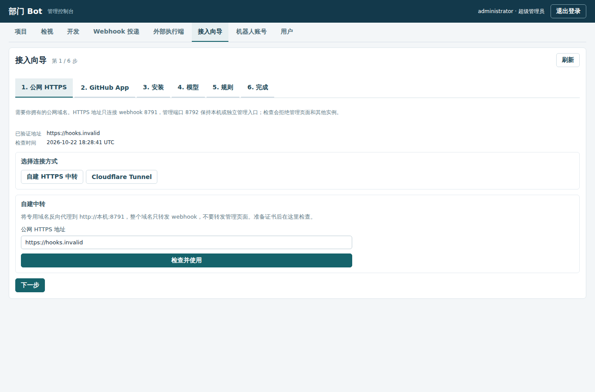
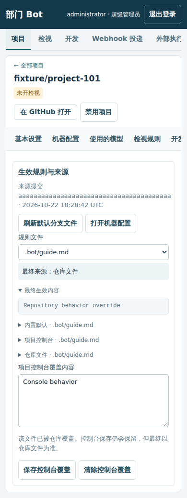

# 自助接入与项目规则

本部署继续只使用 Docker Compose。超级管理员进入「接入向导」；项目管理员在自己项目的「生效规则」中查看和编辑权限范围内的规则。账号、模型、安装、项目电脑与数据卷复用原控制面，不创建另一套资源系统。



## 公网 HTTPS 与域名

先准备自己的域名。自建中转需配置有效证书，整个域名只转发到 webhook 8791；管理页面 8792 保持环回绑定或独立管理入口。填写 HTTPS origin 后点击「检查并使用」。检查使用当前实例的一次性 nonce／proof，拒绝 HTTP、重定向、其他实例和管理监听，同时检查根路径、管理 API 与脚本不会被公开。DNS 地址在每次连接时校验并固定，不能指向私网。

Cloudflare Tunnel 是 Compose 中独立的 `tunnel` 服务。初始没有 token，不连接任何账号；在向导中保存 token 后自动连接。token 不进入 Compose 环境变量、命令参数或读取接口：数据库加密保存，专用凭据卷中以 0600 文件交给非 root tunnel 进程读取。更换后自动重连，停用会移除文件并断开。该服务不发布宿主端口。Tunnel 位于独立 edge 网络，只能经过固定转发到 bot:8791 的 webhook 网关；控制面和 manager 不加入 edge 网络。即使远端路由填错，Tunnel 也不能直接连接管理端口。

在 Cloudflare 控制台的 Networks → Tunnels 创建 tunnel，在 Routes → Published application 选择自有域名，Service URL 填 `http://webhook:8791`。向导读取 tunnel 的路由和连接状态，指向管理端口的路由会标错；点击正确路由的「检查并使用此域名」后才保存公网地址。域名配置和 GitHub 确认由账号所有者在对应页面完成，Bot 不替用户点击。

## GitHub App 与安装

优先使用已有 GitHub App。选择「使用此 App」会检查 App 和安装，并将 webhook 更新到验证过的域名及该账号已登记的 webhook 路径。凭据不会返回浏览器。

没有 App 时，填写组织和 App 名称，向导生成 manifest，再点击「前往 GitHub 确认创建」。默认是组织私有 App；需要一个 App 覆盖多个组织时，勾选「公开 App，允许安装到其他组织」。固定权限为 contents、issues、pull_requests 写和 metadata 读；default_events 只有 issues、pull_request。installation 和 installation_repositories 由 GitHub 自动投递，不写入 manifest。不存在创建 App 的 REST 调用，也不要求 fine-grained PAT。

GitHub 确认后返回本机管理回调。随机 state 绑定发起的超级管理员，15 分钟有效，一次性使用；manifest code 兑换不带 PAT。App 私钥与 webhook secret 只在控制面加密保存，client secret 不需要则丢弃。

安装页提供 GitHub 安装链接和「重新检查安装」。也可以跳过并继续配置模型和规则；页面标明尚未安装，向导不启用检视。已有安装不会被删除或重新创建。确认安装、选择模型后，最后一步仅对用户明确选择的项目启用检视，自动开发保持关闭。

## 模型与规则

模型沿用 URL、API Key、模型名；保存的端点视为可信，项目代码、日志和测试输出可发送给它。Key 只保存、不回显，空白更新保持原值，撤销仍通过已有独立接口。向导可保存部署共享模型，实际项目仍在「使用的模型」中选用。

固定覆盖文件如下，每份文本规则最多 16 KiB：

| 文件 | 作用 |
| --- | --- |
| `.bot/guide.md` | 总体行为指南 |
| `.bot/rules/labels.md` | 检视成功后的标签，使用 `review_label: bot-reviewed` 声明标签名 |
| `.bot/rules/issue-review.md` | 新 Issue 检视与授权意图判断 |
| `.bot/rules/pr-review.md` | PR 检视、证据位置与 COMMENT 输出 |
| `.bot/rules/issue-development.md` | 明确要求改代码时的实现与测试 |
| `.bot/computer.yaml` | 合并到现有项目电脑规格的资源、软件包、环境与初始化配置 |
| `.agents/skills/**/SKILL.md` | 仓库追加的简单 skill，仅加载文本，不加载 JS 扩展 |

优先级为内置默认 → 项目控制台 → 默认分支仓库文件，文本文件整份覆盖。已有检视语言、指导和标签配置保留为控制台层。项目的「生效规则」按文件展示来源提交、每一层与最终内容，支持保存／清除控制台覆盖及刷新默认分支。仓库已经覆盖时，保存控制台内容不会悄悄盖过仓库文件。

`computer.yaml` 使用机器配置现有字段，例如：

```yaml
cpus: 2
memory_mb: 4096
packages: [jq]
setup_script: "python3 -m venv /workspace/home/venv"
```

其余可用字段为 pids、tmp_mb、max_command_minutes、egress、env。manager 使用同一套范围校验、镜像派生和初始化逻辑。控制台电脑规格作为独立来源记录，避免把仓库覆盖反写成控制台值；移除仓库文件后可恢复控制台配置。任务准备时应用生效规格，超级管理员也可手动应用；项目管理员不能绕过原来的资源配置权限。

PR 修改 `.bot` 或 `.agents/skills`（含移动、删除）时，检视总结会强制写明「这些文件改变了 bot 的行为，需要人来决定」。PR 新内容不会立即成为该次任务的生效规则／机器配置，规则取自默认分支；行内事件始终是 COMMENT，不能 APPROVE、REQUEST_CHANGES 或自动合并。



## 为什么选择 Pi

选用 [Pi SDK](https://github.com/badlogic/pi-mono/blob/74f46864025c68504cd10c89eeb626b7e3d64cea/packages/coding-agent/docs/sdk.md)，固定 `@earendil-works/pi-coding-agent` 1.4.0，MIT 许可证随项目镜像保留。Pi 可无界面嵌入 Node 进程，支持显式工具、会话、模型与资源加载器；无需引入独立 Agent 服务或桌面。OpenCode 的 headless server 也可工作，但本项目已有 Node runner 和控制面权限边界，SDK 更适合保留这些边界。

Pi 在每项目容器的任务工作目录执行现有文件／命令工具，模型循环由 Pi 驱动。项目内只存在指向 loopback 的无真实凭据代理；任务专属请求／响应邮箱通过 manager 中继给控制面，控制面选择已授权模型并附加真实 Key。只允许该项目选定模型的 chat completion，不代理任意 URL，也不暴露 GitHub、管理员或 manager 凭据。仓库网络仍各自独立，容器不发布公网端口。

控制面将上游非流式结果转成 Pi 需要的本地 SSE，兼容现有接口并在写回容器前脱敏；不会把真实模型 Key 带入 SDK。任务最多 32 次模型请求，原独立测试验证、GitHub outbox、head 和分支归属校验继续有效。容器重启依据启动标识检查 Pi 状态，未完成工作重新准备，不把 Docker running 当作任务完成。

## 验证

`npm run check`、`npm test` 和 `npm run test:e2e` 覆盖协议、权限、向导及来源界面。`npm run test:agent` 使用真实 Pi 和 Docker 项目容器配合假模型／GitHub，验证检视、开发、恢复与凭据隔离。测试实例使用独立 Compose 项目与卷；不要对人类试用实例运行 `down -v`。
