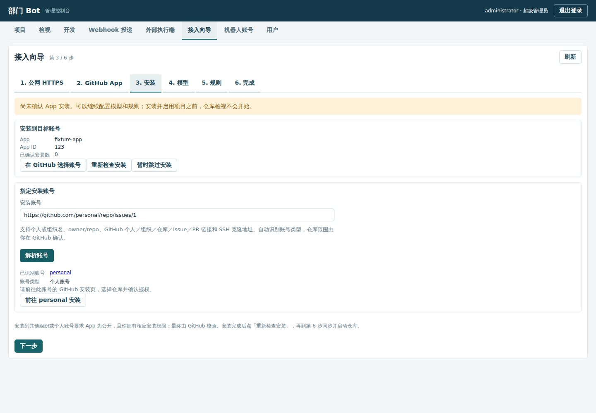
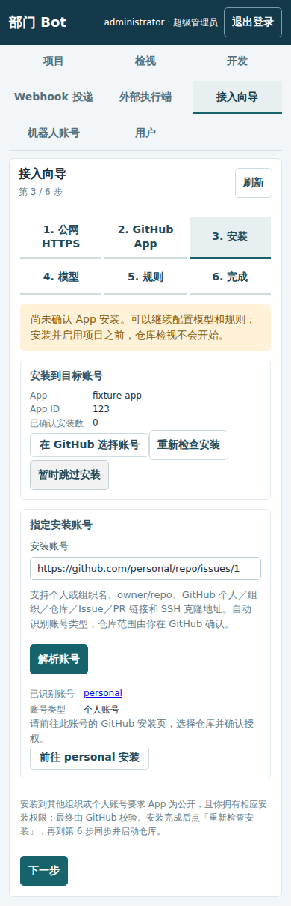
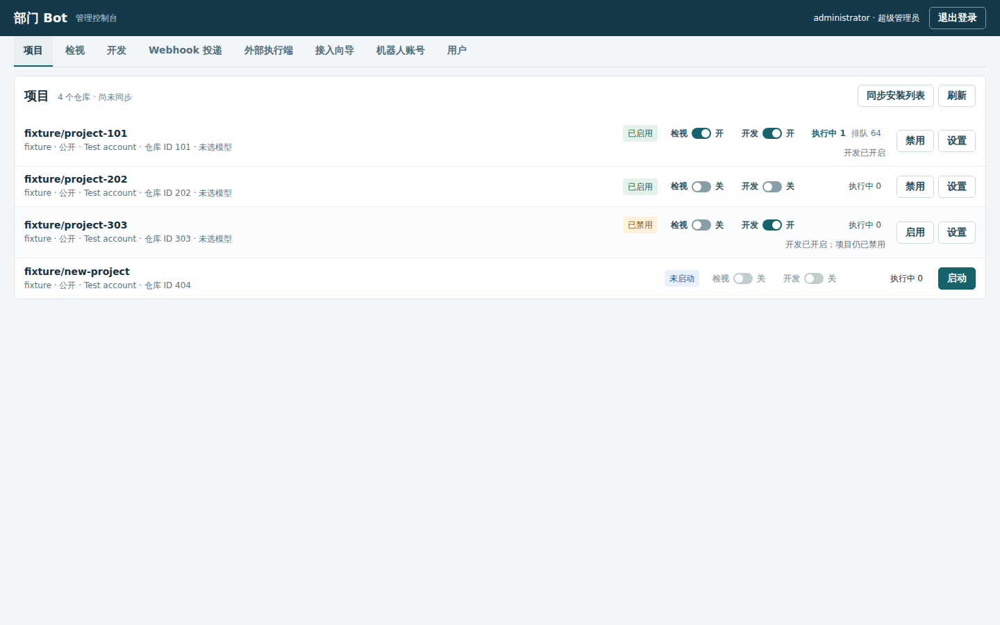
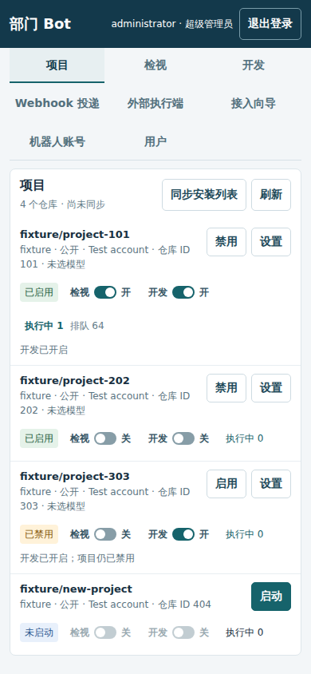

# 自助接入与项目规则

本部署继续只使用 Docker Compose。超级管理员进入「接入向导」；项目管理员在自己项目的「检视」「开发」「规则总览」中查看和编辑权限范围内的规则。账号、模型、安装、项目电脑与数据卷复用原控制面，不创建另一套资源系统。


## 公网 HTTPS 与域名

先准备自己的域名。自建中转需配置有效证书，整个域名只转发到 webhook 8791；管理页面 8792 保持环回绑定或独立管理入口。填写 HTTPS origin 后点击「检查并使用」。检查使用当前实例的一次性 nonce／proof，拒绝 HTTP、重定向、其他实例和管理监听，同时检查根路径、管理 API 与脚本不会被公开。DNS 地址在每次连接时校验并固定，不能指向私网。

Cloudflare Tunnel 是 Compose 中独立的 `tunnel` 服务。初始没有 token，不连接任何账号；在向导中保存 token 后自动连接。token 不进入 Compose 环境变量、命令参数或读取接口：数据库加密保存，专用凭据卷中以 0600 文件交给非 root tunnel 进程读取。更换后自动重连，停用会移除文件并断开。该服务不发布宿主端口。Tunnel 位于独立 edge 网络，只能经过固定转发到 bot:8791 的 webhook 网关；控制面和 manager 不加入 edge 网络。即使远端路由填错，Tunnel 也不能直接连接管理端口。

在 Cloudflare 控制台的 Networks → Tunnels 创建 tunnel，在 Routes → Published application 选择自有域名，Service URL 填 `http://webhook:8791`。向导读取 tunnel 的路由和连接状态，指向管理端口的路由会标错；点击正确路由的「检查并使用此域名」后才保存公网地址。域名配置和 GitHub 确认由账号所有者在对应页面完成，Bot 不替用户点击。

## GitHub App 与安装

优先使用已有 GitHub App。选择「使用此 App」会检查 App 和安装，并将 webhook 更新到验证过的域名及该账号已登记的 webhook 路径。凭据不会返回浏览器。

没有 App 时，填写「App 所属组织」和 App 名称，向导生成 manifest，再点击「前往 GitHub 确认创建」。这里填写的是 App 的归属组织，安装目标在第 3 步选择。默认是组织私有 App；需要安装到其他组织或个人账号时，勾选「公开 App，允许安装到其他账号」。固定权限为 contents、issues、pull_requests 写和 metadata 读；default_events 只有 issues、pull_request。installation 和 installation_repositories 由 GitHub 自动投递，不写入 manifest。不存在创建 App 的 REST 调用，也不要求 fine-grained PAT。

GitHub 确认后返回本机管理回调。随机 state 绑定发起的超级管理员，15 分钟有效，一次性使用；manifest code 兑换不带 PAT。App 私钥与 webhook secret 只在控制面加密保存，client secret 不需要则丢弃。

第 3 步的「安装账号」支持个人账号名、组织名、`owner/repo`、GitHub 个人主页、组织或仓库链接（包括 Issue、PR、代码目录链接），以及 `git@github.com:owner/repo.git`、`ssh://git@github.com/owner/repo.git`。点击「解析账号」，控制面从链接提取 owner，再通过 GitHub 核对并显示规范名称和账号类型（组织或个人账号）；无效链接、不存在的账号和不能安装的账号类型会显示原因。解析时不连接粘贴的网址，不读取仓库内容，也不会安装 App 或启用仓库。

确认账号后，点击「前往 <账号> 安装」，打开 GitHub 定向安装页。使用 GitHub [文档支持的 `suggested_target_id`](https://docs.github.com/en/apps/creating-github-apps/about-creating-github-apps/migrating-oauth-apps-to-github-apps) 预选个人或组织账号 ID，仓库范围及安装权限由 GitHub 页面确认。如果此 App 已安装到该账号，入口改为现有的安装设置：组织使用组织设置页，个人账号使用个人设置页。安装到其他组织或个人账号仍要求公开 App 和相应的 GitHub 权限；个人安装需在 GitHub 登录该个人账号，向导不会绕过授权或替其他用户确认。控制面用 App JWT 查询对应的 `/orgs/{org}/installation` 或 [`/users/{username}/installation`](https://docs.github.com/en/rest/apps/apps#get-a-user-installation-for-the-authenticated-app)，不需要用户 PAT。

安装页也保留「在 GitHub 选择账号」和「重新检查安装」。安装后点「重新检查安装」，再到第 6 步同步并启动目标仓库。也可以跳过并继续配置模型和规则；页面标明尚未安装，向导不启用检视。已有安装不会被删除或重新创建。确认安装、选择模型后，最后一步仅对用户明确选择的项目启用检视，自动开发保持关闭。





## 项目列表的快捷设置

项目列表右侧将项目状态、检视／开发开关和任务数放在同一区域。点击开关即保存对应项目策略；保存中暂时锁定该项目的两个开关，成功显示结果，失败显示原因并保留原状态。超级管理员可配置全部项目，项目管理员只能配置分配给自己的项目。未启动的仓库需先启动；已禁用项目可以预先保存开关，但不会因此启用项目或启动任务。

「执行中」显示该项目当前执行阶段的任务数；有排队任务时同时显示「排队」。任务数每 5 秒刷新，点击可进入项目的运行记录。配置等待、环境等待、失败和已结束的任务不会计入执行中；计数覆盖全部任务，不受任务列表每页条数限制。该区域支持后续追加项目特性的状态或开关。





## 模型与规则

模型沿用 URL、API Key、模型名；保存的端点视为可信，项目代码、日志和测试输出可发送给它。Key 只保存、不回显，空白更新保持原值，撤销仍通过已有独立接口。向导可保存部署共享模型，实际项目仍在「使用的模型」中选用。

固定覆盖文件如下，每份文本规则最多 16 KiB：

| 文件 | 作用 |
| --- | --- |
| `.bot/guide.md` | 总体行为指南 |
| `.bot/rules/labels.md` | 检视成功后的标签，使用 `review_label: bot-reviewed` 声明标签名 |
| `.bot/rules/issue-review.md` | 新 Issue 检视与授权意图判断 |
| `.bot/rules/pr-review.md` | PR 检视、证据位置与 COMMENT 输出 |
| `.bot/rules/issue-development.md` | 明确要求改代码时的实现与测试 |
| `.bot/computer.yaml` | 合并到现有项目电脑规格的资源、软件包、环境与初始化配置 |
| `.agents/skills/**/SKILL.md` | 仓库追加的简单 skill，仅加载文本，不加载 JS 扩展 |

打标签、Issue 检视、PR 检视与 Issue 自动开发四个场景的内置规则就是 [`prompts/`](prompts/README.md) 下的 Markdown 原文；没有控制台覆盖和仓库文件的项目直接使用它们，也可以复制后修改再放进仓库。

优先级为内置默认 → 项目控制台 → 默认分支仓库文件，文本文件整份覆盖。每个任务读取自己的规则文件：Issue 检视、PR 检视和检视标签在项目的「检视」里编辑，开发规则在「开发」里编辑，行为指南在「规则总览」里编辑，电脑规格在「机器配置」里编辑。每份文件显示当前生效内容和被覆盖的层，控制台覆盖按需展开编辑或清除。「规则总览」用一张表列出每份文件的作用、路径、用于哪些任务，以及内置默认／项目控制台／仓库文件哪一层生效，并可刷新默认分支。早期版本单独保存的项目检视指引和检视标签，升级时一次性写入对应规则文件的控制台层，之后只在规则文件里编辑。仓库已经覆盖时，保存控制台内容不会悄悄盖过仓库文件。

`computer.yaml` 使用机器配置现有字段，例如：

```yaml
cpus: 2
memory_mb: 4096
packages: [jq]
setup_script: "python3 -m venv /workspace/home/venv"
```

其余可用字段为 pids、tmp_mb、egress、env。命令不限时长，旧文件中的 `max_command_minutes` 会被忽略。manager 使用同一套范围校验、镜像派生和初始化逻辑。控制台电脑规格作为独立来源记录，避免把仓库覆盖反写成控制台值；移除仓库文件后可恢复控制台配置。任务准备时应用生效规格，超级管理员也可手动应用；项目管理员不能绕过原来的资源配置权限。

PR 修改 `.bot` 或 `.agents/skills`（含移动、删除）时，检视总结会强制写明「这些文件改变了 bot 的行为，需要人来决定」。PR 新内容不会立即成为该次任务的生效规则／机器配置，规则取自默认分支；行内事件始终是 COMMENT，不能 APPROVE、REQUEST_CHANGES 或自动合并。


## 为什么选择 Pi

选用 [Pi SDK](https://github.com/badlogic/pi-mono/blob/74f46864025c68504cd10c89eeb626b7e3d64cea/packages/coding-agent/docs/sdk.md)，固定 `@earendil-works/pi-coding-agent` 1.4.0，MIT 许可证随项目镜像保留。Pi 可无界面嵌入 Node 进程，支持显式工具、会话、模型与资源加载器；无需引入独立 Agent 服务或桌面。OpenCode 的 headless server 也可工作，但本项目已有 Node runner 和控制面权限边界，SDK 更适合保留这些边界。

Pi 在每项目容器的任务工作目录执行现有文件／命令工具，模型循环由 Pi 驱动。项目内只存在指向 loopback 的无真实凭据代理；任务专属请求／响应邮箱通过 manager 中继给控制面，控制面选择已授权模型并附加真实 Key。只允许该项目选定模型的 chat completion，不代理任意 URL，也不暴露 GitHub、管理员或 manager 凭据。仓库网络仍各自独立，容器不发布公网端口。

控制面将上游非流式结果转成 Pi 需要的本地 SSE，兼容现有接口并在写回容器前脱敏；不会把真实模型 Key 带入 SDK。任务不限模型请求次数，原独立测试验证、GitHub outbox、head 和分支归属校验继续有效。容器重启依据启动标识检查 Pi 状态，未完成工作重新准备，不把 Docker running 当作任务完成。

## 检视与修订的发布边界

「项目检视指引」属于控制台层，由规则解析器放入 Issue／PR 的检视文件；仓库默认分支文件覆盖后，控制台原文不会再以额外管理员提示或上下文字段发送给模型。标签表单与 labels.md 编辑共用同一控制台层。GitHub 评论不发布选用行内／讨论形式的理由；这些理由保留在任务结果中，重复的相同发现只保留一次。

bot 自己的 PR 仅修订原始 implementation_goal 与明确可执行、属于该目标、无需人工决定的发现。clarification_required 阻止开发，待人决定和超出范围的发现不会进入修订上下文。每次修订确认 head 后同步更新 PR 标题、正文和测试结果；提交使用独立的代码变更标题，不套用检视总结模板。提交邮箱根据当前账号 ID／登录名动态推导，控制面和容器内本地 git 使用同一身份。

推送后 PR head 尚未更新时，任务先短暂重读；超时显示「等待 PR 更新」和已推送 SHA，并自动继续核对。等待不重复推送、不增加修订轮数。作者、仓库和分支真正变化时分别暂停说明，不能把延迟当成权限变化。Webhook 列表区分已创建任务、草稿、非触发和重复，并链接对应任务。手机上导航与向导步骤完整换行，规则正文随页面展开。

## 验证

`npm run check`、`npm test` 和 `npm run test:e2e` 覆盖协议、权限、向导及来源界面。`npm run test:agent` 使用真实 Pi 和 Docker 项目容器配合假模型／GitHub，验证检视、开发、恢复与凭据隔离。测试实例使用独立 Compose 项目与卷；不要对人类试用实例运行 `down -v`。
