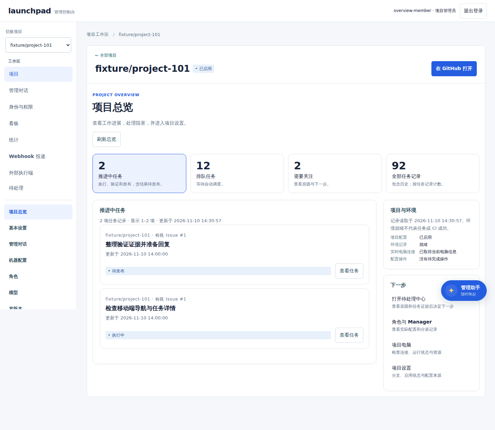
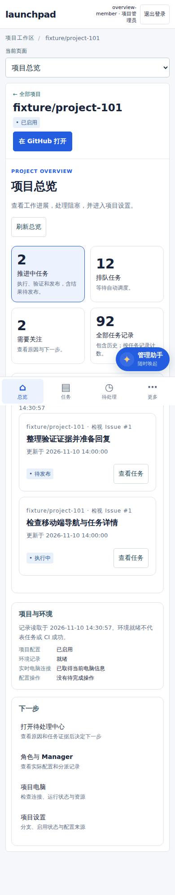

# 项目总览

项目列表的「项目总览」、侧栏项目选择器、项目分类和手机的「当前页面」均可进入 `#/projects/<id>/overview`。原 `basic`、`activity` 和其他项目地址保留；总览复用现有任务详情、待处理中心、角色配置及项目设置，不提供绕过授权的快捷写入。

## 任务范围与数据来源

`GET /api/tasks?repository_id=<id>&summary=1&group=<group>&limit=10&offset=0` 在同一数据库事务中读取完整范围的统计与当前页。授权、项目、优先级和工作类型条件先应用，再按状态分组，最后分页；不从最近一页或 RoleRun 行数估计任务数。

| group | 口径 |
| --- | --- |
| `active` | running、preparing、implementing、validating、publishing、result_ready；标题为「推进中任务」，包括结果待发布，不宣称都在执行命令 |
| `queued` | queued，正常等待调度 |
| `attention` | failed、paused、waiting_configuration、waiting_environment、waiting_permission、waiting_publication、needs_replan，与待处理中心复用状态集合 |
| `all` | 当前授权及筛选范围内的全部任务记录，包含历史，不等同于 Issue/PR 或角色运行数 |

`summary` 返回 all/active/queued/attention 和 sampled_at。四个统计与对应列表共用条件；任务仍按记录计数，同一对象的不同任务不会被前端合并。自动重试等待和等待 PR 更新不被归入人工待处理。原 `attention=1` 接口兼容，未知 group/summary 和冲突筛选返回 400，越权项目仍由原服务端拒绝。

总览地址可携带 `overview/queued`、`overview/queued.10` 等范围和偏移；刷新、返回及分享保留地址。每页 10 项，任务状态变化后本页为空时可返回上一页。任务详情继续呈现实际执行、产物、验收与发布证据，总览不据自然语言或环境状态推断 CI、合入和发布成功。

## 刷新与异常

总览每 5 秒只刷新当前只读投影，后台标签页暂停读取，不重建项目表单或已打开详情。未变化的任务行保持原节点，焦点和阅读位置不受定时刷新影响；离开页面、切换项目或登录用户后丢弃迟到响应。

任务与环境分别读取、分别记录成功时间。首次失败显示未知，不显示假零；后续失败保留上次成功内容并明确可能过期。重新加载可恢复。401/403/404 清除当前总览数据并提示重新加载授权，不继续呈现为有效数据。

项目「已启用」仅表示配置。环境卡列出保存状态、是否取得实时电脑信息及待完成配置操作；电脑信息暂不可取时明确未核实，保存的 ready 不被当作实时健康或任务成功。

## 界面与验证

页面使用公共 token、consoleLink/consoleState/consoleTaskRow、state、card 和原任务详情。桌面为任务主区与项目环境/下一步侧区，窄屏改成单列；统计保持两列可点击入口，所有功能可从手机进入，不复制另一套凭据、任务或权限状态。

`test/project-overview.test.mjs` 验证完整计数、分页下钻、状态集合、优先级、授权变更和只读行为。`e2e/project-overview.spec.mjs` 通过真实控制面 API 和隔离的 manager 协议夹具验证六断点、深链、详情返回、局部故障、过期提示、焦点、权限撤销及迟到回包。浏览器检查不代替真实设备软键盘或屏幕阅读器验收。

本批为 #226 的项目总览与工作进展切片，项目设置、成员管理和公开投影继续沿用现有实现，不据此提前关闭整个模块。

