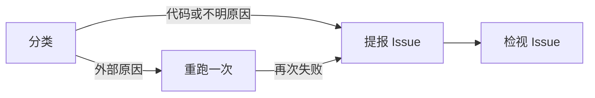

# Actions failure handling

This workflow runs fixed control-plane rules, not an agent: the text below describes them and is not sent to a model.
A model's variance must not decide the single automatic rerun or whether a failure may reach development. Classification
rules and reporting details are in `docs/actions-failures.md`.

## Flow

1. **Classify**: read the failed steps' logs of a failed run on the default branch and classify it as external, code or
   unknown with fixed rules.
2. **Rerun once**: an external failure whose workflow declares `workflow_dispatch` is rerun once with the same run id.
3. **Report**: a code or unknown failure, or an external failure that fails again, is filed as an Issue (or a comment on
   the open Issue with the same signature), with a redacted log excerpt.
4. **Review**: the Issue review workflow reviews the report. Only a code failure that the review confirms as a product
   defect, with the development label added by a person, can reach development.
