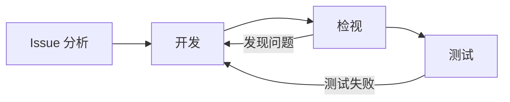

# 工作流

项目的「工作流」页（`#/projects/<仓库 ID>/workflows/<工作流 id>`）左侧列出这个仓库会运行的全部工作流和共用规则，右侧是选中那一项的编辑器。内置工作流和新增的工作流设置方式完全一样：

- **概览**：名称、说明、启用开关，一份摘要（何时触发、用哪份提示词、哪个模型、允许哪些写入，以及谁来执行：原来的执行器，还是这个入口开了角色协调后由主控委派。开发工作流由主控按需委派已启用的 Dev、Test、Reviewer、UX；检视和 Actions 失败处理只委派 Dev，Dev 仍用这条工作流原来的 Pi 执行器。候选都由主控提名后交给独立 QA 验收），流程图，以及触发源：从同一份目录里勾选，按标签触发的写上标签名。流程图左侧画出勾选的触发源，改动勾选时图跟着变。
- **提示词与流程**：交给 agent 的 Markdown 规则，其中一张 ` ```mermaid ` 流程图说明步骤顺序，页面把这张图画出来。
- **权限与模型**：读取不限制，不用配置；写入按需勾选（回复评论、加标签、修改代码、开 PR、提报 Issue、重跑 Actions、写发行说明中这条工作流能用的几项），使用的模型（留空时继承项目默认），以及检视语言、测试命令等原有设置。

工作流只定义入口：何时触发、用哪份提示词和模型、允许哪些写入。一个任务要达成的目标、由谁分工、怎样验收记在任务和「角色」页里，不需要为单个任务新写工作流；列表下方的「新增工作流」「用聊天新增」用于现有工作流接不住的新触发条件。流程图来自提示词，只是给 agent 的步骤说明，不会按节点创建角色，也不授予写入。

编辑器上方的「用聊天编写」打开悬浮的工作流助手，「保存」一次保存所有标签页。还没保存的修改（包括新工作流）保存在这个浏览器里，离开页面或刷新后回到这条工作流仍在，列表里标「未保存」；新工作流的草稿在列表里显示为「未保存的草稿」，可以在编辑器上方丢弃。窄屏时列表在上、编辑器在下。

现有的六项任务、Actions 失败处理和接入门禁是八条内置工作流，工作流 id 等于原来的任务类型（Actions 失败处理是 `actions.failures`），所以已保存的 `task_models` 映射原样生效。管理员也可以在页面上新增工作流，不需要改代码或发版。内置工作流不能删除，可以关掉。

## 现有能力的去向

| 现有能力 | 去向 | 说明 |
| --- | --- | --- |
| Issue 检视（`review.issue`） | 内置工作流 `review.issue` | 触发源：Issue 打开、Issue 修改或可信评论、评论提到 bot；提示词：`.bot/rules/issue-review.md`；流程：检视 → 回复；发布：控制面发一条评论并加标签 |
| PR 检视（`review.pr`） | 内置工作流 `review.pr` | 触发源：PR 打开或 Ready for review、head 更新、PR 讨论更新、评论提到 bot；草稿不检视；提示词：`.bot/rules/pr-review.md`；流程：检视 → 回复；发布：COMMENT 行内检视加一条总结评论 |
| 开发 Issue（`development.issue`） | 内置工作流 `development.issue` | 触发源固定：Issue 检视发布且结论要求改代码，或之后有人加上开发标签；提示词：`.bot/rules/issue-development.md`；流程：Issue 分析 → 开发 → 检视 → 测试，检视或测试发现问题时回到开发；发布：控制面推 bot 分支、开 PR |
| 跟进 bot PR（`development.pr`） | 内置工作流 `development.pr` | 触发源固定：bot PR 的检视发布后，有仓库成员要求的修改（检视判断是要求修改而不是提问，不限次数，每条评论一次）、其他检视机器人的合理意见（每个机器人每个 PR 一次），或 bot 自己检视新提交发现的可执行意见（在修订轮数内）；和开发 Issue 共用同一份提示词 |
| CI 观察（`release.observe`） | 内置工作流 `release.observe` | 触发源固定：「发版本」页查看 Release 工作流运行；提示词：内置 `docs/prompts/release-observe.md`，可由控制台覆盖；只读，不发布 |
| 发行说明（`release.notes`） | 内置工作流 `release.notes` | 触发源固定：「发版本」页起草；提示词：默认分支的 `.agents/skills/release-notes/SKILL.md`，没有时用控制台提示词，都没有时用内置 release-notes-v1（不调用模型，直接列出来源） |
| `.bot/rules/` 下三份检视和开发规则 | 对应内置工作流的提示词 | 仓库文件整份替换提示词，并且优先于控制台里对同一份提示词的设置；`development_label` 行见下文 |
| `.bot/rules/labels.md`、`.bot/guide.md` | 共用提示词 | 标签规则交给两条检视工作流，行为指南交给所有工作区工作流；在工作流页的「通用准则」里编辑 |
| 开发开关、人（不是 App）加上的开发标签、Issue 无人指派、发布前复核 | 控制面硬条件 | 写在任务引擎里，提示词关不掉；`development_label` 改名后仍然要求，去掉这一行仍按 `bot-develop` 要求 |
| 测试失败不推分支、不开 PR | 控制面硬条件 | 项目测试命令是开发工作流的设置，`create_pull_request` 先固定快照再运行它，失败返回 `validation_failed` |
| 发行说明来源完整且不重复 | 控制面硬条件 | 无论提示词来自哪一层，模型只能给来源分组，控制面核验每个来源恰好出现一次，标题和链接由控制面原样写出 |
| 草稿、已关闭对象、bot 自己写的内容、仓库外人员的评论不触发 | 控制面硬条件 | 所有触发源共用这套过滤，自定义工作流也一样。例外：bot 自己开的 PR 上，其他检视机器人的评论和检视会触发检视 PR，由检视判断是否采纳 |
| 发布 outbox、对账、PR head 校验、bot 分支归属 | 控制面硬条件 | 不变 |
| `src/automation` 的标签规范、PR 状态、门禁、合并队列 | 确定性模块 | 仍是代码模块，由 `config/repositories/<owner>__<repo>.yml` 和 policy 的 `automation` 配置，不改成提示词 |
| Actions 失败分类、单次重跑与提报 | 内置工作流 `actions.failures` | 触发源：默认分支的 Actions 运行失败；流程：读取日志 → 模型分析原因 → 外部原因重跑一次／代码或不明原因提报 Issue → 检视 Issue；提示词：`docs/prompts/actions-failures.md`；控制面核验模型引用的日志行，`external`／`code` 没有真实引用就按 unknown 处理，单次重跑预算和提报仍由控制面执行；开关就是原来的 `actions_failures_enabled` |
| `.bot/computer.yaml` | 机器配置 | 不是工作流，按字段合并进虚拟电脑配置 |
| 项目列表上的检视、开发开关 | 项目总开关 | 仍然有效：关掉检视，两条检视工作流都不运行；关掉开发，两条开发工作流都不运行。每条工作流另有自己的开关 |
| 接入门禁（`gate.onboarding`） | 内置工作流 `gate.onboarding` | 触发源：「接入门禁」对话里开始或回复，每一轮是一个任务；流程：读取对话与门禁事实 → 分析仓库 → 试跑命令 → 设计各 lane → 提交方案；提示词：`docs/prompts/gate-onboarding.md`；写入：提交门禁方案（`submit_gate_plan`），方案只回到对话里；门禁 PR 由人看过将提交的文件并确认后，由控制面创建 |
| 公共看板 | 控制面功能 | 不是模型工作流 |

## 触发源

所有工作流从同一份目录里选触发源；每条工作流只列出它能处理的那些：

| id | 含义 | 可用于 |
| --- | --- | --- |
| `issue.opened` | Issue 打开 | 检视 Issue、自定义 |
| `issue.updated` | Issue 标题或正文被修改，或有可信评论（作者或 `OWNER`、`MEMBER`、`COLLABORATOR`） | 检视 Issue、自定义 |
| `issue.labeled` | 有人（不是 App）给 Issue 加上指定标签，比较时不区分大小写 | 检视 Issue、开发 Issue（标签固定为开发标签）、自定义 |
| `pull_request.opened` | PR 打开或从草稿转为 Ready for review | 检视 PR、自定义 |
| `pull_request.synchronize` | PR head 更新 | 检视 PR、自定义 |
| `pull_request.updated` | PR 标题或描述被修改、可信评论、提交检视或回复检视意见 | 检视 PR、自定义 |
| `pull_request.labeled` | 有人（不是 App）给 PR 加上指定标签 | 检视 PR、自定义 |
| `comment.mention` | 新评论提到 `BOT_MENTION_NAMES` 里的名字 | 检视 Issue、检视 PR、自定义 |
| `review.published` | 检视工作流发布结论后：Issue 的结论要求改代码；或 bot PR 的检视采纳了成员或其他检视机器人的修改要求，或有自己的可执行意见 | 开发 Issue、跟进 bot PR |
| `release.manual` | 「发版本」页的操作 | CI 观察、发行说明 |
| `actions.run_failed` | 默认分支的 Actions 运行失败 | Actions 失败处理 |
| `gate.manual` | 「接入门禁」对话里开始或回复 | 接入门禁 |

内置检视工作流在第一次保存触发源之前，按项目原有的开关（`review_issues`、`review_issue_updates`、`review_pull_requests`、`review_pr_updates`、`review_pr_discussion`）算出触发源，和以前一样：Issue 更新和 Issue 上的提及跟着「Issue 打开」，PR 讨论更新和 PR 上的提及跟着「PR 打开或 Ready for review」。在页面上保存过触发源以后，工作流用自己的列表，每个触发源独立生效（例如可以只关掉提及）；这些策略字段仍随列表同步，`PATCH /api/repositories/:id/policy` 改它们时也会增删列表里对应的触发源。关闭 PR head 更新也会停止 bot PR 的自动跟进。按标签再次检视时，和其他更新一样并入还在排队的检视。

开发工作流的触发源只决定什么时候检查是否开始开发；开发开关、检视结论里的原文依据、人加上的开发标签、Issue 无人指派这些条件始终由控制面检查，发布 PR 前再查一次。发版本的两条工作流关掉（或去掉触发源）以后，发版本页不再调用模型：CI 观察返回 409 `workflow_disabled`，发行说明按内置规则直接列出已核验的来源。

自定义工作流的每个触发源都用上面同一套过滤。同一次投递只为一条自定义工作流建一个任务；同一 PR head 的打开和推送只运行一次。自定义工作流有自己的启用开关，不依赖项目的检视开关；项目禁用时都不运行。

## 提示词与流程图

流程图写在提示词里，取第一个 ` ```mermaid ` 代码块，以 `flowchart LR` 开头。节点写成 `id[标签]`，边写成 `-->`，带说明的边写成 `-->|说明|` 或 `-- 说明 -->`，指回前面节点的边就是回退。内置开发提示词的图是：



图后面按步骤写给 agent 看的说明。页面只画提示词里的图，不另存一份；仓库文件替换了提示词而没有写图时，页面显示「没有流程图」。

触发源不写进提示词的图：页面从这条工作流的触发源列表把它们画在图的左侧（按标签触发的带上标签名），都指向第一步；没有触发源时画一个「没有触发源」，没有流程图时第一步画成「按提示词执行」。

内置工作流的提示词分三层：内置默认 → 项目控制台 → 默认分支仓库文件，生效的是最后存在的一层。编辑器里改的是控制台层；仓库里有同名文件时，控制台内容要等仓库删掉这个文件后才生效。开发 Issue 和跟进 bot PR 共用一份提示词。自定义工作流只有控制台这一层。

提示词、名称和说明不设文件数量、单份大小、总大小、字符集或长度的限制；含 NUL 字节的文本仍然拒绝，开发提示词里的 `development_label` 行仍按原规则校验。

## 运行方式

所有工作流共用项目队列和任务引擎。未开启角色协作的工作流使用项目电脑中的 Pi 执行器；开启角色协作的入口按各角色配置的 Agent 后端执行，新配置默认推荐 Pi。工作区是相关提交的检出——Issue 检出默认分支，PR 检出它的 head，CI 观察和发行说明检出发版本的提交，Actions 失败处理检出失败运行的提交。事件本身放在检出旁边的 `../context/` 里：CI 观察有 `run.json`；发行说明有 `sources.json` 和 `release-notes-skill.md`；Actions 失败处理有 `run.json`，以及 `failed-steps/<job id>.log`（每个失败 job 的失败 step 打印的内容）。每条工作流都按同样的方式选模型、记账，任务过程同样能在任务详情里查看。项目电脑没有就绪时，发版本和 Actions 失败处理的任务也和其他任务一样等待。

- CI 观察：在「发版本」页点「让智能体看这次运行」，排一个任务。页面显示「运行分析在项目电脑里排队或执行中」，完成后显示分析结果；运行或 attempt 变了，任务就停止。
- 发行说明：只有默认分支的 Skill 或控制台提示词需要模型整理时，发版本才在「准备发行说明」这一步排一个任务并等它完成；没有任务时按内置规则直接列出来源。模型不可用时这一步失败、任务取消，由人点「继续／查证此步骤」重试，重试会排一个新任务。
- Actions 失败处理：每个失败运行的 attempt 排一个分析任务，扫描等它完成后再执行重跑或提报。模型不可用时运行保持待处理，什么也不写。
- 接入门禁：对话的每一轮排一个任务，检出默认分支；`../context/` 里有 `conversation.json`（到目前的对话）、`plan.json`（当前方案）和 `gate.json`（控制面读到的门禁事实、门禁 job 可以放的位置和门禁 PR 一定会做的标准改动）。项目没启动、虚拟电脑没就绪、工作流关着或没有模型时不能开始。

## 权限

读取不限制，写入按工作流配置：

- 所有工作流都可以读取工作区、运行命令、写项目笔记、启动独立 agent，并用只读令牌读取仓库的代码、Issue、PR、Actions、检查和提交状态。令牌由执行器保管，GitHub 返回任何写权限时拒绝交付，任务结束即撤销。读取不需要配置。
- 写入是平台提供的工具，在「权限与模型」页按工作流勾选；agent 需要时自己调用，由控制面执行。每条工作流只列出它能用的写入，以它结束任务的那一项不能去掉：

| 写入 | 工具 | 控制面做什么 | 可用于 |
| --- | --- | --- | --- |
| 回复评论（`reply`） | `finish_review` | agent 结束时交出回复；控制面发一条评论，PR 上有真实 diff 位置的意见作为 COMMENT 行内检视 | 检视（固定）、自定义（默认） |
| 加分类标签（`labels`） | `finish_review` 的 `labels` | 只加仓库里已有、对象上还没有的标签，从不加检视标签和开发标签；检视工作流的检视标签也属于这一项 | 检视（默认）、自定义 |
| 修改工作区代码（`code`） | `write_file` | 只改这次任务的检出 | 开发（固定）、检视、自定义 |
| 开或更新 bot PR（`pull_request`） | `create_pull_request` | 固定快照、跑项目测试命令，通过后推 bot 分支、开或更新 PR | 开发（固定）、检视、自定义 |
| 提报 Issue（`issue`） | `create_issue`；Actions 失败处理是 `report_failure` | 以 bot 身份新建 Issue，`@` 提及会被转义；Actions 失败处理核验引用的日志行后新建或评论 Issue，同一失败只报一次 | 全部（Actions 失败处理默认） |
| 重跑失败的 Actions 运行（`actions_rerun`） | `rerun_failed_run` | 每个原始运行最多重跑一次，只重跑支持 `workflow_dispatch` 的运行 | Actions 失败处理（默认） |
| 写发行说明（`release_notes`） | `finish_release_notes` | 核验每个来源恰好出现一次，再写出正文 | 发行说明（默认） |
| 提交门禁方案（`gate_plan`） | `submit_gate_plan` | 核对方案（没写到的 lane 保持原样，不合格的方案不替换当前方案），把回复和方案放回接入门禁对话；人确认后才开门禁 PR | 接入门禁（固定） |

开 PR 必须同时允许修改代码。开发 Issue 和跟进 bot PR 仍以 PR 结束，开发标签、指派人、测试和发布前复核这些条件不变。检视和自定义工作流也可以开 PR：项目的开发开关关着时工具返回 `development_disabled`；在 Issue 上开一个新的 bot PR，在 PR 上只能更新 bot 自己的 PR（别人的 PR 返回 `pull_request_not_owned`）；每个任务最多开一个 PR，开完 agent 继续，最后照常回复。这里不要求开发标签，管理员用触发源（例如按标签触发）决定什么时候运行。

Actions 失败处理的 `rerun_failed_run` 和 `report_failure` 在调用时只登记并告诉 agent 引用的日志行有没有找到；agent 结束后，控制面用完整日志核验引用、按单次重跑预算重跑或提报，没有覆盖到的失败 job 按 unknown 提报。没有 `actions_rerun` 时外部原因也提报；没有 `issue` 时只记录分类，不提报。

写入保存在 `PUT`/`POST` 的 `writes`（写入 id 的列表）里；不在这条工作流可选范围里、去掉了固定的写入、或开 PR 却没有修改代码，返回 400 `invalid_workflow_writes`。还没保存过写入的工作流用默认值；早先版本保存的读取范围不再生效。这些设置每次任务从存储里读，不来自 Issue、PR、仓库文件或模型输出；已删除的自定义工作流不再运行任务。

## GitHub 写入

agent 只拿得到只读令牌，不能在命令里推送、评论、加标签或合并。所有写入都通过上面的工具交给控制面，由控制面用 GitHub App 安装令牌（或登记的机器人账号）完成。每次写入前控制面重新核对对象、head 和条件，经发布队列写出；结果不明时先在 GitHub 上对账，不重复写。

## 独立 agent

提示词决定什么时候启动独立 agent（例如内置开发提示词在「检视」一步启动一个审查者），运行时提供 `start_agent` 工具。调用时 agent 写明对方的角色说明和任务，可以收窄权限：

- 独立 agent 是一个新会话：系统提示是控制面的固定说明加上调用方写的角色说明，第一条消息是任务，不带调用方的任何消息。
- 它的工具是调用方工具的子集，按收窄后的权限过滤；`true` 不会补上调用方没有的权限。它不能发布、不能结束任务，也不能再启动 agent。
- 它的结果作为工具结果交还调用方，模型请求和费用记在同一个任务上，任务日志里带 `agent` 标记。

独立 agent 在项目电脑的 Pi 进程里另建一个会话，不能使用任何写入工具。子集检查由 runner 执行，控制面对所有邮箱请求仍按工作流保存的写入检查，所以即使 runner 被篡改，也不能多拿写入能力。

## 用聊天编写

「用聊天编写」打开工作流助手：一个悬浮窗口，拖动标题栏移动，拖动右下角调整大小，位置和大小保存在浏览器里。它像一般的 agent 一样工作，并把过程流式显示出来：

- 先用 `list_workflows` 看项目里已有的工作流；账号是 GitHub App 时还可以用 `github_read`、`github_search` 等只读工具看仓库。
- 用 `update_draft` 提出草稿（名称、说明、触发源、含流程图的提示词、写入）。控制面按编辑器的规则检查：触发源或写入不在这条工作流可选的范围里就去掉（固定的写入保留，开 PR 时补上修改代码），没有流程图会提示；检查结果返回给助手，它可以再改。
- 文字、思考过程、每次工具调用的参数和结果、草稿（带流程图）按发生顺序出现在窗口里；运行中可以停止。

草稿只在窗口里显示，点「填入编辑器」才放进对应工作流的编辑器（编辑器不在当前页面时会跳过去），再点「保存」才生效；保存的人是控制台的项目管理员或超级管理员，审计记录为 `workflow.created`／`workflow.updated`。助手没有保存或修改任何配置的工具，运行中的模型也不能改工作流。

窗口在切换到项目的其他页面时保持打开；每条工作流（包括还没保存的新工作流）的对话按项目保存在这个浏览器里，收起、换页面或刷新后，再打开同一条工作流的助手，对话还在。「清空对话」只清掉这条工作流的对话。

## 接口

| 路径 | 方法 | 说明 |
| --- | --- | --- |
| `/api/repositories/:id/workflows` | GET | 全部工作流（八条内置在前），以及触发源目录 `triggers`（每项有 `title` 和画图用的短名 `short`）、新工作流的写入选项 `custom_write_options` 和默认值 `custom_writes`、提及名字 `mention_names` |
| `/api/repositories/:id/workflows` | POST | 新增自定义工作流：`name,prompt` 必填，`description,enabled,triggers,writes,model_id` 可选（`writes` 缺省为 `["reply"]`）；`triggers` 为 `[{id,label?}]`，按标签触发时 `label` 必填；返回 201 和 `workflow`，id 形如 `custom.<12 位十六进制>` |
| `/api/repositories/:id/workflows/:workflow` | GET / PUT / DELETE | 读取、保存、删除。每条工作流返回 `name,description,enabled,active,triggers`（`[{id,label?}]`）、`trigger_options`（它可选的触发源）、`prompt,model` 和 `settings`，`permissions`（读取能力和保存的 `writes`）、`write_options`（可选的写入，带工具名、说明和是否固定）。内置工作流的 PUT 和自定义的一样接受 `name,description,enabled,triggers,prompt,writes,model_id`（名称留空恢复默认；`prompt` 为 `null` 清除控制台层；`triggers` 也接受旧的 `{id:布尔}` 写法），另接受 `settings`（检视为 `review_language`，开发为 `test_command,max_revisions`）；带 `version` 时与当前版本不一致返回 409 `workflow_version_conflict`。内置工作流不能删除（409 `builtin_workflow_required`）；删除自定义工作流会取消它未完成的任务 |
| `/api/repositories/:id/workflows/assistant` | POST | 工作流助手：`messages`（`[{role:user|assistant,content}]`）、可选 `workflow_id` 和编辑器当前内容 `draft`；返回 `reply,draft,warnings`（助手没有调用 `update_draft` 时 `draft` 为 `null`），不保存任何内容。加 `?stream=1` 时以 `application/x-ndjson` 逐行返回过程：`text`、`reasoning`（文字增量）、`tool_call`、`tool_result`、`draft`、`turn`，最后是 `done`（同上三项）或 `error`。项目没有可用模型时返回 409 `model_not_configured` |

自定义工作流的任务类型是 `workflow.issue` 或 `workflow.pr`，任务记录的 `workflow_id` 指向工作流。它们在同一台项目电脑上排队，和检视一样准备检出，结束时调用 `finish_review` 返回 `summary`、`findings`（有 `labels` 写入时还有 `labels`）；有 `reply` 写入时控制面发一条评论，PR 上有真实 diff 位置的意见作为 COMMENT 行内检视发出，没有时结果只留在控制台。中途开的 PR 记在任务结果的 `pull_request` 里。自定义工作流不衔接开发、不延续检视会话。CI 观察、发行说明和 Actions 失败处理的任务类型就是它们的工作流 id，没有 Issue／PR 编号。

## 看板

看板按工作流分卡：每张卡是一条工作流在一个 Issue／PR 上的工作，或一条发版本。工具栏的「工作流」筛选和「按…分列 → 工作流」列出可见仓库的全部工作流，名称取仓库里保存的名称（内置工作流改了名就显示新名称，各仓库名称不同时都列出），自定义工作流也在其中；发版本卡片归在「发版本」。卡片上的徽章写工作流名称和最近一次任务的状态，例如「检视 Issue 已完成」「文档检查 执行中」。自定义工作流的卡片沿用检视的阶段，单独筛选它时阶段显示为未执行、正在执行、已执行；点开卡片只列出这条工作流的任务。已删除的自定义工作流留下的卡片显示为「已删除的工作流」。

筛选值就是工作流 id（`review.issue`、`review.pr`、`development.issue`、`development.pr`、`custom.<id>`、`release`）。以前保存的视图里的 `review`、`development` 仍然有效，分别表示全部检视和全部开发／跟进工作流；旧地址 `#/reviews`、`#/developments` 也按这两个值进入。`GET /api/board` 返回 `workflows`（`[{id,name,repository?}]`），卡片带 `card_category`（工作流 id）和 `card_category_name`。
